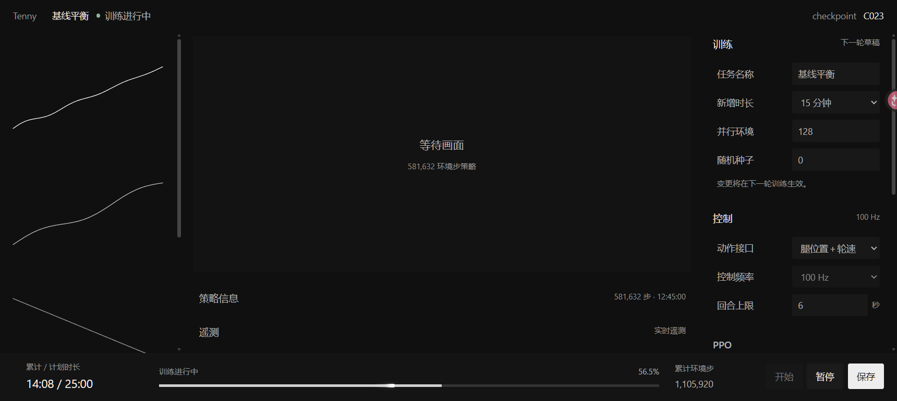
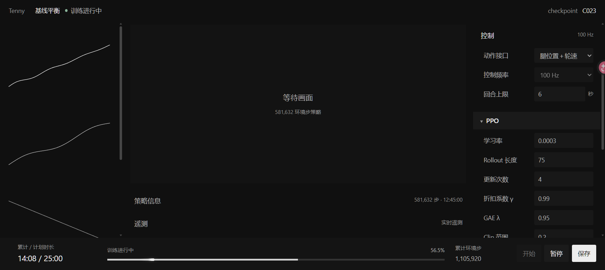

# Project Tenny RL

> 🚧 **进行中（Work in progress）**：项目仍在开发，目录结构、脚本和结果随时可能变动。

Tenny 轮腿机器人的强化学习与仿真实验：基于 MuJoCo MJX + Brax PPO 训练平衡/速度跟踪策略，并配有网页预览。

新工作台已完成[生产整合](docs/workbench-production.md)，支持训练暂停/继续、手动保存、历史 checkpoint 续训、参数编辑、最多四窗预览及本机目录导入。保留已验收的 512 配置继承、原生评估与阶段计时；控制及重连语义见[工作台合同](docs/workbench-controls.md)，后续需求见[后端对照表](docs/workbench-backend.md)。

前端设计与模拟示例保留在 [ui-prototype](experiments/torque200/ui-prototype/README.md)，生产 UI 位于 [workbench-ui](experiments/torque200/workbench-ui/README.md)；版本化[只读接口](experiments/torque200/workbench_api/README.md)仍可独立测试。

## 工作台预览

以下截图使用独立 UI 预览的模拟数据，展示三栏布局、曲线和参数层级；此预览不含仿真画面。布局与交互原则见[设计约定](docs/workbench-design.md)。





## 快速开始

```bash
python tenny.py            # 打开网页控制台，点按钮运行任务（Python 3.11+，无需安装依赖）
python tenny.py list       # 终端里列出所有任务
python tenny.py run test-torque200 steps=16   # 终端里运行任务
```

控制台地址形如 `http://tenny.localhost:8800/`（`*.localhost` 由浏览器直接解析到本机，无需改 hosts）。
端口从 8800 起试；Windows 的 Hyper-V/WSL 有时会保留整段端口，此时自动改用系统分配的空闲端口，以终端打印为准。

任务在 `tenny/tasks.toml` 里登记，网页和命令行共用。Windows 下任务经 `wsl.exe` 在 WSL 中执行，
Linux 下直接用 bash；macOS 不支持训练类任务。

日常训练使用启动页的 **打开完整训练控制台**，进入带训练控制、学习曲线和实时仿真的页面（WSL后端默认8770端口）。Windows启动器会提供只监听本机的转发地址，绕过浏览器无法直达WSL地址的问题；端口以显示链接为准。启动页刷新后会恢复已启动的任务列表。

直接打开混合动作100 Hz控制台：

```bash
python tenny.py run web mode=hybrid_virtual_leg_force_100
```

控制台中可选择动作模式与100/200 Hz、定时或不限时训练、从最近兼容模型继续、停止并保存。混合动作第一次没有模型也能进入控制台；已有模型或训练中的策略快照准备好后才可显示仿真。训练期间关闭网页不会停止训练，停止按钮会等待安全计算边界并验证保存结果。

更新并重启控制台后，新训练会保存分阶段耗时日志及汇总，覆盖准备、首次JIT/计算、训练、评估、快照、IO和保存验证。运行未结束也可分析，详见[训练耗时记录](experiments/torque200/TRAINING-TIMING.md)。

腿力教师模式现已默认使用C++原生评估，GPU继续执行采样/PPO；每次评估读取当前训练参数，并保留分项指标与耗时日志。接入方式和实际整体收益见[训练评估接入](experiments/native_eval/docs/brax-training.md)及[短训练对照](experiments/native_eval/TRAINING-INTEGRATION-RESULTS.md)。

当前腿力教师模式的新训练默认512个并行环境、batch512；已有模型续训继承保存的并行配置，最新模型已使用512。新默认通过120秒实际训练、保存恢复和最终模型站立评估，优化清单及使用/兼容规则见[默认运行配置](experiments/torque200/RUNTIME-DEFAULTS.md)。

进一步定位采样和PPO内部开销，使用独立的[分阶段诊断](experiments/training_profile/README.md)。设备trace、编译和采集扰动分别记录；实测边界与优化优先级见[诊断结果](experiments/training_profile/RESULTS.md)。

当前推荐“腿力＋轮扭矩（老师初始化）”`leg_force_bc`：腿为虚拟轴向力，经实时雅可比映射至关节扭矩，四个执行器全部是motor；先用可达的教师实际力/扭矩标签初始化，再接PPO。详见[腿力教师模式](experiments/torque200/FORCE-TEACHER.md)。

此前“腿位置＋轮扭矩（老师初始化）”`wheel_torque_bc`保留为独立对照，它仍使用原版腿位置执行器，不能与腿力模型混用。详见[位置模式教师说明](experiments/torque200/WHEEL-TEACHER.md)。两者均支持同页开始、停止保存、续训和按需预览。

## 目录

最近一轮原地平衡诊断、单因素对照、成熟模型微调与实际改进，见[实验综述与结论](docs/reports/2026-11-balance-experiments.md)和[公开证据归档](docs/archives/balance-20261117/README.md)。通用工具见[实验工具包](experiments/experiment_tools/README.md)；后续网页接入已记录在[会话交接](tasks/experiment-web-handoff.md)，尚未部署这些实验功能。

| 路径 | 说明 |
|---|---|
| `tenny.py`、`tenny/` | 统一入口（网页控制台 + CLI）与任务清单 `tenny/tasks.toml` |
| `experiments/torque200/` | 全扭矩接口 200 Hz 独立实验（环境回归测试 + 短训练流水线），详见其中的 `README.md` |
| `experiments/native_eval/` | 可复用 C++ 原生评估，独立构建与 Python/CLI 入口；[模块文档](experiments/native_eval/README.md) |
| `experiments/training_profile/` | 独立采样/PPO诊断、GPU阶段归因和测量验收；[模块文档](experiments/training_profile/README.md) |
| `reference/` | 参考项目的副本（见下） |
| `docs/` | 文档（控制模式 `docs/CONTROL-MODES.md` 等） |
| `tasks/` | 过程记录与辅助脚本 |

## 混合动作实验

新增单主动腿关节轮心虚拟伸展力 + 独立轮扭矩模式，以及匹配包络和直接扭矩对照。原模式不变。
先在本机运行 `python tenny.py run test-hybrid`，完整预检、短训练和热启动通过后再正式训练。
实现与验证边界见 [hybrid/README.md](experiments/torque200/hybrid/README.md)。本轮云端未运行真实训练。

网页与 `train-hybrid` 按动态预检、新训练保存导出、检查点热启动三个阶段缓存准备结果。每阶段通过后立即保存凭据；取消或后续失败时，下一次只补未通过或失效的阶段。复用要求该阶段依赖的源码/模型、模式频率、Python依赖、GPU运行配置及产物哈希一致，热启动凭据还绑定上游检查点与报告。`test-hybrid` 与网页“重新完整检查”强制重验全部阶段。正式训练结束后的保存、重载及导出校验每次仍执行。混合动作网页训练时长从准备检查通过后开始计算，仍包括正式训练的初始化、编译与评估，最终保存用时另计。

修改了训练相关源码后，旧验证记录和旧模型不会自动成为新版本的有效证据。原先100 Hz本机管线通过不等于本次控制台扩展已完成GPU验收，也不等于策略已经学会平衡。

## 已知限制

- 训练依赖 GPU + JAX，只能在 Linux/WSL 中运行。
- 原始训练输出（`experiments/torque200/results/`、`tasks/results/`）不入库；脱敏后的结论、小型统计和关键图单独归档在 `docs/archives/`，不含完整模型或大轨迹。
- 训练所需的 WSL 环境（`~/projects/tenny-reference` 等）需按 `tasks/REPRODUCTION.md` 自行搭建。

## 参考项目

本仓库参考了作者「星际浪子」的两个 MIT 协议开源项目，副本位于 `reference/`，各自保留原 LICENSE：

- `reference/mujoco_legwheel_rl_public`：腿轮机器人（LegWheelRobot）的 MJX + Brax PPO 强化学习项目（[原项目](https://gitee.com/starimpact_admin/mujoco_legwheel_rl_public)）
- `reference/mujoco_esp32_robot_deploy_public`：WL Pro Robot 轮腿机器人 ESP32 固件与主机仿真（[原项目](https://gitee.com/starimpact_admin/mujoco_esp32_robot_deploy_public)）

`experiments/torque200` 由上述环境改造而来，**不是原项目**；对原环境的修改仅在本仓库内。

## 依赖

Python、JAX、Brax、MuJoCo（MJX）；GPU 训练在 WSL2 中运行。具体版本见各子项目的 `requirements*.txt`。
