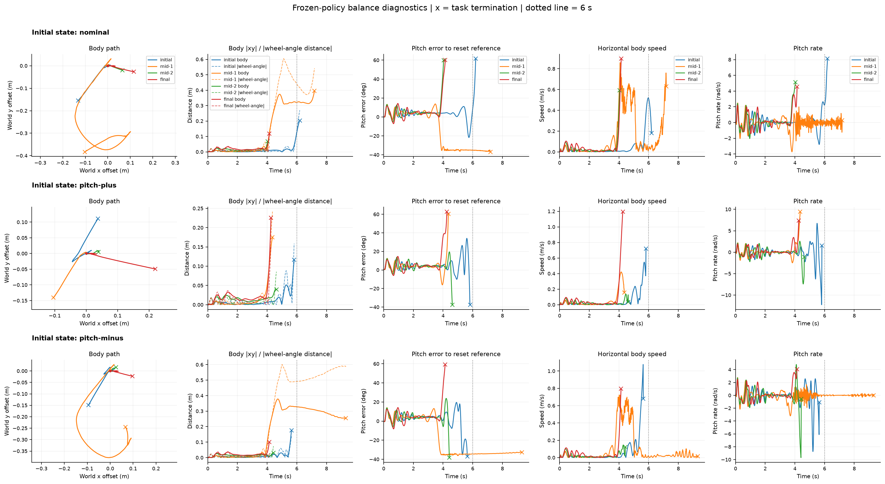

# 固定策略平衡诊断结果

本轮确认两个问题同时存在：6秒上限遮蔽了初始化模型稍后的失稳，而PPO更新后的最终模型在前6秒内已经退化。单独延长训练回合尚不能视为修复。

同一轮训练的4个策略，共用真实生产标称reset及固定±0.01rad俯仰扰动，最长回放30秒。12组首回合都提前触发原任务终止，范围4.04～9.31秒。以下为标称初态：

| 策略 | 终止时间 | 终止前最大机身位移 | 原因 |
| --- | ---: | ---: | --- |
| 模仿初始化 | 6.20秒 | 20.29cm | 俯仰越界 |
| 中间3,768,320步 | 7.19秒 | 39.62cm | 俯仰越界 |
| 中间6,799,360步 | 4.04秒 | 6.79cm | 俯仰越界 |
| 最终7,954,432步 | 4.15秒 | 11.83cm | 俯仰越界 |

位移包含直到终止的运动；回合长度不同，不能把更早失败造成的小位移或高平均奖励当作更好的位置保持。中间第一份模型即使只看原6秒窗口，机身也已偏移37.39cm。

## 位置与姿态

现有位置保持奖励使用左右轮关节角均值，这是编码器代理，不是机身世界坐标位置。已分开记录实际机身位移、带符号轮角×半径的推算量、俯仰与速度。例如标称中间第二份模型终止时，机身净位移6.79cm，而轮角推算净距绝对值仅0.54cm；机身倾倒运动也会造成二者差异。因此不能用轮角代理替代真实机身位置诊断。

描述性事件阈值为俯仰误差10°、平面速度0.1m/s、位移5cm，持续0.2秒才确认。初始化标称轨迹在5.63秒开始持续姿态越界，5.69秒开始持续速度越界，5.85秒开始持续位移越界，6.20秒触发俯仰终止；最终模型对应姿态3.86秒、速度3.94秒，4.15秒终止。先后关系支持先观察姿态纠偏和随后的漂移，不能单独证明根因。

下一轮应独立检验姿态/真实位移目标与PPO更新的影响；世界位置奖励可用于训练评价，但实机策略所需的位置反馈必须具备可获得的估计，不能默认拥有仿真真值。本轮未改奖励、回合合同、模型或训练参数，也未启动新训练。

## 对齐与边界

- 初始化标称6秒回报11218.234733991028，与该轮训练初始记录完全一致。
- 12组6秒与30秒回放的共同前缀在观测、动作、qpos、qvel、ctrl和奖励上逐点一致。改变上限没有改变前段控制行为。
- 最终导出与checkpoint在共同观测上的动作最大差异0；初始化、两中间、最终的归一化均值/std差异0。
- 9份唯一输入文件及3个checkpoint树在诊断前后哈希不变。没有训练、服务切换或生产部署。
- 固定±0.01rad扰动保持标称目标参考，不与重新计算每次reset平衡参考的旧BC门禁混作同一工况；不代表随机鲁棒性测试。
- 20项针对测试通过；增加放大图后局部5项复验通过。实际查看完整图与放大图，未做浏览器交互验收。

完整中文报告：report.html（本机原始资料，未入此归档）；摘要：[summary.csv](result/summary.csv)；完整数据：results.json（本机原始资料，未入此归档）。原始物理轨迹NPZ和输入保护记录位于同目录。通用工具和后续浏览器接入合同见项目`experiments/balance_diagnostics/README.md`。

