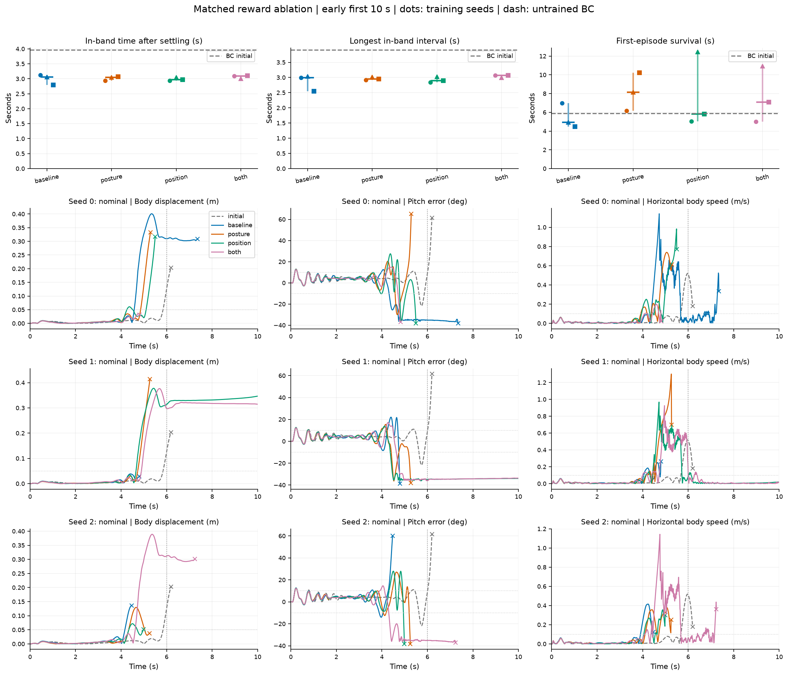

# 姿态与真实位移奖励：独立对照结果

**预先固定的这组权重与短训预算下，未见一致的原地平衡改善。** 所有训练seed在主要累计合格时间上均低于未继续训练的BC初始化；不能概括成所有指标都变差，也不能据此否定姿态或真实位移奖励这个方向。

## 对照条件

原奖励、只补俯仰、只补真实机身XY位移、两项同时补，4组×3个配对训练seed。每次精确2,097,152环境步，总25,165,824步；正式矩阵墙钟22.53分钟，包含各进程准备、编译、过程评价和保存，不含前期工具实现与GPU smoke。

全部从同一份BC actor/critic/normalizer开始，优化器重建；512环境、batch512、unroll16、1 minibatch/1 update、学习率3e-5、熵系数.001、原6秒训练回合、100Hz控制/400Hz物理，无噪声/推力/域随机化。冻结归一化、观测、动作、原奖励各项和终止条件。

新增俯仰项权重4、尺度10°；真实位移项权重10、尺度5cm，均为目标处0、偏离为负的有界惩罚。原轮角代理保持项保留。姿态目标与世界XY原点在整回合固定，未向actor增加世界位置真值。

最终模型统一做最长30秒首回合评价：标称及±.01rad三个主要初态，另±.02rad两个预留固定初态。连同BC参考共65条轨迹，均未达到30秒时限；额外存活经常发生在姿态、位置或速度超出本次合格范围之后。

## 主要结果

累计合格时间剔除开始1秒，只在俯仰误差≤10°、真实XY偏移≤5cm、平面速度≤0.1m/s同时满足的真实采样区间累积。先对每个训练seed的三个主要初态取平均，再汇总三个训练seed；固定初态不是独立训练重复。

| 组别 | 累计合格时间中位数 [min,max] | 同seed相对原奖励的配对中位差 | 主指标增加的seed |
| --- | ---: | ---: | ---: |
| BC初始化，不继续训练 | 3.970秒 | — | — |
| 原奖励 | 3.060 [2.793,3.130]秒 | 参照 | — |
| 只加俯仰 | 3.053 [2.937,3.070]秒 | -0.0067秒 | 1/3 |
| 只加真实位移 | 2.967 [2.940,3.053]秒 | -0.0067秒 | 1/3 |
| 同时加入 | 3.090 [3.007,3.100]秒 | -0.0400秒 | 1/3 |

约-0.0067秒的配对差不应解释成明确变差；三种子只支持有限的描述性比较。组合组的分组中位数3.09秒略高于原奖励3.06秒，而同seed配对中位差为-0.04秒并不矛盾：两种统计量的排序方式不同，配对差应优先用于本对照。

组合组的最长连续合格段在2/3个seed增加，配对中位差+0.08秒；其组中位数3.07秒，仍低于BC的3.903秒。这个局部改善需要与累计合格时间未一致增加共同保留。

典型例子：真实位移组seed1标称回放存活21.76秒，但累计合格时间只有3.03秒；约4～5秒后俯仰和位移已离开合格范围，较长的存活不能称为原地站稳。原奖励seed0存活7.35秒，同样只有3.13秒累计合格；BC标称累计合格4.45秒。

## 可以和不可以得出的判断

- 本次新增两项奖励本身，没有在固定短训预算下解决原地平衡与继续PPO后的主指标退化。没有采用或发布新的生产模型。
- 本轮仍保持6秒训练回合，**未检验延长训练回合的效果**；其他权重、更多训练或不同PPO更新设置也未被排除。
- 回放中根据共同base奖励复算各组新增项后，部分超出合格范围的长尾出现负步奖励。该字段来自确定性最终策略回放，不是随机训练rollout统计，不能单独证明策略在学习提早终止。
- 固定初态和三训练seed不是随机鲁棒性或实机验收；这些带宽是预先声明的诊断口径。

## 完整性与工具

12次实际步数、有效配置与初始化数组完全一致；所有归一化均不漂移，actor均有更新，完整checkpoint保存/重载精确，actor/critic/normalizer全部有限。16份输入文件、4个旧checkpoint树和物理源码/资产指纹保持不变。原网页与production latest没有切换。

28项针对CPU用例通过；实际GPU固定动作/自动reset smoke通过。独立复算65条轨迹的累计/最长合格时间，误差0；完整和前10秒放大图已实际检查。没有重跑全仓测试。

0步恢复校验曾因std_eps=0的float64/float32表示差异停止；规范零值dtype后完整数组摘要一致。失败矩阵与探针未执行PPO更新，保留且未混入正式结果。

实测使用的训练代码以冻结副本运行，归档为actual-training-source.tar.gz（本机原始资料，未入此归档）。原始训练descriptor的初始化身份残留已在评价副本中清理并绑定本次checkpoint，原件保留。仓库入口另补同系数校验、新策略身份及非有限参数拒绝检查；这几个保护/元数据改动不改变训练公式，没有为它们重跑GPU矩阵。

完整报告（本机原始资料，未入此归档） · [配对汇总JSON](comparison/paired-summary.json) · [各工况CSV](comparison/summary.csv) · 完整轨迹JSON（本机原始资料，未入此归档） · [矩阵核验](comparison/matrix-verification.json)

通用训练、指标和报告模块位于项目`experiments/reward_ablation/`，与网页分离。以后可复用状态/轨迹/配对汇总接入浏览器，当前没有新增生产API或页面控件。

