# WL Pro Robot

轮腿机器人固件，带主机仿真。同一套网页可以开仿真或开真机；仿真画在旁边的 MuJoCo 窗口里，不画进网页。

---

## 真机展示

| 真机演示 1 | 真机演示 2 |
|:--:|:--:|
| 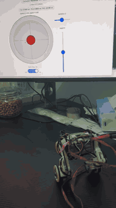 | 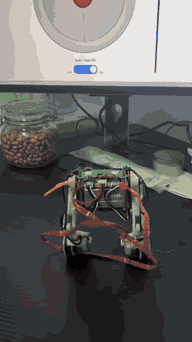 |

---

## 仿真 Demo

60s 编排（seed=7，噪声和随机推力都开）：**0 次摔倒，13 次推力**。

完整视频：[demo/holdpos_heading_s07_720p.mp4](demo/holdpos_heading_s07_720p.mp4)

| 站立 · `t=2.5s` | 抗推 · `t=4.4s` | 前进 · `t=7.5s` |
|:--:|:--:|:--:|
| 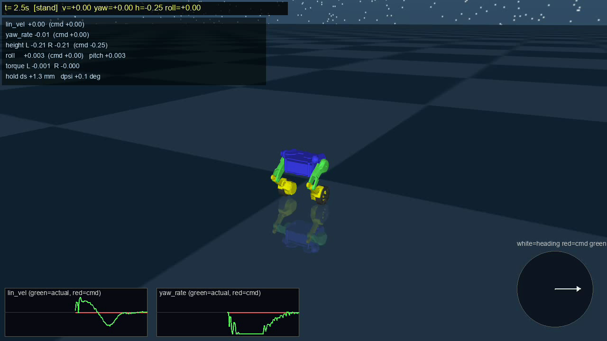 | 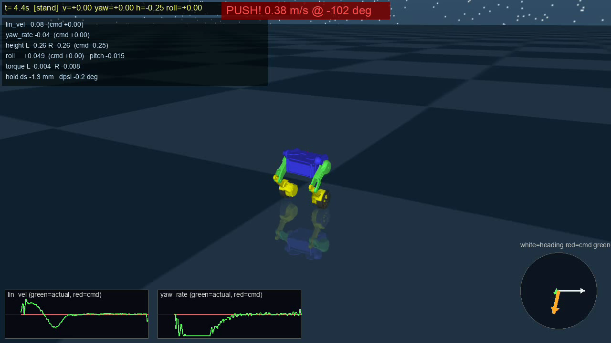 | 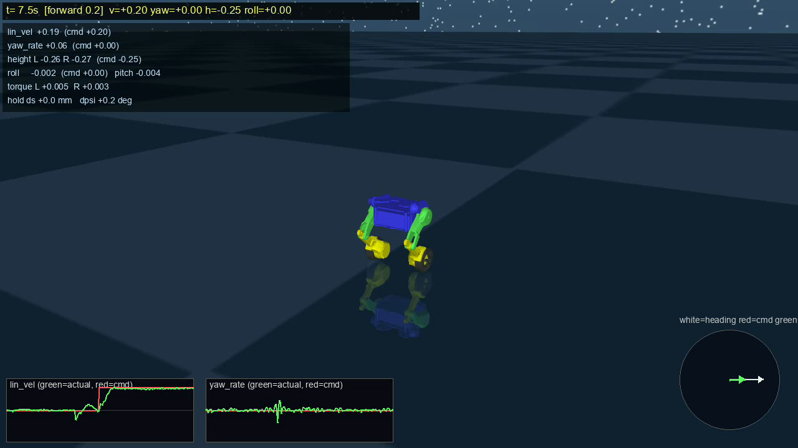 |

| 左转 · `t=17.5s` | 站高 · `t=27.5s` | 下蹲 · `t=32.5s` |
|:--:|:--:|:--:|
| 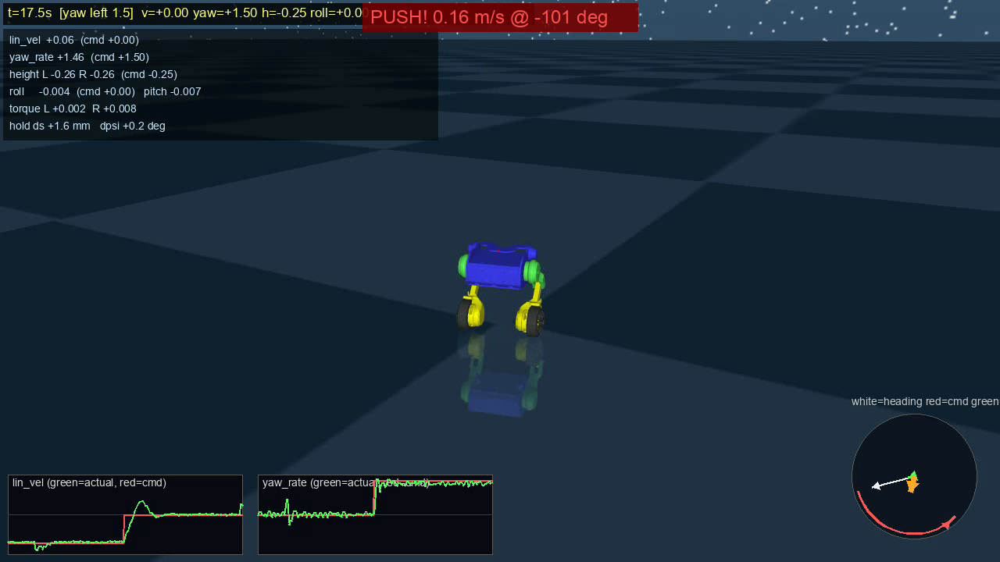 | 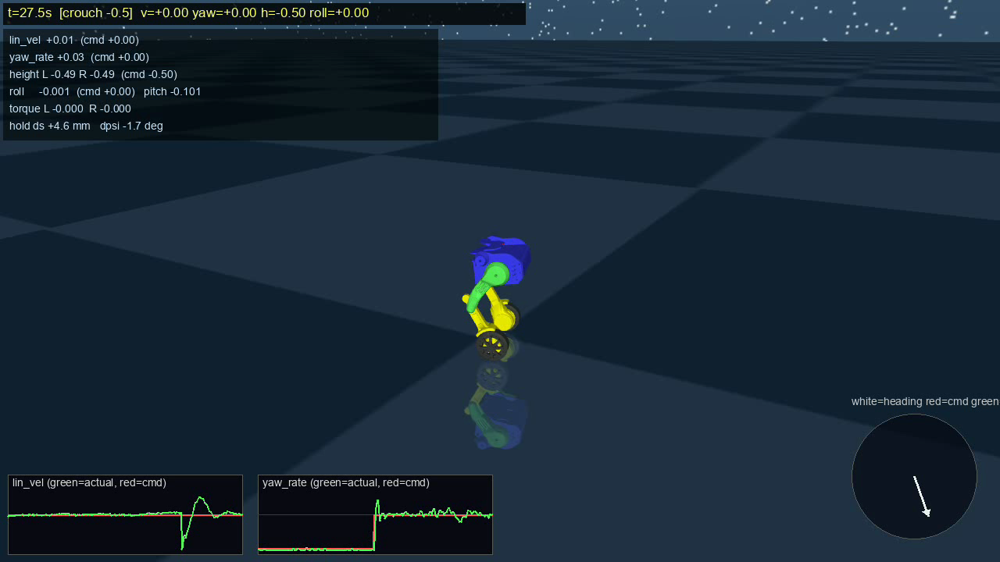 | 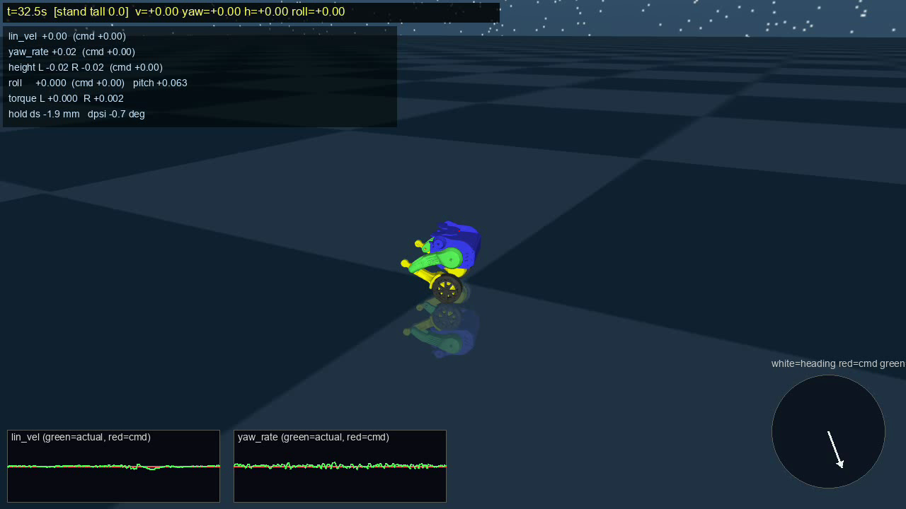 |

| 左倾 · `t=37.5s` | 前进+转向 · `t=47.5s` | 收尾站立 · `t=57.5s` |
|:--:|:--:|:--:|
| 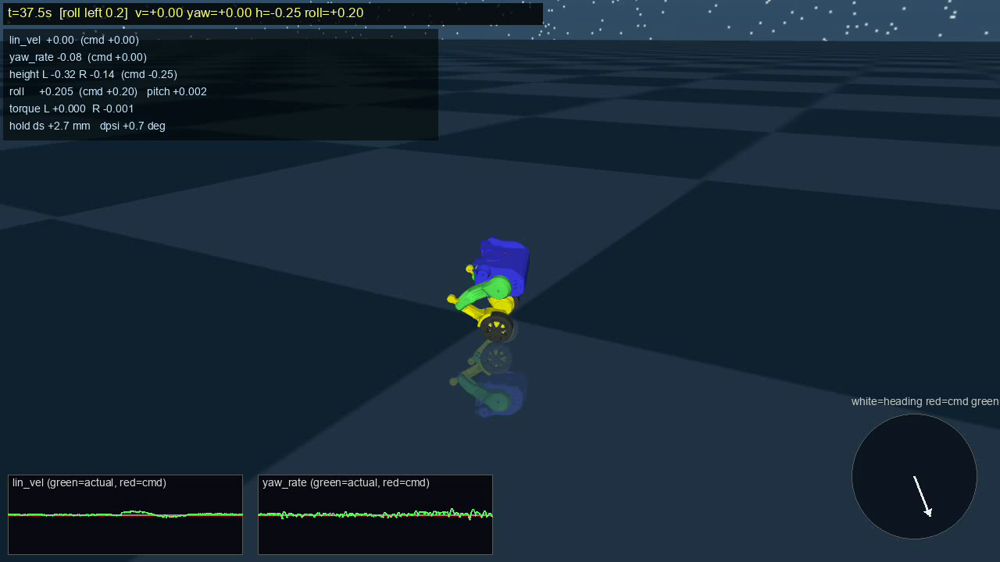 | 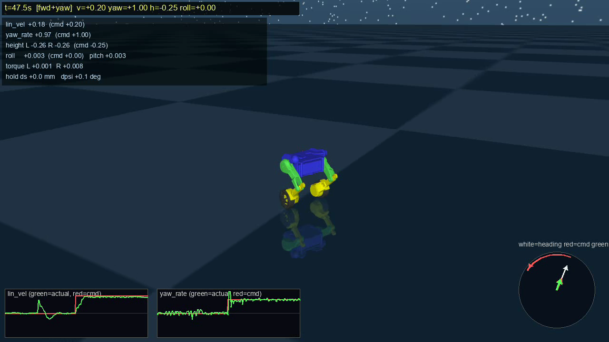 | 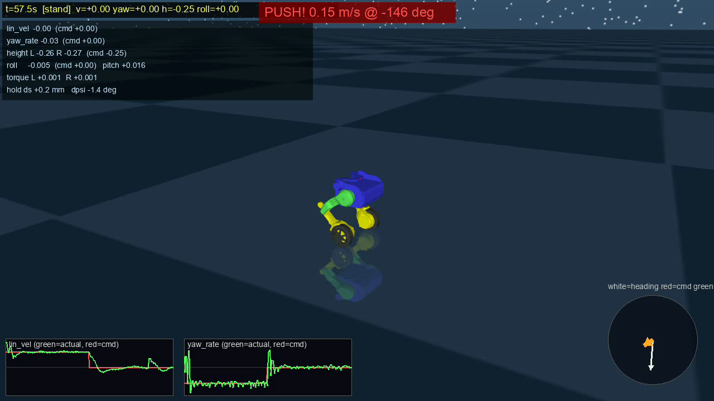 |

---

## 安装

仿真本体（MJCF、网格、`LegWheelRobot`）在本仓库 `vendor/`。训练仍在 `legwheel_rl`；换权重才需要那边。

```bash
export FW=/path/to/mujoco_esp32_robot_deploy_public  # 替换为本仓库位置
cd "$FW"
uv venv --python 3.12 .venv
uv pip install --python .venv/bin/python -r requirements-sim.txt
```

已有训练仓 `.venv` 也可以先跑，`sim_web.sh` 会回退用它。建议还是在本仓建独立环境。

macOS **不要**设 `MUJOCO_GL=egl`，否则没有窗口。

烧真机：Arduino IDE 打开 `$FW/wl_pro_robot.ino`（板卡 ESP32）。固件在 `src/`，页面在 `data/`（LittleFS 上传）。

---

## 实验

### 网页摇杆 + MuJoCo

```bash
cd $FW
bash sim_web.sh
```

会打开 `http://127.0.0.1:8765/`，并弹出 `LegWheel Web + Sim`。首次大约几十秒。端口写在 `sim_web.sh` 顶部。

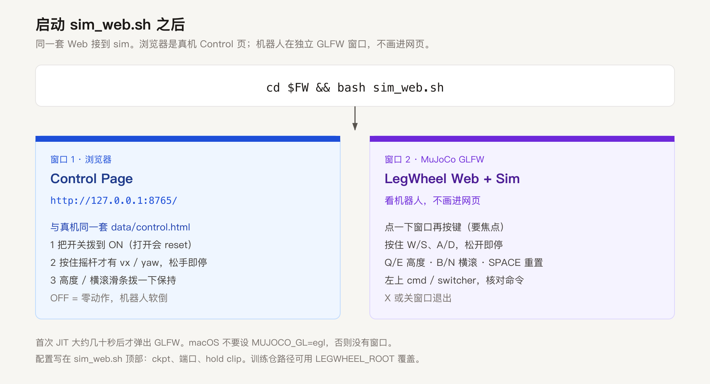

**先把网页开关拨到 ON**，等窗口里站起来，再推杆或按键。松手应停住，不该自己溜、不该自己转。

| 网页 | 键盘（先点一下 MuJoCo 窗口） |
|------|------------------------------|
| 开关 ON = 出力；OFF = 软倒 | 按住 W/S 前进后退，松开停 |
| 摇杆按住才动，松手回中 | 按住 A/D 转向，松开停 |
| height 0 站、100 蹲 | Q/E 高度，B/N 横滚 |
| oscillation 横滚 | SPACE 重置，X 退出 |

建议：先松手看能不能站住 → 只前进再松手 → 只原地转再松手。

### 单测

以下测试只需要 Python 3 标准库：

```bash
cd "$FW"
python3 tests/test_hold_obs.py -v
python3 tests/test_obs.py -v
python3 tests/test_real_io.py -v
python3 tests/test_web_command.py -v
python3 tests/test_web_http.py -v
```

策略测试还需要 NumPy，可在已有的 NumPy 环境中运行：

```bash
python3 tests/test_rl_policy.py -v
```

仿真核对使用本仓 `.venv`：

```bash
JAX_PLATFORMS=cpu "$FW/.venv/bin/python" "$FW/tests/sim_verify_hold_obs.py"
```

### 真机

编译和上传见 [Arduino 固件编译](docs/arduino_compile.md)。换权重需要训练仓、checkpoint 及其 Python 环境；用 `LEGWHEEL_ROOT` 指定训练仓位置：

```bash
cd "$FW"
LEGWHEEL_ROOT=/path/to/legwheel_rl python3 tools/sync_rl_policy.py
```

上机：站立 → 轻推看回位 → 只前进再松手 → 只原地转再松手。

---

## 文档

| | |
|---|---|
| [docs/arduino_compile.md](docs/arduino_compile.md) | 依赖、Wi-Fi 配置、编译与上传 |
| [docs/hold_position_heading_test.md](docs/hold_position_heading_test.md) | 画面约定、键盘 viewer、录 demo、上机参数 |
| [docs/sim_verify_framework.md](docs/sim_verify_framework.md) | 仿真如何核对真机核、模块怎么拆 |
| [docs/performance_benchmark.md](docs/performance_benchmark.md) | 真机控制耗时、耗时分布与分项测量方法 |
| 训练仓 `docs/hold_position_heading.md` | 算法定义 |
