# hold-position-heading 测试使用说明

日期：2026-09-02  
当前版本：`main`（本文最初编写于 `hold-position-heading` 阶段）
训练仓库：`legwheel_rl` 的 `improvements/hold-position-heading`  
策略：`ckpts/newobs-norecovery/000403660800`（须重训后的新观测，不能复用 `20260111-2109`）

算法定义见训练仓 `docs/hold_position_heading.md`。仿真如何核对真机核心见 `docs/sim_verify_framework.md`。本文只写**怎么测、画面长什么样**。

下文 `$FW` 是本仓库。仿真资产在 `$FW/vendor/`。训练仓写成 `$RL`（默认 `$HOME/Work/robotics/workspace/legwheel_rl`），只在换权重、对照训练 viewer、录 demo 时需要。

## 1. 测什么

停车保持改成双锚点：位置 \(s_0\) 和朝向 \(\psi_0\)。

- 位置：\(s=(q_L+q_R)/2\)（未饱和共模轮角）。左右轮观测槽都填同一个 \(\Delta s\)。
- 朝向：\(\sin(\psi \times 0.5)/0.5\)（IMU / 姿态，不用轮差动）。
- \(|v_x|\) 过死区只刷 \(s_0\)；\(|\omega_z|\) 过死区只刷 \(\psi_0\)。
- 出分布只 clip 观测（\(\Delta s \pm 3\)、\(\Delta\psi \pm 1\)），锚点不动。

不覆盖 IMU 安装符号、舵机映射、环频率。那些只能上真机。

## 2. 效果图

下面截自官方 60s 编排（seed=7，1280×720，观测噪声和随机推力都开）。完整视频在 `$FW/demo/holdpos_heading_s07_720p.mp4`。该次：**0 次摔倒，13 次推力**。

画面约定：左上是实测 / 命令；左下绿线=实测、红线=命令；右下白箭头=当前航向；顶部红条 `PUSH!` 表示刚被推了一下。停车时看 `hold ds` / `dpsi`（相对锚点的位置误差和朝向误差）。

### 2.1 站立

`t=2.5s`，命令全零。`lin_vel`、`yaw_rate` 贴在 0 附近。

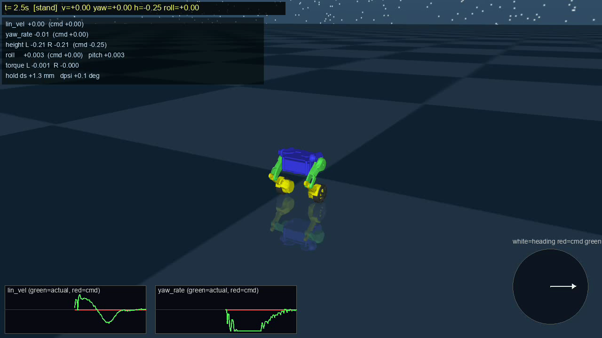

### 2.2 抗推

`t=4.4s`，站立中被推（`PUSH! 0.38 m/s`）。速度和偏航被打偏后往命令 0 收回，没有倒。

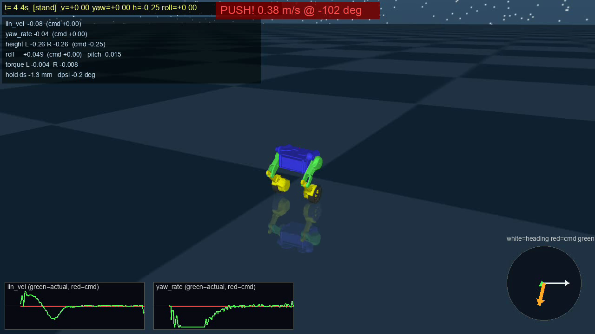

### 2.3 前进 0.2 m/s

`t=7.5s`。实测线速度约 `+0.19`（命令 `+0.20`）。前进只刷位置锚点，朝向锚点冻结。

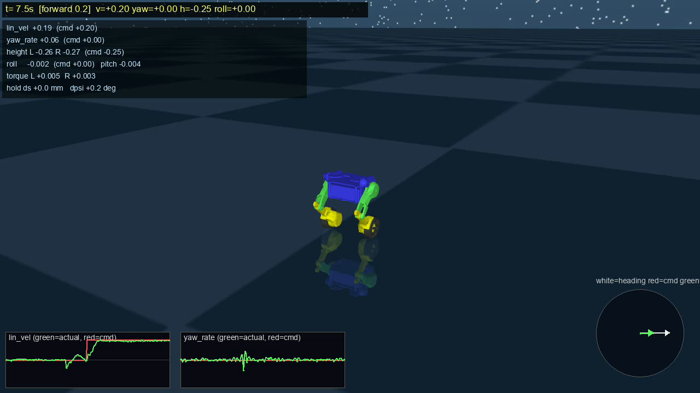

### 2.4 左转 1.5 rad/s

`t=17.5s`。实测偏航约 `+1.46`（命令 `+1.50`）。转向只刷朝向锚点，位置锚点冻结。这一帧同时挨了一下推。

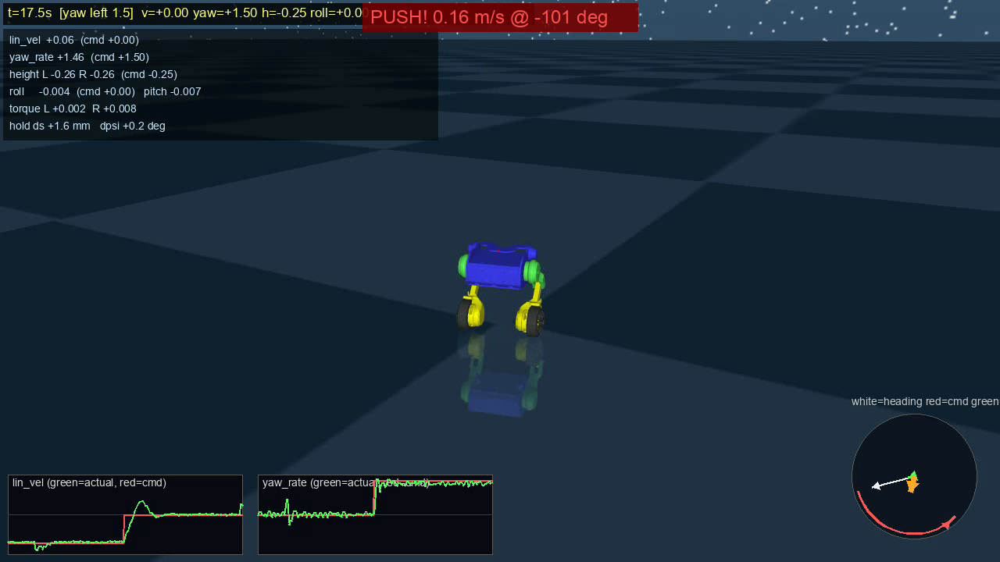

### 2.5 站高

`t=27.5s`，高度命令 `-0.50`。左右腿高约 `-0.49`（大腿伸直）。视频叠字是 `crouch`，和训练编排英文名一致，看起来是站高。

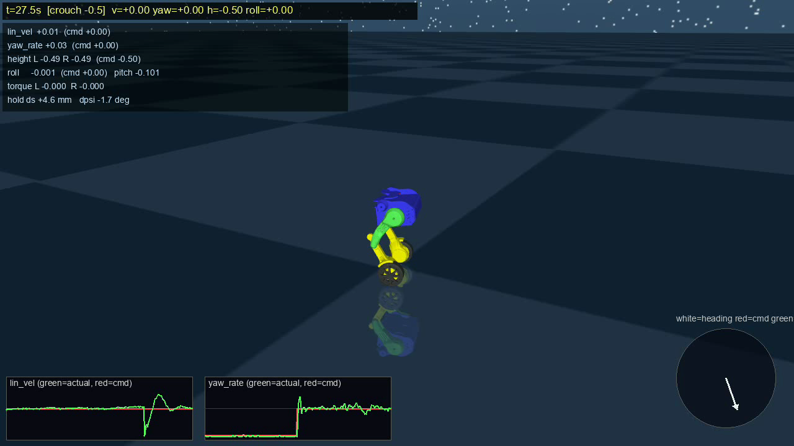

### 2.6 下蹲

`t=32.5s`，高度命令 `0.0`。左右腿高约 `0`。视频叠字是 `stand tall`，看起来是下蹲。停车保持误差约 `ds -1.9 mm`、`dpsi -0.7 deg`。

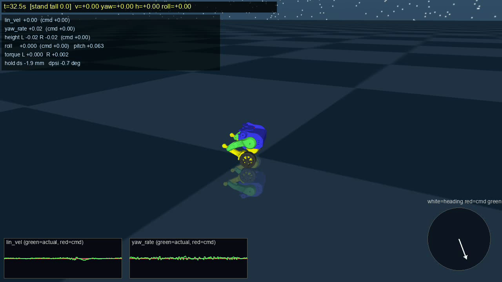

### 2.7 左倾

`t=37.5s`，roll 命令 `+0.20`，实测约 `+0.205`。左右腿高差开，线速度仍接近 0。

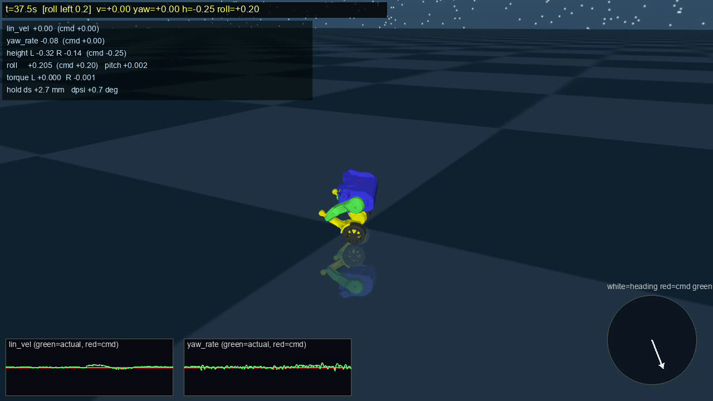

### 2.8 前进 + 转向

`t=47.5s`，同时跟 `v=0.20`、`yaw=1.00`。两套锚点各自刷新，停车误差行接近 0（在走，不保原地）。

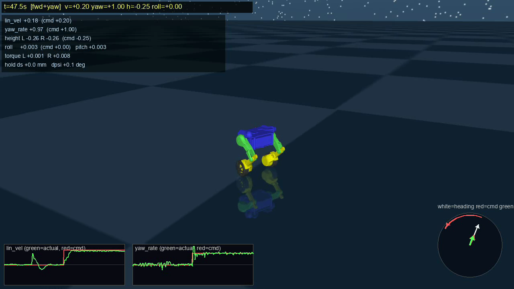

### 2.9 收尾站立

`t=57.5s`，命令回到零。序列跑完后仍站住，即使末段还有推力。

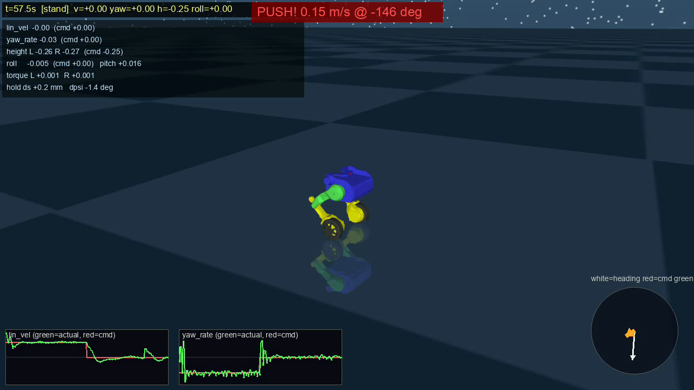

60s 命令表（每段 5s）：

| 时间 | 段 | 命令 `[v, yaw, h, roll]` |
|------|----|--------------------------|
| 0–5 | stand | `[0, 0, -0.25, 0]` |
| 5–10 | forward 0.2 | `[0.2, 0, -0.25, 0]` |
| 10–15 | backward -0.2 | `[-0.2, 0, -0.25, 0]` |
| 15–20 | yaw left 1.5 | `[0, 1.5, -0.25, 0]` |
| 20–25 | yaw right -1.5 | `[0, -1.5, -0.25, 0]` |
| 25–30 | crouch -0.5 | `[0, 0, -0.5, 0]` |
| 30–35 | stand tall 0.0 | `[0, 0, 0, 0]` |
| 35–40 | roll left 0.2 | `[0, 0, -0.25, 0.2]` |
| 40–45 | roll right -0.2 | `[0, 0, -0.25, -0.2]` |
| 45–50 | fwd+yaw | `[0.2, 1.0, -0.25, 0]` |
| 50–55 | combo | `[0.15, -1.0, -0.4, 0.15]` |
| 55–60 | stand | `[0, 0, -0.25, 0]` |

训练编排把 `h=-0.5` 叫 crouch、`h=0` 叫 stand tall。本机大腿 0 是蹲、−0.5 是伸直，所以上面两段的中文截图按姿态叫站高 / 下蹲，和视频叠字英文相反。

## 3. 离线单测（不需要 JAX / 仿真）

固件观测核心的纯 Python 副本：`host/controller/hold_obs.py`（与 `src/controller/hold_obs.cpp` 对着写）。 
单测覆盖：共模只增 \(\Delta s\)、差动 \(\Delta s=0\)、IMU 只增 \(\Delta\psi\)、\(v_x\) 不刷朝向、yaw 不刷位置、两轮槽相同、clip 观测不改锚点、死区、倒地双锚点重置。

```bash
cd "$FW"
python3 tests/test_hold_obs.py -v
python3 tests/test_real_io.py -v
```

期望：`test_hold_obs.py` 9 项、`test_real_io.py` 2 项，合计 11 项全部 `ok`。这些测试只需要 Python 3 标准库。

## 4. MJX 逐步核对（不需要真机）

把仿真状态喂给固件副本，和训练环境 `_get_obs` 比 \(\Delta s\) / \(\Delta\psi\) / 锚点。噪声和推力关掉，clip 开成与固件相同的 `3.0 / 1.0`。

用本仓库仿真 venv（`requirements-sim.txt`）：

```bash
cd $FW
JAX_PLATFORMS=cpu .venv/bin/python tests/sim_verify_hold_obs.py
```

期望：6 个运动学探针通过；闭环 600/600 步与策略逐步对齐、0 次摔倒。结果写到 `tests/sim_verify_hold_obs_results.json`。

本机最近一次：最大 \(|\Delta s|\) 约 \(1.8\times 10^{-7}\)，\(|\Delta\psi|\) 约 \(2.1\times 10^{-8}\)。

## 5. 键盘 viewer（训练仓）

开 GLFW 窗口，键盘发命令。macOS 不要设 `MUJOCO_GL`（设成 egl 会没有窗口）。测**策略本身**用这条；测网页映射用下一节 `sim_web.sh`。

```bash
cd $RL
unset MUJOCO_GL
.venv/bin/python scripts/viewer.py \
  --ckpt ckpts/newobs-norecovery/000403660800 \
  --noise false --random-init false \
  --hold-clip-wheel 3.0 --hold-clip-sinyaw 1.0
```

窗口标题：`LegWheel Robot Control`。

| 键 | 作用 |
|----|------|
| W / S | 前进 / 后退（粘滞累加） |
| A / D | 左转 / 右转 |
| Q / E | 升高 / 降低 |
| B / N | 左倾 / 右倾 |
| SPACE | 重置（双锚点一起清） |
| R | 开始/停止录像 |
| X | 退出 |

`view.sh` 仍指向旧 baseline ckpt 和更紧的 clip，测本策略请用上面这条命令。

## 6. Web + sim：`bash sim_web.sh`

同一套真机 Control 页接到仿真。浏览器**不画**机器人；旁边弹出 MuJoCo 窗口。

```bash
cd $FW
bash sim_web.sh
```

会打开 `http://127.0.0.1:8765/`，并弹出窗口 `LegWheel Web + Sim`。首次 JIT 大约几十秒。配置（端口、clip）写在 `sim_web.sh` 顶部。本体来自 `vendor/`。

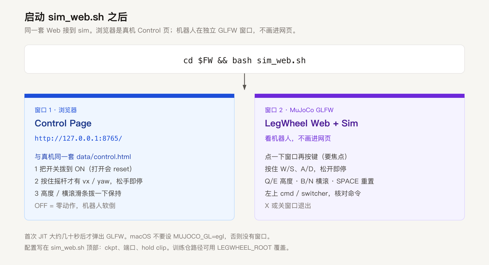

### 6.1 Control 页

与真机 `data/control.html` 同一套。

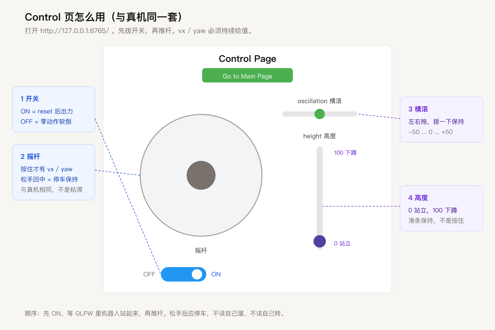

| 控件 | 语义（与真机相同） |
|------|-------------------|
| 开关 | **先拨到 ON**。ON = `reset` 后策略出力；OFF = 零动作，机器人软倒 |
| 摇杆 | **按住才有** \(v_x\) / \(\omega_z\)，松手回中 = 停车保持。不是粘滞 |
| height | 0 站立，100 下蹲；滑条保持 |
| oscillation | 横滚；滑条保持 |

顺序：先 ON → 等 GLFW 里机器人站起来 → 再推杆。松手后应停车，不该自己溜、不该自己转。

### 6.2 MuJoCo 窗口

点一下窗口再按键（要焦点）。叠加层是英文，避免乱码。

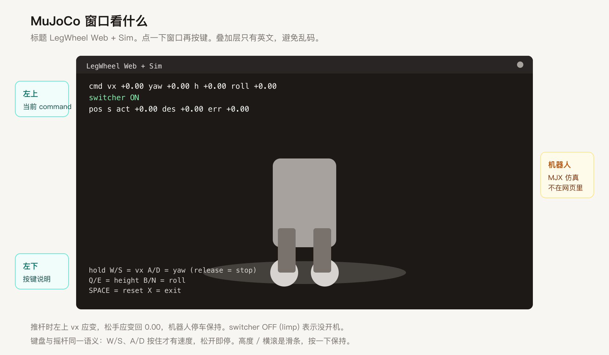

| 键 | 作用 |
|----|------|
| W / S | 按住前进 / 后退，松开停止 |
| A / D | 按住左转 / 右转，松开停止 |
| Q / E | 升高 / 降低（滑条，保持） |
| B / N | 左倾 / 右倾（滑条，保持） |
| SPACE | 重置 |
| X | 退出 |

左上 `cmd vx ...` 应随摇杆/按键变；松手应变回 `0.00`。`switcher OFF (limp)` 表示没开机。

建议先松手看停车：位置/朝向误差应收到接近 0。再只前进再松手（位置锚点跟着走、朝向保持）；只原地转再松手（朝向跟着转、位置不丢）。

## 7. 录 60s demo

官方编排 + 噪声 + 随机推力。macOS 离屏用 CGL：

```bash
cd $RL
MUJOCO_GL=cgl .venv/bin/python tools/record_baseline_demo.py \
  --ckpt ckpts/newobs-norecovery/000403660800 \
  --seed 7 --width 1280 --height 720 \
  --out $FW/demo --tag holdpos_heading
```

输出：

- `demo/holdpos_heading_s07_720p.mp4`
- `demo/schedule.txt`
- `demo/falls_s07_720p.txt`（摔倒时刻；本样例为 0）

从视频抽帧到 `docs/images/`（本机已抽过，不必重做）：

```bash
cd $FW
ffmpeg -y -ss 2.5  -i demo/holdpos_heading_s07_720p.mp4 -frames:v 1 docs/images/stand.png
ffmpeg -y -ss 4.4  -i demo/holdpos_heading_s07_720p.mp4 -frames:v 1 docs/images/push.png
ffmpeg -y -ss 7.5  -i demo/holdpos_heading_s07_720p.mp4 -frames:v 1 docs/images/forward.png
ffmpeg -y -ss 17.5 -i demo/holdpos_heading_s07_720p.mp4 -frames:v 1 docs/images/yaw_left.png
ffmpeg -y -ss 27.5 -i demo/holdpos_heading_s07_720p.mp4 -frames:v 1 docs/images/stand_tall.png
ffmpeg -y -ss 32.5 -i demo/holdpos_heading_s07_720p.mp4 -frames:v 1 docs/images/crouch.png
ffmpeg -y -ss 37.5 -i demo/holdpos_heading_s07_720p.mp4 -frames:v 1 docs/images/roll_left.png
ffmpeg -y -ss 47.5 -i demo/holdpos_heading_s07_720p.mp4 -frames:v 1 docs/images/fwd_yaw.png
ffmpeg -y -ss 57.5 -i demo/holdpos_heading_s07_720p.mp4 -frames:v 1 docs/images/stand_end.png
```

## 8. 真机

观测/锚点逻辑在 `src/controller/` 与 `src/control/control.cpp`。Kweb 可调：

| 参数 | 默认 | 含义 |
|------|------|------|
| `hold_error_clip_enable` | 1 | 推理时 clip 观测误差 |
| `hold_error_clip_ds` | 3.0 | \(\Delta s\) 半幅 |
| `hold_error_clip_dpsi` | 1.0 | \(\Delta\psi\) 半幅 |

串口 debug 含 `ds_true` / `dpsi_true` / `ds_obs` / `dpsi_obs` / `s0` / `yaw0`。真值可以超 clip，观测被夹、锚点仍冻。

策略已导出到 `src/policy/rl_policy.cpp`（`ckpts/newobs-norecovery/000403660800`），sim / real 共用。换权重跑 `$FW/tools/sync_rl_policy.py`。

上机建议顺序：站立 → 轻推看回位 → 只前进再松手 → 只原地转再松手。倒地或开关机会把两个锚点一起重置。
