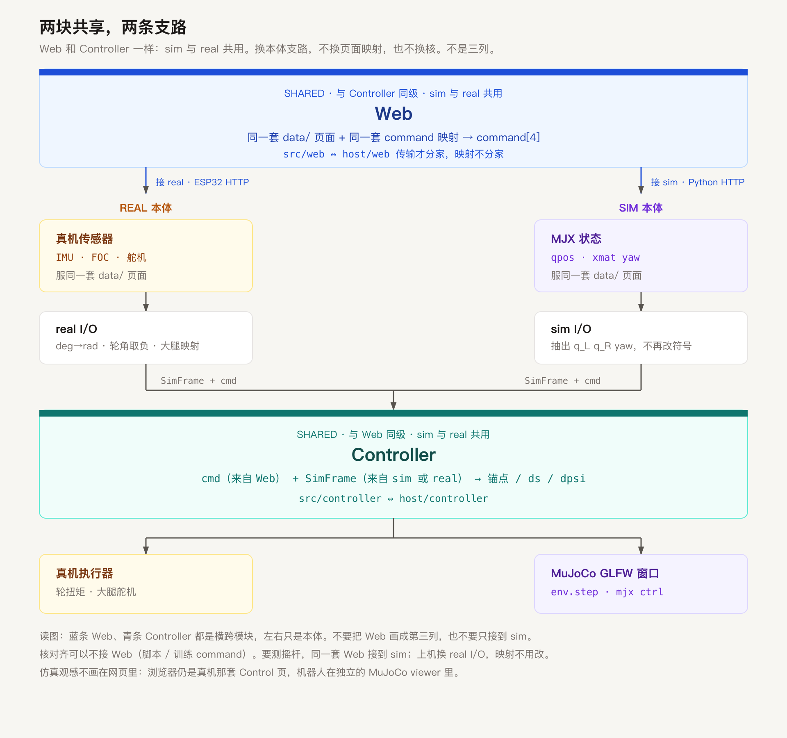
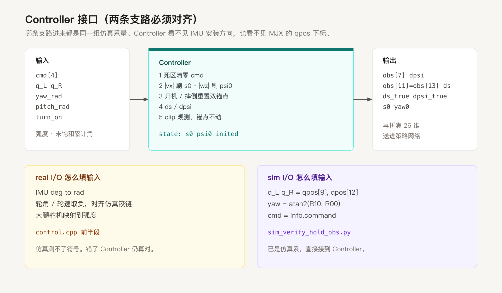
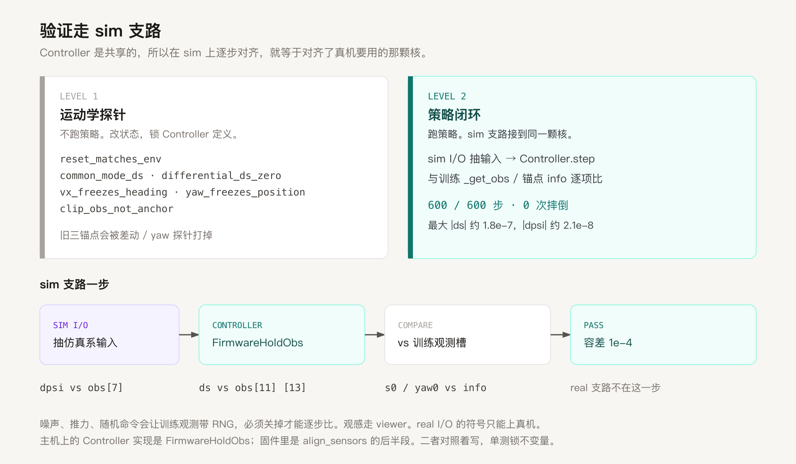

# 用仿真验证真机核心控制代码：框架设计

日期：2026-09-02  
相关：算法定义见训练仓 `docs/hold_position_heading.md`；怎么跑测试见本仓 `docs/hold_position_heading_test.md`。

## 1. 共享模块，两条支路

**Policy、Web、Controller** 是同级的共享模块：sim 与 real 都接到它们，而不是各写一套。本体 I/O 才分叉，而且互斥。

| | 解决什么 | 模块 | 谁共用 |
|---|---|---|---|
| **Policy（共享）** | 同一份导出权重 | `src/policy` ↔ `host/policy` | **sim 与 real 共用**。禁止仿真另 load JAX ckpt |
| **Web（共享）** | 人怎么给 `command` / K | `src/web` ↔ `host/web` | **sim 与 real 共用**。传输分家（ESP32 HTTP / Python HTTP），页面和映射不分家 |
| **Controller（共享）** | 锚点 + 26 维拼装 | `src/controller` ↔ `host/controller` | **sim 与 real 共用**。换支路，不换核 |
| 本体（分叉） | 状态从哪来、往哪执行 | `real` / `sim` | **互斥**：真机传感器 **或** MJX + GLFW 窗口 |

不要把 Web、sim、real 画成三列。Web 不是第三条本体，也不是只挂在仿真上的调试页。



| | Real 本体 | **共享（Web + Controller）** | Sim 本体 |
|---|---|---|---|
| Web | ESP32 服同一套 `data/` | **页面 + `command` 映射** | Python 服同一套 `data/` |
| 进来 | IMU、FOC 轮角、大腿舵机 | `cmd` + `SimFrame` | MJX `qpos` / `xmat` / gyro |
| 适配 | deg→rad、轮角取负、大腿映射 | 看不见传感器，也不看见 `qpos` 下标 | 抽出仿真系量，不再改符号 |
| 出去 | 轮扭矩、大腿舵机 | 26 维观测 → 同一份策略 | `env.step` · **独立 MuJoCo 窗口** |

所以：

- 核对齐可以 **不接 Web**（现在的 `sim_verify_hold_obs.py` 用训练 `info.command`）
- 要测「人在网页上推杆」，**同一套 Web 接到 sim**：浏览器仍是真机那套 Control 页，机器人在 MuJoCo viewer 里，不画进网页
- 上机换 real I/O，**Web 映射、Controller、策略都不用改**

当前代码按这个拓扑拆开。根目录只留 `wl_pro_robot.ino`；固件全在 `src/`，主机 Python 全在 `host/`。

- 共享策略：`src/policy/` ↔ `host/policy/`（`DEPLOY_CKPT` 三处锁同一份）
- 共享 Web：`src/web/command.*` + `lqrwebserver.*` ↔ `host/web/`（与 Controller 同级，sim / real 共用）
- 共享核：`src/controller/` ↔ `host/controller/`（HoldObs + ObsPack + SimFrame）
- Real I/O：`src/real/` ↔ `host/real/`
- Sim I/O：`host/sim/`（只在主机；固件没有仿真本体）
- 仿真本体快照：`vendor/assets/` + `vendor/legwheel/`（不依赖训练仓路径）
- 胶水：`src/control/control.cpp` = real I/O → HoldObs → ObsPack → 策略 / PID；control 页走 `web_cmd::apply_control_page`
- HAL：`.ino` 读传感器；`src/hal/` 遥控协议和舵机

Arduino 会编译根目录 `.ino` 以及 **`src/` 递归**（`src/` 在 include path 里）。例如 `#include "controller/hold_obs.h"`、`#include "control/control.h"`、`#include "real/io.h"`、`#include "web/command.h"`。Arduino IDE 顶部标签通常只显示 `.ino`，`src/` 里的源码从左侧资源管理器打开。

## 2. 共享接口

哪条支路进来，填的都是同一组仿真系量。Controller 拆成两块，名字容易混：

**HoldObs** 是 `Hold`（停车保持）+ `Obs`（observation）的缩写，不是「整个观测」。它只维护位置锚点 \(s_0\) 和朝向锚点 \(\psi_0\)，算出相对误差 \(\Delta s\)、\(\Delta\psi\)，填进策略输入的 `[7]` 和 `[11]/[13]`。前进只刷 \(s_0\)，转向只刷 \(\psi_0\)；clip 只夹送进网络的误差，锚点不动。更贴切的叫法是双锚点，类名暂时没改。

**ObsPack** 才是 26 维拼装：把 HoldObs 的那几维，加上 gyro、pitch/roll、大腿、轮速历史，拼成策略输入。`note_policy_action` 只更新观测用的轮速历史，不跑 PID。

契约：



| | |
|---|---|
| 输入 | `command[4]` + 完整 `SimFrame`（轮角、姿态、gyro、大腿、轮速） |
| 状态 | `s_0`，`ψ_0`，`hold_anchors_inited`；轮速平滑 / 指令历史 |
| 输出 | 26 维观测。HoldObs 填 `obs[7]=Δψ`、`obs[11]=obs[13]=Δs`；ObsPack 填其余槽位 |

`q_L,q_R` 是未饱和累计角，与仿真 `qpos[9]、qpos[12]` 同号同单位。`yaw` 与 `atan2(R[1,0], R[0,0])` 同一套。SimpleFOC `shaft_angle` 是累计角，可当 \(s\) 的积分器；不要用饱和的 `sin(q·scale)` 当位置。

核内部顺序必须固定：先按死区后的指令刷锚点，再被开机/摔倒覆盖，再算误差，最后 clip 观测。

- 位置 \(s=(q_L+q_R)/2\)，两轮槽同一个 \(\Delta s\)
- 朝向 \(\psi=\sin(\mathrm{yaw}\times 0.5)/0.5\)
- \(|v_x|\) 过死区只刷 \(s_0\)；\(|\omega_z|\) 过死区只刷 \(\psi_0\)
- clip 只夹送进网络的误差（\(\Delta s \pm 3\)、\(\Delta\psi \pm 1\)），锚点不动

`HoldObs` 与固件常量为同一套：`yaw_sin_scale=0.5`，线速度死区 `0.000195`，偏航死区 `0.01`，摔倒 `pitch < -0.6` 或 `> 1.1`。

## 3. 为什么仿真能验证真机核

三条「直接跑」的路都不通：C++ 链不进 MJX，JAX 烧不进 ESP32，真机 log 和仿真 log 对不上同一时刻的 \((q_L,q_R,\psi,\mathrm{cmd})\)。

不需要第三套算法。只要：

1. real I/O 和 sim I/O 都填同一份 `SimFrame`
2. 主机上的 `HoldObs` / `ObsPack` 与固件对着写（单测锁不变量）
3. `sim_verify_hold_obs.py` 把 sim 支路接到 HoldObs，逐步和训练 `_get_obs` 的 \(\Delta s\) / \(\Delta\psi\) 比
4. Web+sim viewer 用同一套 ObsPack 喂策略，不再走训练 `_get_obs`

\(\Delta s\) / \(\Delta\psi\) 对上了，说明锚点语义与训练一致。完整 26 维是固件拼装（pitch 零点走大腿曲线，不是训练的 `sin_balance_zero`）；sim viewer 和真机吃的是这一份。

## 4. 验证走 sim 支路



离线单测不经过任何支路，直接拿手工 \((q,\psi,\mathrm{cmd})\) 打核本身：`python3 tests/test_hold_obs.py -v`。

仿真核对把 **sim I/O** 接到同一颗核：

```bash
JAX_PLATFORMS=cpu $FW/.venv/bin/python tests/sim_verify_hold_obs.py
```

### 4.1 运动学探针

不跑策略。改 `qpos` 或锚点，锁核的定义。

| 探针 | 在锁什么 |
|------|----------|
| `reset_matches_env` | 第一帧双锚点都是当前值 |
| `common_mode_ds` | 两轮同加，只增 \(\Delta s\) |
| `differential_ds_zero` | 差动不属于位置 |
| `vx_freezes_heading` | 前进不刷 \(\psi_0\) |
| `yaw_freezes_position` | 转向不刷 \(s_0\) |
| `clip_obs_not_anchor` | clip 观测，锚点不动 |

### 4.2 策略闭环

sim I/O 抽输入 → `HoldObs.step` → 与 `obs[7/11/13]` 和 `info` 锚点比。容差 `1e-4`。本机最近一次：600/600 步，0 次摔倒，最大 \(|\Delta s|\) 约 \(1.8\times 10^{-7}\)。

比较槽位：

| 语义 | Controller | 训练 |
|------|------------|------|
| \(\Delta\psi\) | `obs_dpsi` | `obs["state"][7]` |
| \(\Delta s\) | `obs_ds_l` / `obs_ds_r` | `obs["state"][11]` / `[13]` |
| \(s_0\) | `s0` | `info["position_start"]` |
| \(\psi_0\) | `yaw0` | `info["sinyaw_start"]` |

两边吃同一份 MJX 状态，比的是核，不是接触模型。

核对必须关掉噪声、推力、环境自己换命令（否则观测带 RNG）。`hold_error_clip` 开成与固件相同的 `3.0 / 1.0`。闭环里核设 `reset_on_fallen=False`：训练摔倒走 episode reset，固件 `fallen(pitch)` 当场重锚；逐步对齐的是未倒地中段。摔倒重置只在单测里打。

## 5. 能证明什么，不能证明什么

**sim 支路已经证明：** 共享核与训练 `_get_obs` 的 \(\Delta s\) / \(\Delta\psi\) 槽逐步一致；旧的三锚点会被差动 / yaw 探针打掉。Web+sim viewer 的策略输入走共享 ObsPack，不再用训练 `_get_obs`。

**real 支路仿真测不了：**

- I/O 符号（IMU 安装、轮角取负）。填错了核仍「算对」，机器人反着走
- 执行器环、扭矩饱和、接触与打滑

上机：看串口 `ds_true` / `dpsi_true` / `s0` / `yaw0` 是否与核同一语义。换权重用 `tools/sync_rl_policy.py`。

## 6. 文件怎么落到图上

| 图上的块 | 文件 |
|----------|------|
| Controller（共享核） | `src/controller/hold_obs.cpp` + `obs.cpp`；`host/controller/hold_obs.py` + `obs.py` |
| SimFrame 接口 | `src/controller/sim_frame.h`；`host/controller/sim_frame.py` |
| Real I/O | `src/real/io.cpp`；`host/real/io.py` |
| Sim I/O | `host/sim/io.py`（填满 SimFrame） |
| Web（共享，与 Controller 同级） | `src/web/command.*` + `lqrwebserver.*` ↔ `host/web/`；同一套 `data/` 页面 |
| 胶水（real→核→策略 / PID） | `src/control/control.cpp` |
| HAL | `wl_pro_robot.ino`；`src/hal/` |
| 策略（共享） | `src/policy/` ↔ `host/policy/` |
| 训练合同 | `vendor/legwheel/env.py` `_get_obs` 与锚点 info（快照自训练仓） |
| 仿真本体 | `vendor/assets/`（MJCF / mesh）+ `vendor/legwheel/` |
| 核的单测 | `tests/test_hold_obs.py`；`tests/test_obs.py` |
| real I/O 单测 | `tests/test_real_io.py` |
| web 映射单测 | `tests/test_web_command.py` |
| sim 支路逐步核对 | `tests/sim_verify_hold_obs.py` |

改锚点语义：训练合同与固件核一起改 → 更新 `host/controller/hold_obs.py` → 单测和 sim 支路核对都绿 → 再导出权重。不要只改一条支路或只改一份核。
