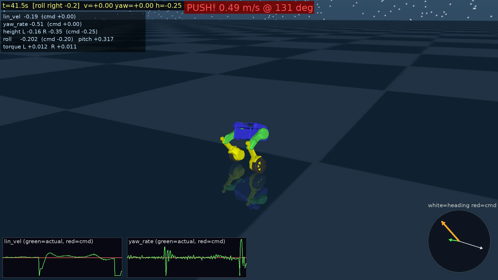
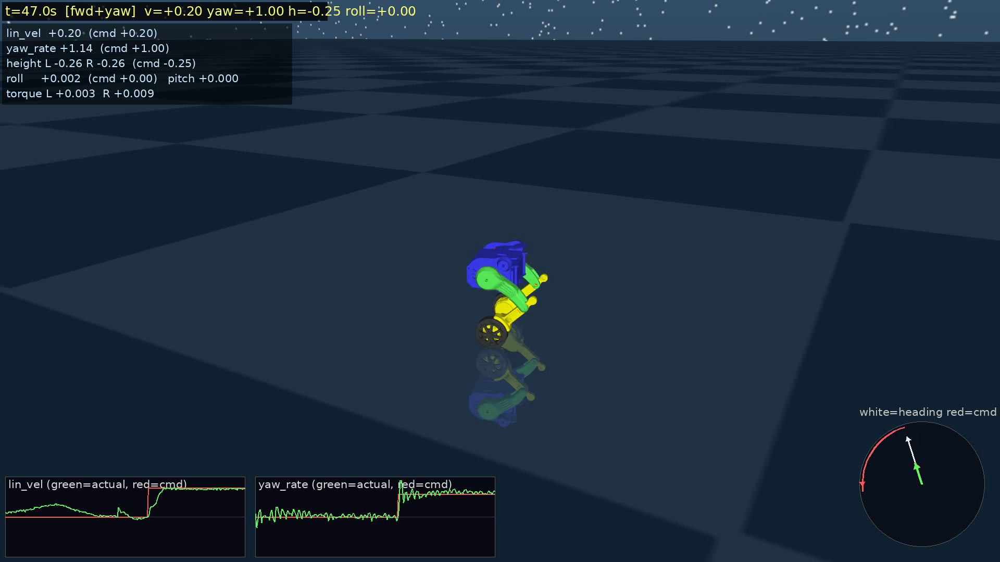
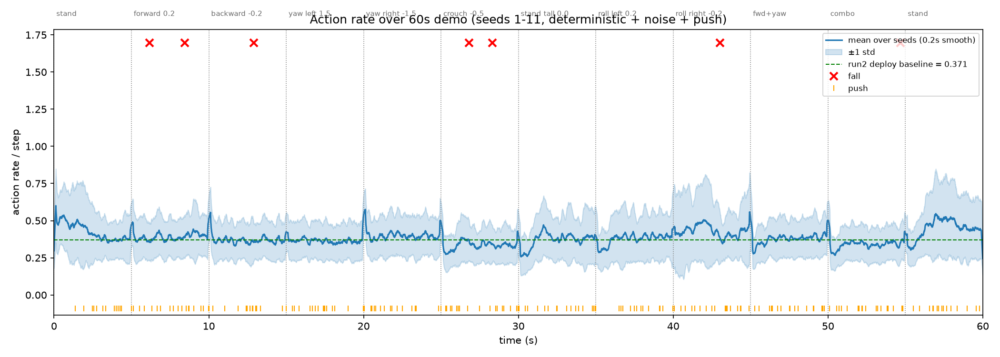
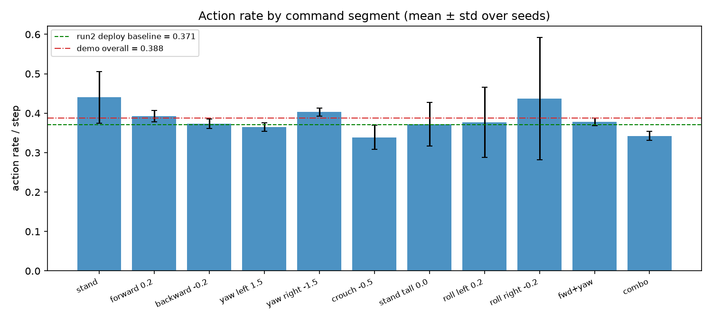
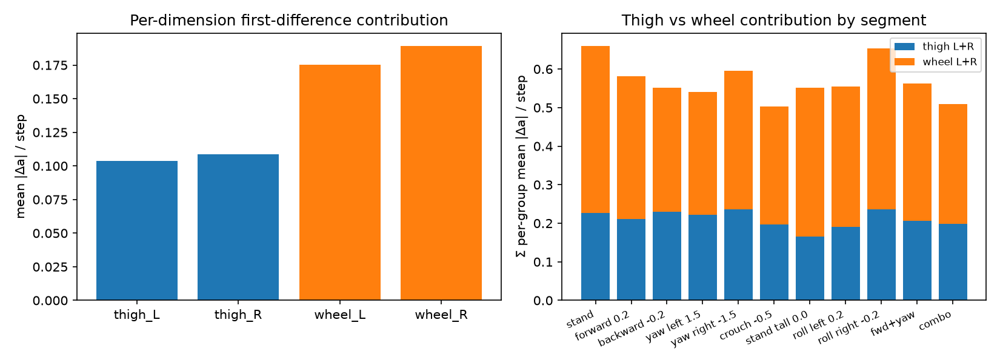
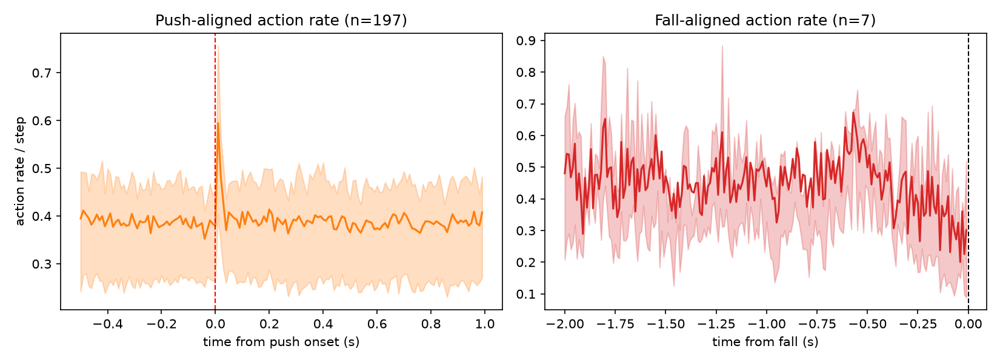

# Baseline 策略 60s 部署演示测试报告

日期：2026-08-30
模型：`tuning/run1/trials/confirm-baseline-s0/ckpt/000408576000`(run1 baseline,4e8 步确认轮冠军，即当前代码默认参数)
录制工具：`tools/record_baseline_demo.py`(已入库)

## 1. 测试目的

用训练好的 baseline 策略在 **deploy 口径**(deterministic 策略 + 观测噪声 + 随机推力扰动)下录制 60 秒连续演示视频，覆盖全部操控维度(前后移动、转向、蹲起、侧倾及组合),检验机器人在持续扰动下的稳定性与自愈能力。

## 2. 测试设置

| 项目 | 设置 |
|---|---|
| 策略模式 | deterministic(与端侧部署一致) |
| 观测噪声 | 开(与训练一致) |
| 随机推力 | 开，速度脉冲 0~0.5 m/s,随机方向，约每 2~4s 一次 |
| 域随机化 | 关(纯演示，地面参数固定) |
| 时长 | 60s/段，50 fps |
| 段数 | 11 段，seed 1~11 |
| 分辨率 | 1920x1080(1080p_viz 为最终交付);另有 960x540 同 seed 对照批 |

60 秒内按 5s 一段编排 12 段命令 `[vx, yaw_rate, height, roll]`:

| 时间 | 命令 | 值 |
|---|---|---|
| 0-5s | 站立 | [0, 0, -0.25, 0] |
| 5-10s | 前进 | [0.2, 0, -0.25, 0] |
| 10-15s | 后退 | [-0.2, 0, -0.25, 0] |
| 15-20s | 左转 | [0, 1.5, -0.25, 0] |
| 20-25s | 右转 | [0, -1.5, -0.25, 0] |
| 25-30s | 蹲伏 | [0, 0, -0.5, 0] |
| 30-35s | 站高 | [0, 0, 0, 0] |
| 35-40s | 左倾 | [0, 0, -0.25, 0.2] |
| 40-45s | 右倾 | [0, 0, -0.25, -0.2] |
| 45-50s | 前进+转向 | [0.2, 1.0, -0.25, 0] |
| 50-55s | 组合 | [0.15, -1.0, -0.4, 0.15] |
| 55-60s | 站立 | [0, 0, -0.25, 0] |

## 3. 视频内可视化

- **左上遥测面板**:lin_vel / yaw_rate / 左右腿高 / roll / pitch / 左右轮扭矩(实测 vs 命令)
- **底部滚动曲线**:lin_vel 与 yaw_rate 近 5s 跟踪曲线(绿=实测，红=命令)
- **右下罗盘箭头**:白=heading,红=cmd vel 方向，绿=实际 vel 方向，橙=push 方向(闪现 1s),红弧=cmd yaw
- **顶部状态栏**:当前命令名与数值；被推时红字 `PUSH! x.xx m/s @ xxx deg` 闪现





## 4. 结果汇总(11 段，共 203 次推力)

| 段 | seed | 推力次数 | 摔倒次数 | 摔倒时刻 |
|---|---|---|---|---|
| s01 | 1 | 18 | 0 | - |
| s02 | 2 | 31 | 2 | 43.0s, 54.7s |
| s03 | 3 | 14 | 0 | - |
| s04 | 4 | 14 | 0 | - |
| s05 | 5 | 14 | 1 | 8.5s |
| s06 | 6 | 22 | 2 | 26.8s, 58.5s |
| s07 | 7 | 13 | 0 | - |
| s08 | 8 | 21 | 1 | 6.2s |
| s09 | 9 | 17 | 0 | - |
| s10 | 10 | 13 | 0 | - |
| s11 | 11 | 26 | 1 | 12.9s |
| **合计** | | **203** | **7** | 6/11 段全程无摔倒 |

单次推力最大 0.50 m/s,多数在 0.2~0.45 m/s。540p 批与 1080p 批同 seed 同轨迹，摔倒统计完全一致(可复现)。

## 5. 摔倒案例分析

7 次摔倒全部发生在 **推力 + 机动命令叠加** 的时刻，单纯站立/行走中的推力从未导致摔倒:

| 摔倒 | 所处命令段 | 直接诱因 |
|---|---|---|
| s02 43.0s | 右倾 roll -0.2 | 42.5s 侧向推力 0.43 m/s,侧倾+侧推叠加失稳 |
| s02 54.7s | 组合(蹲+转+移) | 组合命令末段连续被推(50-55s 内 6 次) |
| s05 8.5s | 前进 0.2 | 8.0s 前向推力 0.39 m/s 叠加前进步态 |
| s06 26.8s | 蹲伏 -0.5 | 25.7s 推力 0.47 m/s,蹲姿裕度小 |
| s06 58.5s | 结束站立 | 58.0s 推力 0.36 m/s(该段此前已摔过一次，状态未完全回稳) |
| s08 6.2s | 前进 0.2 | 5.8s 推力 0.44 m/s 叠加前进 |
| s11 12.9s | 后退 -0.2 | 12.4s 后向推力 0.35 m/s 叠加后退 |

关键观察:

- **摔倒后能自行爬起继续执行命令**,视频不中断，后续推力正常响应——deploy 场景下具备自愈能力。
- 侧倾(roll)与蹲伏(crouch)是抗推裕度最小的两个姿态，与调参阶段发现的 roll/height 耦合难点一致。
- 纯站立和纯转向阶段的抗推表现最好，11 段中无任何一次在这两个阶段摔倒。

## 6. Action rate 分析

口径与训练 reward / `legwheel/evaluation/action_rate.py` 一致：
`rate/步 = mean(|Δa|) + mean(|Δ²a|)`，作用于策略原始 4 维归一化输出
[thigh_L, thigh_R, wheel_L, wheel_R](thigh=位置环,wheel=力矩环)。
数据由 `tools/analyze_demo_action_rate.py` 复刻录像同 seed rollout 采集
(10/11 段与录像逐事件一致;s06 在首次摔倒处差 1 步后轨迹分叉——GPU 浮点
非确定性在临界状态的翻转,属预期,其后仍是同分布合法样本);
reset 后 0.5s 的差分跨 episode 边界,统计时剔除。

### 6.1 总体水平：无异常

| 指标 | 数值 | 判读 |
|---|---|---|
| 全程均值 | **0.388/步**(c1 0.144 + c2 0.244) | 与 run2 deploy 评测 0.371 一致(+5%) |
| 逐 seed 范围 | 0.359 ~ 0.445 | 离散小;最高的 s02(0.445)正是摔 2 次的段 |
| 动作饱和度 | \|a\|>0.95 占比 < 0.6%(任意维度) | 无持续打满/饱和抖动 |

演示工况比 run2 评测更苛刻(每 5s 一次命令阶跃 + 全程推力),均值仅高 5%,
说明 0.37 量级的 action rate 不是评测环境的侥幸,是策略的固有平滑度。

### 6.2 60s 时间线



- 稳态平台 0.35~0.45,11 段 seed 的 std 带始终不发散;
- 每 5s 命令阶跃处出现瞬时尖峰(<0.5s 回落),是对命令切换的正常响应;
- 推力(底部橙刻度)密布全程,曲线不随推力累积漂移——扰动吸收快;
- 55s 组合段末至末段站立有一次缓慢抬升,对应 s06 在 58.5s 的摔倒。

### 6.3 按命令段分解

| 命令段 | rate/步 | | 命令段 | rate/步 |
|---|---|---|---|---|
| stand | 0.440 ± 0.095 | | stand tall 0.0 | 0.372 ± 0.055 |
| roll right -0.2 | 0.437 ± 0.155 | | roll left 0.2 | 0.377 ± 0.090 |
| yaw right -1.5 | 0.403 ± 0.010 | | backward -0.2 | 0.373 ± 0.012 |
| forward 0.2 | 0.393 ± 0.014 | | yaw left 1.5 | 0.365 ± 0.011 |
| fwd+yaw | 0.378 ± 0.010 | | combo | 0.343 ± 0.011 |
| crouch -0.5 | 0.339 ± 0.031 | | | |



- stand 偏高不意外:纯站立靠轮做倒立摆式持续微平衡,且 s06 末段站立
  摔倒前的挣扎抬升计入该段;
- roll right 方差大(±0.155)是 s02 在 43s 摔倒所致,与第 5 节
  "侧倾+侧推裕度最小"的结论互证;
- combo 最低(0.343):多命令同时给定时策略动作反而更"有目的",
  微纠正占比下降。

### 6.4 动作维度分解



- 轮两维贡献一阶差分的 ~63%(wheel_L 0.175 + wheel_R 0.189,
  thigh 仅 0.104 + 0.109):轮是力矩环、承担平衡主任务,天然高频;
  thigh 位置环慢变,符合控制结构预期;
- 左右轻微不对称(R 比 L 大 5~8%)与编排中不对称的组合段
  (combo yaw -1.0 / fwd+yaw +1.0)一致,非异常。

### 6.5 事件对齐:推力响应与摔倒前兆



- **push 对齐(n=197)**:推力瞬间小幅上冲至 ~0.42(+8%),约 0.1s 内
  回到平台,无振荡尾——响应快、阻尼良好;
- **fall 对齐(n=7)**:摔倒前 1s 均值 0.439(比平台 +13%),前 2s 持续
  偏高且波动加剧——action rate 升高是摔倒的**前兆特征**(策略在挣扎),
  但幅度有限,不能单独作摔倒预测器。

### 6.6 小结

未发现异常：总量与 run2 评测互洽、无饱和、无持续振荡、推力响应快速
阻尼；所有升高场景（命令切换、摔倒前挣扎）均有物理解释。剩余风险点
仍是第 5 节的"侧倾/蹲伏 + 推力"叠加工况，与 action rate 无关。

## 7. 结论

baseline 策略(当前默认参数)在 deploy 口径 60s 连续演示中:

- 全命令维度(移速/转向/蹲起/侧倾/组合)均可执行，跟踪曲线贴合命令；
- 203 次随机推力下仅摔 7 次(每段平均 18 次推力、摔 0.64 次),且全部摔倒可自愈恢复；
- 无摔倒段占 6/11,摔倒集中在"推力×机动"叠加工况，符合物理直觉，非策略缺陷性失稳。

## 8. 产物与复现

产物(gitignored，本地路径):

```
test/baseline_demo_60s/
├── 1080p_viz/    # 最终交付:11 段 1080p 带完整可视化 + falls_*.txt 逐次推力记录
├── 540p/         # 11 段 540p 同 seed 对照批
├── 1080p_plain/  # (空，无可视化 1080p 批已被 1080p_viz 取代)
├── action_rate/  # action_rate_sNN.npz 逐步动作/推力/摔倒原始数据
└── schedule.txt  # 命令编排
```

复现(换 seed / 分辨率 / 时长):

```bash
MUJOCO_GL=egl .venv-local/bin/python tools/record_baseline_demo.py \
    --seed 1 --width 1920 --height 1080 --duration 60
```

action rate 采集与出图(断点续采,已有 npz 的 seed 自动跳过):

```bash
.venv-local/bin/python tools/analyze_demo_action_rate.py          # 采集+统计+出图
.venv-local/bin/python tools/analyze_demo_action_rate.py --no-plot 1 2 3  # 只采集
```

换 checkpoint 需改脚本内 `CKPT` 常量。

已知瑕疵：罗盘图例文字右边缘被画面裁切约一半(脚本已修，未重录，不影响数据)。
