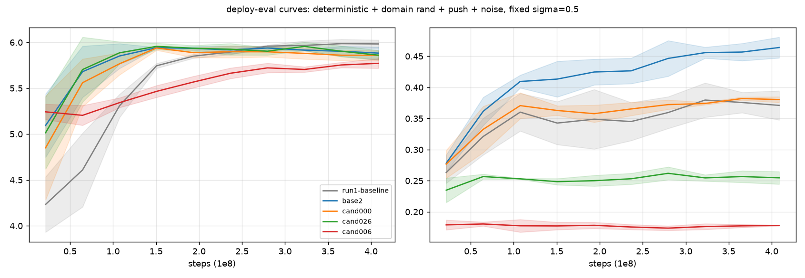

# deploy 口径无权重总 reward 全量对比

日期:2026-08-29。本文档只含 **deploy 口径**数据,无任何训练报表口径混入。

## 0. 口径定义

所有数字均来自 `legwheel/evaluation/action_rate.py::deploy_evaluate`:

- **deterministic 策略**(取均值动作,无探索采样);
- **域随机化**(1024 个并行环境各抽一套物理参数)+ **push** + **观测噪声**;
- **固定 σ=0.5** 打分(各 trial 训练时的 σ 搜索值不影响测量);
- NaN 步按 0 分计;逐环境只计首次 done 之前。

无权重总 reward/步 = Σ8 项达成率 − action_rate(权重只取正负号,正负由
reward 结构决定:跟踪/姿势类为正,action_rate 为负)。

注意:energy_cost 与 pitch_velocity_penalty 两个惩罚项未在 deploy 实测中
采集(报表口径下量级也很小,合计 <0.1/步),不含在求和内;所有组同口径
处理,不影响相对比较。

## 1. 4e8 全量确认组(3 seeds 均值;无权重和 ± std)

| 排名 | 组 | lin_vel | ang_vel | height_jnt | height_action | pitch | roll | sinyaw | sinpos | ar ↓ | **无权重和/步 ↑** |
|---|---|---|---|---|---|---|---|---|---|---|---|
| 1 | run1 baseline | 0.853 | 0.874 | 0.680 | 0.815 | 0.861 | 0.869 | 0.829 | 0.567 | 0.371 | **5.98±0.06** |
| 2 | base2 | 0.845 | 0.844 | 0.676 | 0.803 | 0.851 | 0.893 | 0.872 | 0.568 | 0.464 | **5.89±0.09** |
| 3 | cand026 | 0.819 | 0.828 | 0.619 | 0.751 | 0.851 | 0.820 | 0.863 | 0.568 | 0.255 | **5.86±0.06** |
| 4 | cand000 | 0.817 | 0.835 | 0.680 | 0.808 | 0.846 | 0.868 | 0.847 | 0.535 | 0.380 | **5.86±0.07** |
| 5 | cand006 | 0.842 | 0.941 | 0.579 | 0.654 | 0.778 | 0.917 | 0.788 | 0.450 | 0.178 | **5.77±0.07** |

## 2. 前三名参数对照

| 参数 | run1 baseline(第1) | base2(第2) | cand026(第3) |
|---|---|---|---|
| learning_rate | 1e-4 | 3e-4 | 3e-4 |
| num_updates_per_batch | 4 | 8 | 8 |
| vel_pid.kp (×1e-4) | 2.0 | 1.70 | 1.76 |
| vel_pid.notsmoothing | 0.5 | 0.251 | 0.310 |
| vel_scale | 2.0 | 2.0 | 1.19 |
| height_scale | 2.0 | 2.0 | 1.77 |
| roll_scale | 4.0 | 4.0 | 1.75 |
| zero_keep_scale | 10.0 | 10.0 | 7.57 |
| action_rate_scale | -0.5 | -0.5 | -0.55 |
| energy_scale | -1.0 | -1.0 | -2.52 |
| pitch_velocity_penalty_scale | -0.5 | -0.5 | -0.24 |
| sigma * | 0.5 | 0.5 | 0.87 |
| sigma_wheel * | 0.5 | 0.5 | 0.63 |
| 网络/动作映射/扭矩限幅 | 全部相同(冻结,部署口径零变化) | | |

\* σ 在 run2 中被搜索(cand026 的 0.87 即搜索结果),已事后决议永久冻结
为默认 0.5;表中列出仅为存档,后续训练一律用 0.5。

读表:

- **base2 vs baseline**:只动了优化器(lr ×3、updates ×2)和轮速环
  (kp、滤波)——reward 权重一个没动。它的收益(sinyaw +4.3pp)来自
  控制环,代价是 ar 0.464 全场最差;
- **cand026 的配方**:全面下调跟踪/姿势权重(÷1.1~2.3),猛加能耗惩罚
  (×2.5)、微加 ar 惩罚——换来了 ar 0.255,但跟踪达成率普遍亏 2~6pp,
  高度两项亏最多;
- **三名的差距(5.98/5.89/5.86)远小于组内噪声容许的分辨率之外唯有
  baseline vs cand006**——前三名实质是同一档,baseline 领跑;
- 若部署对抖动敏感,应看第 5 名 cand006(ar 0.178,参数对照见
  `docs/tuning_run2_unweighted_review.md` 4.1 节)。

## 3. 1e8 搜索 trial 全量排名(19 完成 + 3 深剪枝补测)

| 排名 | trial | **无权重和/步 ↑** | ar ↓ | 训练深度 |
|---|---|---|---|---|
| 1 | search2-000 | **5.905** | 0.339 | 1e8 |
| 2 | search2-026 | **5.859** | 0.260 | 1e8 |
| 3 | search2-007 | **5.858** | 0.364 | 1e8 |
| 4 | search2-036 | **5.706** | 0.362 | 1e8 |
| 5 | search2-024 | **5.676** | 0.382 | 1e8 |
| 6 | search2-004 | **5.608** | 0.524 | 1e8 |
| 7 | search2-032 | **5.573** | 0.279 | 1e8 |
| 8 | search2-033 | **5.530** | 0.325 | 1e8 |
| 9 | search2-003 | **5.385** | 0.349 | 1e8 |
| 10 | search2-048 | **5.266** | 0.479 | 1e8 |
| 11 | search2-006 | **5.235** | 0.174 | 0.86e8(剪枝) |
| 12 | search2-047 | **5.218** | 0.387 | 1e8 |
| 13 | search2-001 | **5.196** | 0.618 | 1e8 |
| 14 | search2-044 | **5.147** | 0.560 | 1e8 |
| 15 | search2-043 | **5.128** | 0.519 | 1e8 |
| 16 | search2-046 | **5.110** | 0.544 | 1e8 |
| 17 | search2-028 | **5.105** | 0.516 | 1e8 |
| 18 | search2-042 | **5.048** | 0.524 | 1e8 |
| 19 | search2-021 | **5.025** | 0.392 | 0.86e8(剪枝) |
| 20 | search2-025 | **5.022** | 0.423 | 0.86e8(剪枝) |
| 21 | search2-049 | **5.009** | 0.335 | 1e8 |
| 22 | search2-045 | **4.800** | 0.480 | 1e8 |

参照:base2 同深度(R0,2 seeds @1.05e8)无权重和 ≈ 5.63、ar 0.37~0.38;
浅剪枝(≤0.42e8,29 个)训练深度不同不可比,未列入。

## 4. 训练过程曲线(4e8 × 3 seeds,逐 ckpt 实测,mean±std)

(每 run 沿训练存档 ckpt 取 10~11 档逐点 deploy_evaluate,共 150 个实测点;
数据 `tuning/run2/reports/deploy_curves.s{0,1}.json`,工具 `tools/deploy_curves.py`)

读图要点:

- **run1 baseline 是慢热型**:1e8 前 deploy 无权重和垫底(~4.2),但持续
  爬升,约 1.5e8 反超,终态居首(曲线末端 ~5.95,尾部终测 5.98,
  差异为采样点方差);其余各组 1.5e8 后进入平台期。
  这解释了为什么 1e8 筛选阶段的 baseline 看起来平庸——它是长训赢家;
- **cand006 的平滑是天生的**:ar 从 0.3e8 起就钉死在 ~0.18,全程不动;
  但其无权重和爬升最慢,4e8 仍垫底(5.77)——平滑与总分不可兼得再次
  验证;
- **base2 的 ar 随训练恶化**(0.28 → 0.46),是唯一 ar 上行的组;
- **cand000/026 平台期高于 base2 的时段出现在 1.5~2.5e8**,但终态
  无优势(5.86 vs 5.89),且都不敌 baseline。

## 5. 产物索引

- 曲线:`tuning/run2/reports/deploy_curves.png`(工具 `tools/deploy_curves.py`)
- 逐点数据:`tuning/run2/reports/deploy_curves.s{0,1}.json`
- 深剪枝补测:`search2_006_deploy_eval.json`、`search2_deep_pruned_deploy_eval.json`
- 4e8 组数据来源:各 trial `result.json` 的 deploy 加测字段
