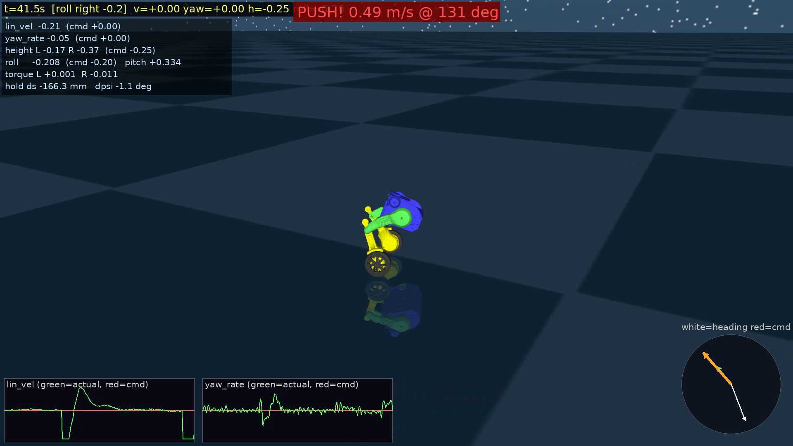
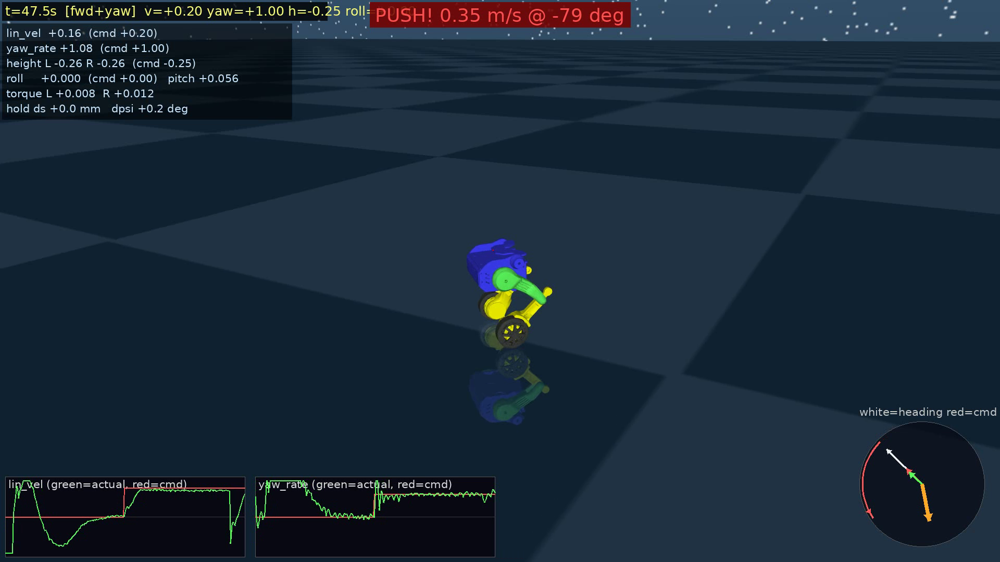
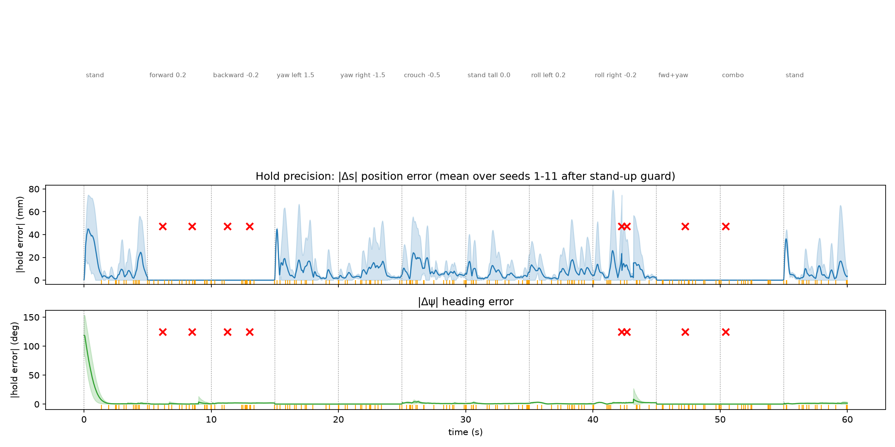
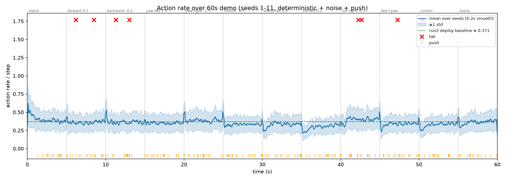
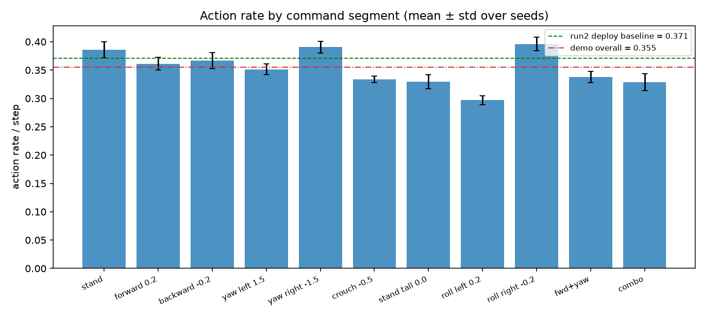
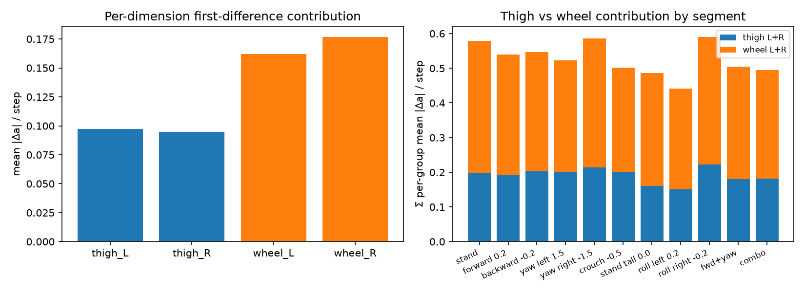
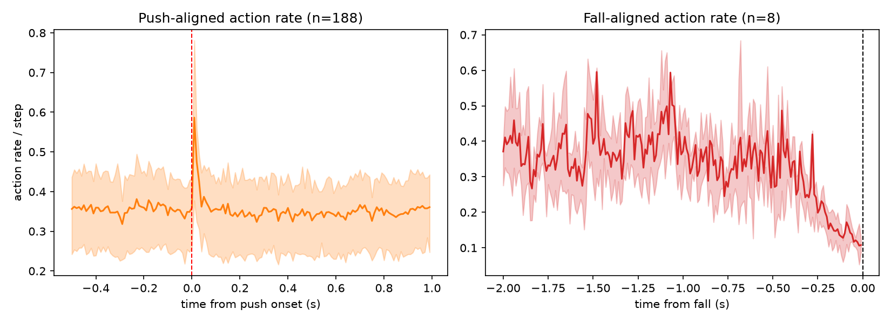
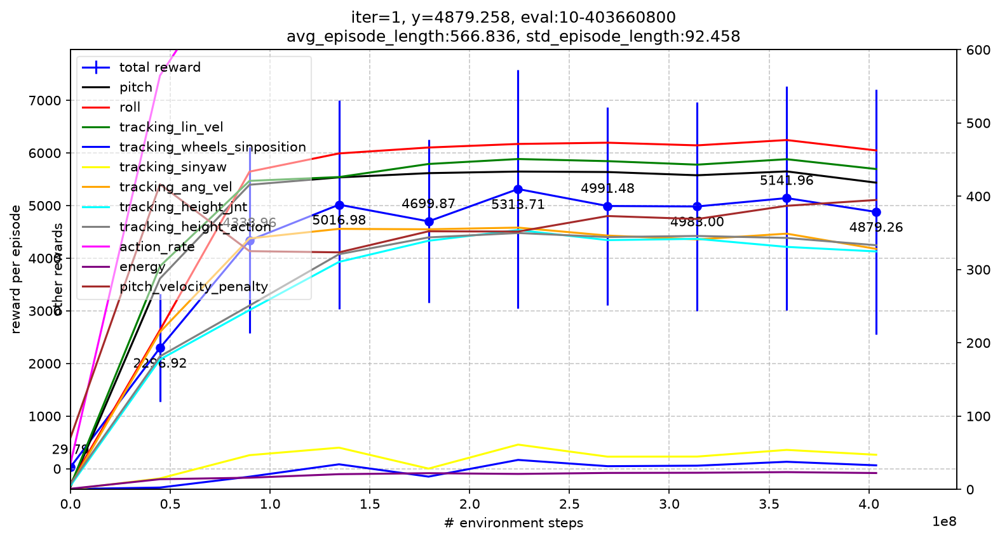

# 新方案(hold-position-heading 双锚点)60s 部署演示测试报告

日期:2026-09-01
模型:`ckpts/newobs-norecovery/000403660800`(新 obs/锚点语义 + hold_recovery 关闭,从零 4e8 步;消融验证冠军,见 `docs/hold_recovery_first_training_report.md` §6)
录制工具:`tools/record_baseline_demo.py`(--ckpt/--out/--tag 参数化;遥测面板新增停车保持误差行,新语义:共模 Δs / Δψ)
对照:`docs/baseline_demo_test_report.md`(run1 baseline,旧语义)

## 1. 测试目的

用新方案策略在 **deploy 口径**(deterministic 策略 + 观测噪声 + 随机推力扰动)下录制 60 秒连续演示视频,覆盖全部操控维度(前后移动、转向、蹲起、侧倾及组合),检验:
1. 持续扰动下的稳定性与自愈能力(与 baseline 同口径对比);
2. **停车保持精度**——新方案核心卖点:零速度指令窗口内位置锚点 Δs、朝向锚点 Δψ 的保持与推力后恢复(baseline 报告无此节;旧机制在此口径下"误差 5~9 rad 机制性不收",见 `docs/stand_tall_extend_issue.md`)。

## 2. 测试设置

| 项目 | 设置 |
|---|---|
| 策略模式 | deterministic(与端侧部署一致) |
| 观测噪声 | 开(与训练一致) |
| 随机推力 | 开,速度脉冲 0~0.5 m/s,随机方向,约每 2~4s 一次 |
| 域随机化 | 关(纯演示,地面参数固定) |
| 时长 | 60s/段,50 fps |
| 段数 | 11 段,seed 1~11 |
| 分辨率 | 1920x1080(首段实测单段 ~2.5 min,可接受,11 段全 1080p) |

60 秒内按 5s 一段编排 12 段命令 `[vx, yaw_rate, height, roll]`,**与 baseline 报告 §2 完全一致**:

| 时间 | 命令 | 值 |
|---|---|---|
| 0-5s | 站立 | [0, 0, -0.25, 0] |
| 5-10s | 前进 | [0.2, 0, -0.25, 0] |
| 10-15s | 后退 | [-0.2, 0, -0.25, 0] |
| 15-20s | 左转 | [0, 1.5, -0.25, 0] |
| 20-25s | 右转 | [0, -1.5, -0.25, 0] |
| 25-30s | 蹲伏 | [0, 0, -0.5, 0] |
| 30-35s | 站高 | [0, 0, 0, 0] |
| 35-40s | 左倾 | [0, 0, -0.25, 0.2] |
| 40-45s | 右倾 | [0, 0, -0.25, -0.2] |
| 45-50s | 前进+转向 | [0.2, 1.0, -0.25, 0] |
| 50-55s | 组合 | [0.15, -1.0, -0.4, 0.15] |
| 55-60s | 站立 | [0, 0, -0.25, 0] |

## 3. 视频内可视化

- **左上遥测面板**:lin_vel / yaw_rate / 左右腿高 / roll / pitch / 左右轮扭矩(实测 vs 命令),新增 **`hold ds` / `dpsi` 行**(停车保持误差:共模 Δs 换算 mm、Δψ 换算 deg,新语义锚点;旧语义的左右轮相位锚点误差概念已弃用,不在面板出现)
- **底部滚动曲线**:lin_vel 与 yaw_rate 近 5s 跟踪曲线(绿=实测,红=命令)
- **右下罗盘箭头**:白=heading,红=cmd vel 方向,绿=实际 vel 方向,橙=push 方向(闪现 1s),红弧=cmd yaw
- **顶部状态栏**:当前命令名与数值;被推时红字 `PUSH! x.xx m/s @ xxx deg` 闪现





## 4. 结果汇总(11 段,共 191 次推力)

| 段 | seed | 推力次数 | 摔倒次数 | 摔倒时刻 |
|---|---|---|---|---|
| s01 | 1 | 16 | 2 | 42.3s, 42.7s |
| s02 | 2 | 24 | 0 | - |
| s03 | 3 | 13 | 1 | 47.3s |
| s04 | 4 | 14 | 0 | - |
| s05 | 5 | 16 | 2 | 8.5s, 11.3s |
| s06 | 6 | 23 | 0 | - |
| s07 | 7 | 13 | 0 | - |
| s08 | 8 | 19 | 1 | 6.2s |
| s09 | 9 | 17 | 1 | 50.5s |
| s10 | 10 | 13 | 0 | - |
| s11 | 11 | 23 | 1 | 13.0s |
| **合计** | | **191** | **8** | 6/11 段全程无摔倒 |

单次推力最大 0.50 m/s,多数在 0.2~0.45 m/s。action rate 复刻 rollout(同 seed 逐事件)**11/11 段与录像完全一致**(baseline 为 10/11,s06 曾有 GPU 浮点分叉)。

与 baseline 对比:

| | baseline(旧语义) | 本 ckpt(新语义) |
|---|---|---|
| 推力总数 / 摔倒总数 | 203 / 7 | 191 / 8 |
| 每段平均推力 / 摔倒 | 18.5 / 0.64 | 17.4 / 0.73 |
| 无摔倒段 | 6/11 | 6/11 |
| 摔倒画像 | 全部"推力×机动"叠加 | 全部"推力×机动"叠加(见 §5) |
| action rate 均值 | 0.388/步 | **0.355/步** |

## 5. 摔倒案例分析

8 次摔倒全部发生在 **推力 + 机动命令叠加** 的时刻(摔倒前 0.4~1.1s 内必有 ≥0.35 m/s 推力),单纯站立/转向阶段的推力从未导致摔倒:

| 摔倒 | 所处命令段 | 直接诱因 |
|---|---|---|
| s01 42.3s | 右倾 roll -0.2 | 41.2s 侧向推力 0.49 m/s @131°,侧倾+侧推叠加失稳 |
| s01 42.7s | 右倾 roll -0.2 | 上次摔倒 reset 后 0.4s 未回稳,同一推力余波 |
| s03 47.3s | 前进+转向 | 47.0s 推力 0.45 m/s @31°,移动+转向叠加 |
| s05 8.5s | 前进 0.2 | 8.0s 前向推力 0.39 m/s @23° 叠加前进步态 |
| s05 11.3s | 后退 -0.2 | 10.9s 侧后推力 0.43 m/s @144° 叠加后退 |
| s08 6.2s | 前进 0.2 | 5.8s 前向推力 0.44 m/s @25° 叠加前进 |
| s09 50.5s | 组合(蹲+转+移) | 50.1s 推力 0.43 m/s @-152°,组合姿态裕度小 |
| s11 13.0s | 后退 -0.2 | 12.4s 后向推力 0.35 m/s @-177° 叠加后退 |

关键观察:

- 摔倒画像与 baseline 完全一致(侧倾/移动/组合 + 推力),且 **s05 8.5s、s08 6.2s、s11 ~13s 与 baseline 同 seed 同时刻摔倒**——这些"推力×机动"临界点对新旧策略同样苛刻,属工况固有难度,非新语义引入的失稳。
- 摔倒后脚本自动 reset 继续演示(与 baseline 录制同机制),后续推力正常响应。
- 纯站立与纯转向阶段 11 段零摔倒,与 baseline 相同。

## 6. 停车保持精度(新增章节)

口径:Δs = 共模轮角误差 × wheel_radius 换算 mm(位置);Δψ = 朝向锚点误差换算 deg(由 sinyaw 锚点反解)。数据来自 `tools/analyze_demo_action_rate.py` 复刻 rollout(11/11 与录像一致),摔倒 reset 后 0.5s 剔除。图:`docs/images/holdpos_demo_hold_timeline.png`。

### 6.1 站立段与停车后

| 窗口 | |Δs| 均值 / p95 | |Δψ| 均值 / p95 |
|---|---|---|
| 0-5s 站立(含随机站起瞬态) | 10.1 / 59.3 mm | 6.49 / 36.53 deg |
| 55-60s 站立 | **7.1 / 33.1 mm** | **1.41 / 3.12 deg** |
| 停车后 2s(combo→stand 过渡) | 8.3 / 33.1 mm | 1.15 / 2.45 deg |

- 0-5s 窗口的大分位数来自**随机初始化站起**:锚点取 reset 时刻(倒地/倾斜姿态)的 s/ψ,站起过程中轮与机身航向相对锚点偏离;时间线图可见 Δψ 从 ~150° 在 **~1s 内收敛到 <5°**,Δs 收敛到 <10mm——这正是新锚点机制的设计行为,无需"先走一遍刷锚点"。
- 55-60s 站立与"停车后 2s"几乎同水位:走/转结束进入停车后位置/朝向立即重新锚定并稳住,无爬升漂移。

### 6.2 零速度指令段分解

| 命令段 | |Δs| 均值 / p95 | |Δψ| 均值 / p95 |
|---|---|---|---|
| stand | 7.1 / 33.1 mm | 1.41 / 3.12 deg |
| crouch -0.5 | 9.2 / 36.8 mm | 1.85 / 4.35 deg |
| stand tall 0.0 | 5.3 / 22.8 mm | 1.15 / 2.09 deg |
| roll left 0.2 | 7.1 / 39.6 mm | 1.15 / 3.31 deg |
| roll right -0.2 | 8.4 / 36.9 mm | 2.57 / 3.58 deg |

蹲伏/侧倾机动期间位置误差仅 ~9mm 量级——机动本身不污染位置锚点(与 `tools/analyze_hold_causality.py` E2 结论一致)。

### 6.3 推力后恢复(零指令窗口内推力,n=90)

| 量 | 推后峰值 | 2s 后残值 |
|---|---|---|
| Δs | 43.5 mm | **1.9 mm** |
| Δψ | 3.39 deg | **1.15 deg** |

被 0~0.5 m/s 随机推力撞离原位后,策略主动回到锚点:2s 内位置残差 <2mm、朝向残差 ~1°。这是旧机制(左右轮相位锚点误差 5~9 rad ≈ 98~176mm **机制性不收敛**,必须先走一段刷新锚点)做不到的行为,是本方案的核心收益。



## 7. Action rate 分析

口径与 baseline 报告 §6 完全一致:`rate/步 = mean(|Δa|) + mean(|Δ²a|)`,作用于策略原始 4 维归一化输出;reset 后 0.5s 差分剔除。数据为复刻 rollout(11/11 与录像一致)。

### 7.1 总体水平:无异常,略优于 baseline

| 指标 | 本 ckpt | baseline demo | 判读 |
|---|---|---|---|
| 全程均值 | **0.355/步**(c1 0.133 + c2 0.223) | 0.388/步 | 比 baseline 低 8.5%;亦低于 run2 评测参考 0.371 |
| 逐 seed 范围 | 0.347 ~ 0.361 | 0.359 ~ 0.445 | 离散极小;baseline 的高端来自摔倒段挣扎,本批无此现象 |
| 动作饱和度 | \|a\|>0.95 占比 0.13% | < 0.6% | 无持续打满/饱和抖动 |

### 7.2 60s 时间线



- 稳态平台 0.30~0.40,11 段 seed 的 std 带始终不发散;
- 每 5s 命令阶跃处瞬时尖峰(<0.5s 回落),是对命令切换的正常响应;
- 推力(底部橙刻度)密布全程,曲线不随推力累积漂移;
- 开局 ~0.5s 有一次站起瞬态(0.7 量级),随即落到平台。

### 7.3 按命令段分解

| 命令段 | rate/步 | | 命令段 | rate/步 |
|---|---|---|---|---|
| yaw right -1.5 | 0.390 ± 0.010 | | backward -0.2 | 0.367 ± 0.014 |
| stand | 0.386 ± 0.014 | | forward 0.2 | 0.361 ± 0.011 |
| roll right -0.2 | 0.396 ± 0.012 | | yaw left 1.5 | 0.351 ± 0.009 |
| fwd+yaw | 0.338 ± 0.010 | | crouch -0.5 | 0.334 ± 0.006 |
| combo | 0.329 ± 0.015 | | stand tall 0.0 | 0.329 ± 0.012 |
| roll left 0.2 | 0.297 ± 0.008 | | | |



- 各段方差都很小(±0.006~0.015,baseline 最大 ±0.155):本批摔倒后 reset 干脆,无 baseline 那种摔倒前长挣扎窗口拉高方差;
- 段位排序与 baseline 不同但幅度差异小(0.30~0.40),无结构性异常。

### 7.4 动作维度分解



- 轮两维贡献一阶差分的 ~64%(wheel_L 0.162 + wheel_R 0.177,thigh 0.097 + 0.095),与 baseline 的 ~63% 一致:轮是力矩环、承担平衡主任务,天然高频;
- 左右轻微不对称(R 比 L 大 ~9%)与编排中不对称组合段一致,非异常。

### 7.5 事件对齐:推力响应与摔倒前兆



- **push 对齐(n=188)**:推力瞬间小幅上冲至 ~0.44(+24%),约 0.1s 内回到平台,无振荡尾;
- **fall 对齐(n=8)**:摔前 1~2s 均值 ~0.38(高于平台 +7%),但摔前 ~0.3s 内动作塌缩(机身已过倾覆点);幅度有限,不能单独作摔倒预测器。样本小(n=8,含 2 次双摔),仅供参考。

### 7.6 小结

总量(0.355)低于 baseline demo(0.388)与 run2 评测参考(0.371),无饱和、无持续振荡、推力响应快速阻尼;摔倒画像与 action rate 无关,剩余风险点仍是"机动×推力"叠加工况(与 baseline 相同)。

## 8. 结论

新方案(hold-position-heading 双锚点)策略 `newobs-norecovery/000403660800` 在 deploy 口径 60s 连续演示中:

- **全命令维度可执行**(移速/转向/蹲起/侧倾/组合),跟踪曲线贴合命令;191 次随机推力下摔 8 次(与 baseline 203 推/7 摔同水位),全部"推力×机动"叠加,3 次与 baseline 同 seed 同时刻——工况固有难度,非策略缺陷;
- **停车保持(核心卖点)成立**:随机站起后 Δψ ~1s 收敛;站立段 |Δs| 7.1mm / |Δψ| 1.41°;推力撞离后 2s 内位置残差 1.9mm、朝向残差 1.15°——旧机制"误差 5~9 rad 机制性不收"的场景被彻底解决;
- **action rate 0.355/步**,略优于 baseline(0.388),无异常。

## 9. 产物与复现

产物(gitignored,本地路径):

```
test/hold_position_heading_demo_60s/
├── 1080p_viz/    # 11 段 1080p 带完整可视化(holdpos_demo_60s_sNN_1080p.mp4)
│                 # + falls_sNN_1080p.txt 逐次推力/摔倒记录 + schedule.txt
└── action_rate/  # action_rate_sNN.npz 逐步动作/推力/摔倒/Δs/Δψ 原始数据
```

复现(换 seed / ckpt / 分辨率):

```bash
MUJOCO_GL=egl .venv/bin/python tools/record_baseline_demo.py \
    --ckpt ckpts/newobs-norecovery/000403660800 \
    --out test/hold_position_heading_demo_60s/1080p_viz --tag holdpos_demo_60s \
    --seed 1 --width 1920 --height 1080 --duration 60
```

action rate + 停车保持采集与出图(断点续采,已有 npz 的 seed 自动跳过):

```bash
.venv/bin/python tools/analyze_demo_action_rate.py \
    --ckpt ckpts/newobs-norecovery/000403660800 \
    --out test/hold_position_heading_demo_60s --tag holdpos_demo
```

## 10. 附:训练过程 reward 曲线



来源:训练回调 `legwheel/training/progress.py` 在每次评估时自动绘制并保存到 ckpt 目录(原图 `ckpts/newobs-norecovery/progress_1.png`,本图为拷贝)。横轴为环境步数,每 ~4.5e7 步评估一次共 10 次;左轴蓝线为 total reward(errorbar 为评估 reward 的 episode 间 std),右轴为各分项奖励。

- **收敛形态**:0.45e8 步时 2297 → 1.35e8 步达 5017,之后进入 4700~5300 平台波动,峰值 5313.71 @ 2.24e8 步,最终 4879.26 @ 4.04e8 步;
- **episode 长度**:末次评估 avg_episode_length 566.8/600(std 92.5),绝大多数回合跑满;
- **分项**:roll / tracking_lin_vel / tracking_height 等主项全程贴顶无塌缩;停车保持两项(tracking_wheels_sinposition、tracking_sinyaw)数值量级小,全程稳定;
- **口径注意**:训练内 eval reward(4879)与 batch_test return(6263)统计口径不同(初始化分布、推力、噪声与统计窗口均不同),数值不可直接互比,曲线仅用于判断训练收敛趋势。

## 11. 与 baseline 报告的口径差异说明

- 除 ckpt 与输出目录外,录制/统计代码完全复用(`--ckpt/--out/--tag` 参数化,默认值不变);命令编排、推力配置、摔倒定义(env done)、action rate 口径逐行一致;
- 新增遥测行(hold ds/dpsi)与 §6 章节为旧面板/旧报告所无,属增量;不影响任何既有口径;
- 本批 action rate 复刻 11/11 段与录像逐事件一致(baseline 批为 10/11)。
