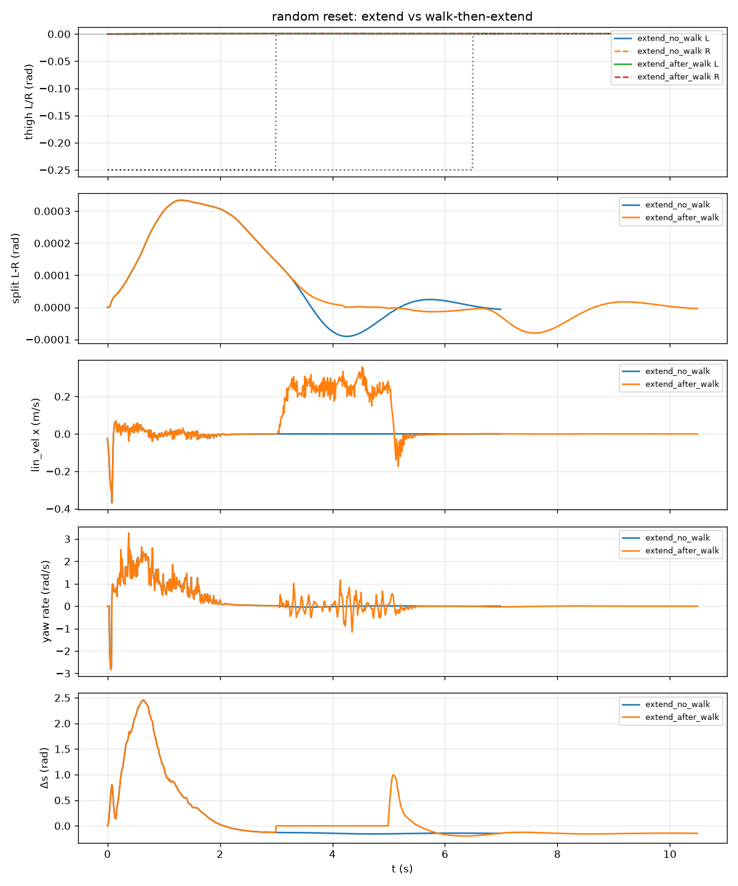
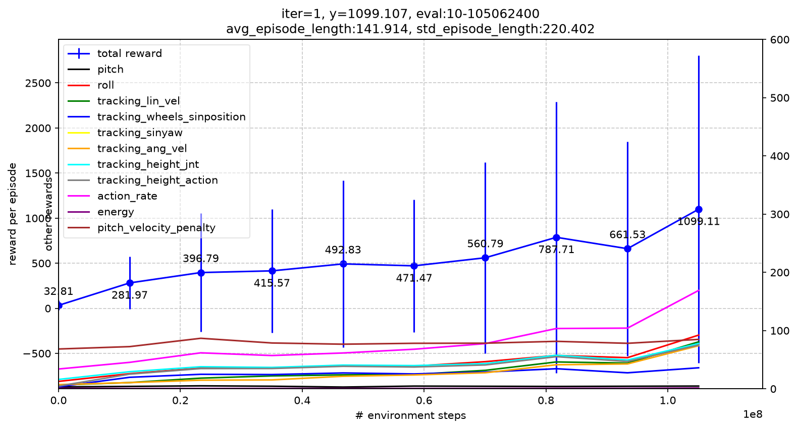
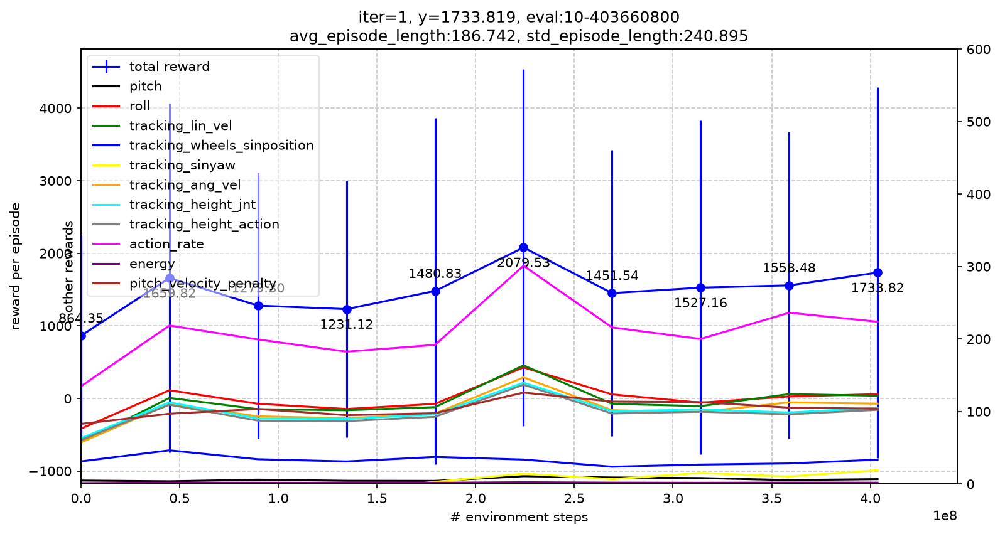

# 停车保持新方案:首次训练(step1/step2)与 baseline 效果对比

日期:2026-09-01(**同日订正**:2.1 节原 repro 结论因工具 bug 作废并重测,新增第 3 节策略退化分析,结论改写)  
方案:`docs/hold_position_heading.md`(位置/朝向双锚点)+ `docs/hold_recovery_training.md`(恢复训练)  
被对比方:run1 baseline(旧方案,`tuning/run1/trials/confirm-baseline-s0/ckpt/000408576000`,4e8 步)

## 1. 训练设置

| 项 | step1 | step2 |
|---|---|---|
| ckpt | `ckpts/holdrec-step1/000105062400` | `ckpts/holdrec-step2/000403660800` |
| 步数 | 1.05e8(全新) | 从 step1 restore 再训 4e8(累计 ≈5.05e8) |
| 配置 | `--override hold_recovery.enable=true`,其余全部默认(lr 1e-4) | 同左 |
| 硬件/耗时 | RTX 4090 单卡,20 min | 同左,71 min |

注意:brax `restore_checkpoint_path` 恢复策略参数但**步数计数从 0 重启**(checkpoint 目录名从 000044851200 重新计),`--maxstep 4e8` 因此是"再训 4e8"而非"训到 4e8"。

训练前已做设计与代码一致性审计(8 条设计点 7 条一致),并修补:补"IMU 航向变化只增 Δψ"单测、训练入口对误开 `hold_error_clip` 加硬防护、`wheel_per_wheel` 标注废弃。

## 2. 结果总览

### 2.1 停车保持 repro(随机站起 → 蹲稳 → 伸直,`tools/repro_stand_tall.py`)

**⚠ 2026-09-01 订正:本节原数据与"完胜"结论作废,以下为修复工具后的重测。**
旧版 `tools/repro_stand_tall.py` 的 rollout **没有 done 检查**:机器人摔倒后继续仿真,躺平姿态(sinpitch 回 ~0、vx/wz/漂移/锚点误差全部 ≈0)产生了"假完美"数据。原表中 step2 的 lin_vel≈0、yaw_rate≈0、xy 漂移 0.0001 m、锚点误差小等,实为 **seed 0 在 0.10s(step 11)摔倒后的躺平轨迹**(thigh 全程 ≈0,也从未蹲到 -0.25)。修复版工具在 done 时中断、只统计存活段,并新增 thigh 实际值 vs cmd_h 的跟踪统计。

重测(noise=0、push=0、cmd_prob=0、deterministic,修复版工具):

| 场景 | 结果 |
|---|---|
| step2 random reset(seed 0~7,settle 3s@-0.25 → 伸直 4s) | **3/8 起步摔倒(0.10s / 0.20s / 0.17s);5/8 存活但全部进入同一"后仰坐地冻结"姿态**:末段 sinpitch=-0.581、mean_h=+0.0005、z=0.0695(站姿 z=0.090),**无一蹲到 cmd -0.25** |
| step2 规范站姿 reset(random=False),同两 case | 全程存活,但 thigh 钉在 ≈0(全伸),|mean_h−cmd_h|=0.2505,**不响应蹲姿指令**;位置/朝向保持本身优异(停车段 vx≈0、xy 漂移 0.0001 m、syn_err −0.009);fwd_0.2 段能走(0.258 m/s)且能停稳 |
| 旧方案对照(base2-s0@1.15e8,`/tmp/lw_base` 旧代码+done 检查,run1 baseline ckpt 已不在本地) | 能站起并下蹲(settle 段 mean_h −0.38),但伸直段复现"跑动+左右腿不等长":lin_vel +0.18 m/s、yaw_rate 尖峰 ±4、split −0.336、轮锚点误差 ±7.5 rad 不收,6.71s 摔倒——旧症状真实存在(与 `docs/stand_tall_extend_issue.md` 一致),且为存活段实测,非躺平假数据 |

解读:新方案锚点在"能站住"时确实锁得住位置/朝向(规范站姿下漂移≈0);但 step2 策略本身已退化(见第 3 节),"随机站起 → 蹲稳 → 伸直"全流程**没有任何一个 seed 完整走通**(要么起步摔倒,要么冻结不蹲)。

(上图亦为旧工具产出,曲线后段可能含摔倒后轨迹,仅供参考。)

### 2.2 batch_test 成功率(4096 envs,推力开,base_seed 42)

| | baseline-s0(旧,4e8) | step1(新,1e8) | step2(新,5e8) | newobs-norecovery(新,无 hold_recovery,4e8,见 §6) |
|---|---|---|---|---|
| 成功率 | **94.82%** | 36.4% | 87.9% | **95.02%** |
| 干净协议(规范初始化+无推力) | — | 35.7% | 87.7% | — |
| 平均失败步 | 342(中后期,推力所致) | 33 | 20(起步瞬态) | 325(中后期,全 pitch) |
| 平均 return | 6265 | ~1390 | ~3870(口径不同,见 2.4) | **6262.9** |

baseline 数据来源:`docs/tuning_run1_results.md` 批量回放表(4096 envs、随机推力开、base_seed 42,同协议)。

**失败画像差异**:baseline 死在"跑了一段被推力掀翻"(平均 342 步);新方案剩余 ~12% 失败几乎全部死在**起步 0.1~0.2 秒**——batch_test 在 reset 时(t=0)即采样随机指令(`env.py:273-276`),撞上训练 `cmd_start_delay_s=1.5` 零指令保护窗的分布外。两种协议(随机初始化+推力 vs 规范初始化+无推力)成功率几乎相同(87.9% vs 87.7%),说明残余失败与推力/初始化无关,集中在起步指令缝隙。

**⚠ 2026-09-01 补充**:成功率本身为真存活(done 判定),但"存活"中包含第 3 节所述的**后仰坐地冻结姿态**——活着不等于在执行任务;3873 的 return 里相当部分 zero_keep/roll 由冻结姿态贡献。

### 2.3 训练曲线

step1(1e8):reward 32 → 1099,末段仍在陡升,未收敛。
step2(累计 5e8):reward → 1734,后半段在 1500~2000 间震荡;训练自有评估协议(含随机初始化+注入+推力,比 batch_test 苛刻)存活 187/600。

### 2.4 口径差异(避免误读)

- baseline 的 94.82% 测于 run1 时代,当时 batch_test 大概率无随机初始化(随机站起恰是旧方案死穴);同协议对上它只会更难看。
- 平均 return 不可直接比:reward 语义中间改过两轮(height 可行域投影、hold 线性代价),分母不同。
- baseline repro 数据为旧观测语义代码下测得(其 ckpt 与新语义不兼容,无法用现代码复测)。

## 3. 策略退化分析(2026-09-01 新增)

数据源:`tools/analyze_holdrec_reward.py` 三口径实测(ckpt `holdrec-step2/000403660800`,deterministic;复跑命令见脚本 docstring)。

### 3.1 现象:后仰坐地冻结

干净环境(noise=0、push=0)下,无论规范站姿还是随机初始化,存活轨迹都收敛到同一姿态:**z 0.090→0.0695,sinpitch 钉在 −0.581(termination 阈值 −0.6 上方仅 0.019),thigh 停在 0(全伸),不响应 height/roll 指令,vx≈0 僵住不动**。规范站姿+零指令(=全伸指令)下 0.51s 确定性后仰摔倒(64/64 envs 同步,step 51)。repro 随机初始化 8 seeds:3 个起步摔倒,5 个全部进入该冻结姿态。

### 3.2 分项达成率(标准口径=batch_test 协议,512 envs,稳态窗口 step≥100,对照 run2 计划 5.1 表)

| 分项 | step2 | baseline(run1) | 判定 |
|---|---|---|---|
| tracking_lin_vel | 77.5% | 74.5% | 正常 |
| tracking_ang_vel | 75.9% | 57.0% | 反升 |
| tracking_sinyaw(朝向锚点) | 85.9% | 85.0% | 正常 |
| tracking_wheels_sinposition(位置锚点) | **74.4%** | 60.9% | **反升** |
| tracking_height_jnt / height_action | **29.1% / 29.2%** | 56.0% / 57.0% | 失血 |
| roll_cost | **49.1%** | 78.3% | 失血 |
| pitch_cost | 0.1% | 72.0% | 失血(权重 0,不进 reward) |

代码级审计(Δs 单位与 σ、门控死区与先后顺序、obs/reward 一致性、reset 锚点=t0、hold_recovery 线性代价/height_split 符号与量级)**未发现实现 bug**:obs 轮槽与 reward 的 Δs 逐 bit 相等,门控与指令死区严格对齐,线性代价为减号。新方案的两个锚点项不降反升;失血集中在本次重构未改动的 height/roll 通路(rewards.py diff 仅触及 hold 两项)。height 29% ≈"永远全伸"的理论地板(24.5%),即策略基本放弃了 height 跟踪。

### 3.3 成因:奖励经济学,而非实现 bug

- `pitch_scale=0`(`config.py:119`):后仰 35° 零代价,pitch_cost 不进 reward;
- `zero_keep_scale=10` 主导:门控窗口"不动"即可拿满 ~20/步,响应 height 指令(满权 4/步)的收益远小于"乱动丢 zero_keep+摔倒"的风险;
- hold_recovery 训练分布(随机初始化站起 + 1.5s 零指令 + 注入锁定零指令 150 步)进一步放大"别动"的时间占比与收益;
- termination 只查 sinpitch<−0.6(`env.py:561`),坐地姿态恰好"合法存活"。

### 3.4 对两个 reward 读数的修正

- 训练自有评估 1734 vs batch_test 3873:**协议差异,不是 bug**。`--mode trainproto --stochastic` 复测 1998(同量级):平均存活仅 ~200/600(随机初始化早夭+注入扰动)、门控激活占比 41%(vs batch_test 8.5%)且注入/站起偏移触发线性代价(sinyaw 达成 25%、可为负)、stochastic 动作惩罚(action_rate 1.22/步 vs det 0.34)。
- batch_test 3873 vs baseline 6265:**策略退化,不是 bug**。差值分解:roll ≈ −840、height 两项 ≈ −735、存活步数(531 vs 600)摊薄 ≈ −400、zero_keep ≈ −110;两个锚点项反而更好。

## 4. 结论(2026-09-01 改写,消融后终审)

- **锚点机制本身验证有效**:位置/朝向双锚点的两个分项达成率相对 baseline 反升(holdrec-step2:74% vs 61%、86% vs 85%;newobs-norecovery 复验:70.6%/88.4% 稳态),规范站姿下位置/朝向保持实测优异(漂移≈0);旧方案的轮相位锚点机制性失败(伸直即跑动、误差 ~7.5 rad 不收)依旧成立(base2 复测,存活段实测)。
- **freeze 根因已定位为 hold_recovery 训练协议,而非 obs/reward 新语义**(三重证据):
  1. E1 反事实四方格(`tools/analyze_hold_causality.py`):同一行为下新旧公式等分(±0.5%),总差距 99% 是行为性;
  2. E2 机动污染探针:蹲起/split/yaw 机动对 Δs/Δψ 的里程计污染 ≈0(轮关节角与轮世界滚转角一致),转向净 Δs≈0.3mm,"机动污染→惩罚机动"的机制链不存在;
  3. **判定性消融**:新 obs/锚点语义 + `hold_recovery.enable=false` 重训(`ckpts/newobs-norecovery/000403660800`,4e8)后 freeze 消失、全面恢复并略超 baseline(见第 6 节)。
- holdrec-step2 的"后仰坐地冻结"是 hold_recovery 训练分布(随机初始化站起 + 1.5s 零指令 + 注入锁定,门控占比 41%)下的生存吸引子,pitch 零权重 + termination 宽松使其免费。
- 下一步:~~按第 5 节修训练分布与姿态经济学后重训 hold_recovery 版本~~
  **(2026-09-01 更新:hold_recovery 已整体移除,第 5 节的重新设计条目作废,
  见 docs/hold_recovery_training.md 消亡史;newobs-norecovery 即为最终语义)**。

## 5. 遗留与下一步(2026-09-01 消融后更新)

根因已定位为**训练分布**(hold_recovery 协议),obs/reward 新语义**维持不变**。

> **2026-09-01 终态:hold_recovery 已整体移除,不再重新设计**——双锚点语义
> 不开 hold_recovery 即治好原病(§6),补丁既无必要又有大害。
> 原修复方向(下列 1~3 条)作废,详见 docs/hold_recovery_training.md(消亡史)。

原修复方向(作废,留档):

1. 训练分布混合:hold_recovery 训练中混入常规 episode(规范初始化、`cmd_start_delay_s=0.2s`、无注入),保住 height/roll 跟踪与起步响应;目标是在 newobs-norecovery 的健康策略上**增量**获得大误差恢复能力,而不是让恢复训练主导策略。
2. 姿态经济学:`pitch_scale` 给正权重(或 posture 项纳入 pitch),必要时收紧 termination(sinpitch 下限 −0.6 离坐地姿态太近)——消除"后仰坐地免费"这一吸引子,使 hold_recovery 分布不再收敛到冻结。
3. 注入触发率过低:实测仅 ~0.01~0.05 次/episode(注入要求"进入停车上升沿",6s episode 内零指令重采样稀少)——提高零指令重采样概率或放宽注入触发条件,否则注入通道练不到。
4. 工具与验收:`tools/repro_stand_tall.py` 已加 done 中断 + 存活/thigh 跟踪统计;`tools/analyze_hold_causality.py --mode e1report` 四方格可用于重训后回归验收。
5. 按 `hold_recovery_training.md` 第 4 节做 `hold_error_clip` 关闭对比,避免长期靠改期望掩盖跟踪。
6. viewer 实机口径过一遍(`newobs-norecovery` 可作为候选部署策略先行验证)。

## 6. 消融验证(newobs-norecovery,2026-09-01)

### 6.1 实验设计

判定性消融:**新 obs/锚点语义 + `hold_recovery.enable=false`,从零 4e8 步,其余全部默认**
(ckpt `ckpts/newobs-norecovery/000403660800`)。若 freeze 根因在新语义,该策略应同样
退化;若根因在 hold_recovery 训练协议,该策略应恢复健康。训练自有评估
avg_episode_length 已达 566.8/600(holdrec-step2 仅 187,base2 旧语义 ~540)——
训练协议死亡分布已先验提示差异。

### 6.2 分项达成率(标准口径=batch_test 协议,deterministic,512 envs,稳态窗口 step≥100)

| 分项 | baseline(run1) | holdrec-step2 | newobs-norecovery | 判定 |
|---|---|---|---|---|
| tracking_lin_vel | 74.5% | 77.5% | **85.3%** | 超 baseline |
| tracking_ang_vel | 57.0% | 75.9% | **85.1%** | 超 baseline |
| tracking_height_jnt | 56.0% | 29.1% | **70.5%** | **恢复并超 baseline** |
| tracking_height_action | 57.0% | 29.2% | **83.0%** | **恢复并超 baseline** |
| roll_cost | 78.3% | 49.1% | **89.1%** | **恢复并超 baseline** |
| tracking_wheels_sinposition(位置锚点) | 60.9% | 74.4% | 70.6% | 保持(step2 的 74% 系冻结虚高) |
| tracking_sinyaw(朝向锚点) | 85.0% | 85.9% | 88.4% | 保持 |
| pitch_cost(诊断项,权重 0) | 72.0% | 0.1% | **87.9%** | 后仰消失,姿态直立 |

全程 return(加权):**6160**(holdrec-step2 为 3705);存活 95.3%(step2 为 88.1%)。

### 6.3 行为探针(规范初始化,noise=0,push=0,deterministic)

- **height 阶跃 0→−0.5→0**:thigh 全程跟踪至 −0.495 再回 +0.001(摆率 ~0.2 rad/s,满幅约 2.5s),姿态直立(sinpitch≈0)、全程存活——holdrec-step2 是"thigh 钉 0、不响应、强制蹲起即摔";
- **roll 阶跃 ±0.2**:sinroll 跟踪至 ±0.17~0.21,thigh split 方向正确;
- **repro(修复版,随机站起→蹲稳→伸直)**:random reset **8/8 seeds 全部存活 700 步**,规范初始化同样存活;settle 段末 1s mean_h −0.222(cmd −0.25,误差 0.028),伸直段 vx +0.0002、xy 漂移 0.0002 m、sinpitch +0.071(直立)——holdrec-step2 同场景 3/8 起步摔倒、5/8 冻结不蹲。

### 6.4 batch_test(4096 envs,推力开,base_seed 42,绝对路径 ckpt)

| ckpt | 语义/协议 | 成功率 | 平均 return | 平均失败步 |
|---|---|---|---|---|
| baseline-s0(run1,4e8) | 旧 | 94.82% | 6265 | 342(中后期,推力) |
| base2-s0(1.15e8,参考) | 旧 | 91%(本工具 512 envs) | 5644 | — |
| holdrec-step2(5e8) | 新 + hold_recovery | 87.9% | ~3873 | 20(起步瞬态) |
| **newobs-norecovery(4e8)** | 新,无 hold_recovery | **95.02%** | **6262.9** | 325(中后期,全 pitch) |

### 6.5 消融结论

freeze 根因**坐实在 hold_recovery 训练协议**:同一套新 obs/锚点/reward 语义,关掉
hold_recovery 从零重训后,策略直立、响应 height/roll 指令、成功率与 return 全面恢复
并略超 baseline(95.02% vs 94.82%、6262.9 vs 6265),失败画像从"起步瞬态"恢复为
baseline 型"中后期推力所致"。obs/reward 新语义无罪且可产出 ≥baseline 的策略;
hold_recovery 的注入/锁定/随机初始化分布~~需按第 5.1~5.3 条改造后再启用~~
**已随本提交整体移除,不再启用;配置键 `hold_recovery.*` 不再存在,
旧 override 会报"未知配置路径"(见 docs/hold_recovery_training.md 消亡史)**。
