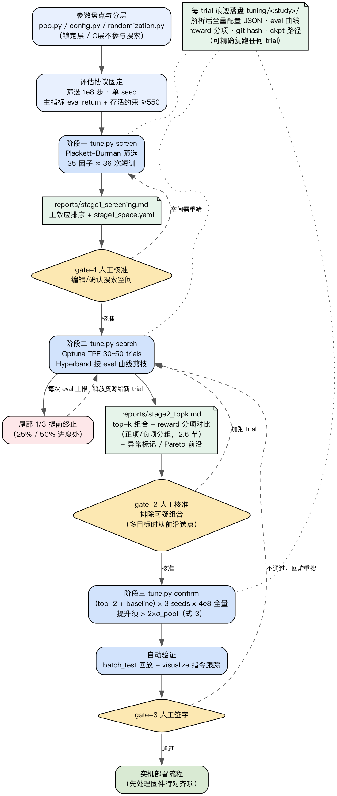
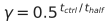
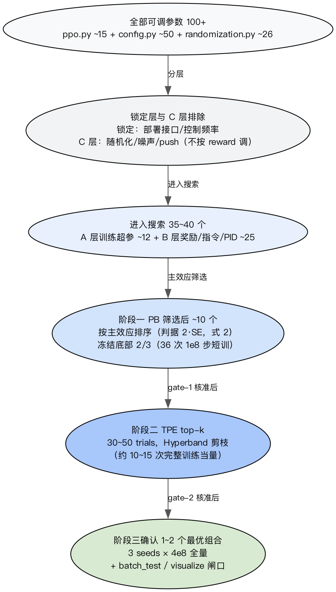
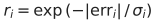
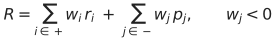
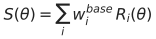
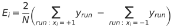
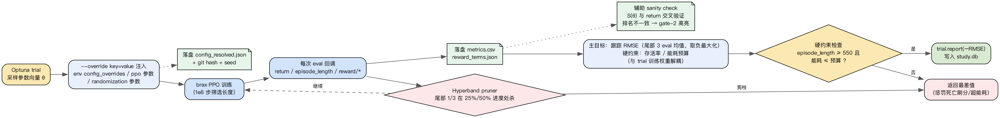

# 参数调优方案：以 reward 为目标的参数组合搜索

日期：2026-08-25（修订：补全三文件参数盘点 + 自动化/留痕 + reward 符号结构 + 图表/伪代码/公式版）
修订 2026-08-26：①筛选前增加噪声底估计协议；②物理指标升为主目标、固定评估分 S(θ) 降为 sanity check；③剪枝 rung 加密（num_evals 40~60）并澄清为 ASHA 语义；④PB 设计勘误（35 因子 N=36 非 40）；⑤组级筛选混杂风险明示；⑥新增编译缓存复用改造项；⑦预算按实测 95k sps 重算。
修订 2026-08-26（二轮，评审后修订）：⑧噪声底判据改用标准误 SE(E_i)=2σ_noise/√N（原 2σ_noise 阈值约偏严 6 倍）；⑨主目标定为跟踪 RMSE 单目标 + 存活/能耗硬约束，去掉未定权重的 combine()；⑩工程改造新增分项反解一致性验收；⑪图与标题同步勘误（40→36、trial 数据流图主目标改为物理指标）。
修订 2026-08-26（三轮）：⑫确认阶段统计判据同步改 2×SE（与筛选阶段一致，原 1×σ_pool 仅约 68% 置信）；⑬PB 两水平按层取值（A 层 ±0.5 dex、B 层 ±50%，与各自搜索范围一致）；⑭噪声底 n=3 的 σ 估计本身粗糙（相对误差 ~50%），建议 4~5 次或极差法，阈值仅作 gate-1 分档指引；⑮RMSE 优先由 env metrics 直接累加 err² 求得（EvalWrapper 逐 episode 累计 state.metrics），反解作后备；⑯新增第 6.5 节：搜索程序的隔离实现设计（不影响现有训练程序）。
修订 2026-08-26（四轮，评审后修订）：⑰确认阶段补入 baseline ×3 全量对照组（原漏算，统计判定需要同长度对照），预算 7e9→9.3e9 步（~20h→~27h）；⑱筛选 y 指标闭环（y=尾部 3 eval RMSE 均值；死亡/发散 run 记 WORST 常量；剪枝 rung 处用已累计 eval 均值）；⑲σ_noise 明确为主指标跨 seed 波动；⑳第 5 节残留条件句与第 8 节措辞同步；㉑能耗约束注明是速度代理量而非真实功耗。
修订 2026-08-26（五轮）：㉒主指标 RMSE 补全归一化合成定义（lin_vel / ang_vel 误差分别除以各自指令量程 0.2 / 1.5 再合成，否则角速度主导 7.5 倍；WORST 上界 = √2）；㉓修复 objective 方向不一致的真 bug（study 统一 direction=minimize、report 与返回值都用 RMSE，原"report RMSE + 返回 -RMSE(maximize)"会让剪枝器把好 trial 剪掉）；㉔第 2 节指标聚合行与第 4 节 rung 累计均值同步；㉕2.6 数据来源句与工程改造 #7（env 直累加优先）同步；㉖6.5.4 明确 pid 标记文件为实现项。
修订 2026-08-26（六轮，源码核对后）：㉗键名勘误：brax 0.14.2 实际输出 `eval/episode_reward`（已由训练日志证实），文档原写 `eval/avg_episode_return` 不存在；㉘WORST 由 √2 改为哨兵值 10——归一化误差可超 1（指令 +0.2、实际 −0.2 时 err/v_max=2），√2 只是"双项恰好满量程"的参考点而非可达上界，死亡 run 记 √2 可能反而排在"活着但反着跑"的 run 前面；㉙EvalWrapper 累计机制精确化（逐 episode **求和** + acting.py 对 env 维取均值，RMSE = sqrt(mean(err²_sum)/avg_episode_length)，工程 #7 补验收细节）；㉚伪代码终值下标 `[-1]` 清理与目录命名统一（tuning/&lt;study&gt;/trials/）。
修订 2026-08-26（七轮，公式方向与量化核查）：㉛第 5 节统计判据公式换向勘误——原 Δ = S_c − S_base 与"RMSE 越低越好"矛盾（那是在挑更差的组合），改为 Δ = S_base − S_c，f_delta.svg 重新渲染；㉜"eval 开销很小"改为实测量化（每次 eval 76.8k 环境步、稳态 ~8 s，48 次 ≈ 训练时间的 1/3）；㉝B 层因子清单与 2.6 规则 2 同步（锚定项 vel_scale 不进搜索）；㉞PB 同 seed = CRN 注记（SE 判据偏保守，方向安全）。
修订 2026-08-26（八轮，盘点核验 + 架构一致）：㉟第 0 节参数盘点表逐项对照分支代码核验（config.py / ppo.py / randomization.py 的"当前生效值"全部一致，含 vel_pid kp=0.0002、v_max=0.2、ω_max=1.5 等归一化依据）；㊱第 4 节伪代码补"落地形态"：与 6.5.3 子进程隔离统一——on_eval 在 worker 内写 metrics.csv，父进程轮询调 trial.report/should_prune、剪枝时向 worker 发 SIGTERM（原伪代码把 trial 对象画在训练进程内，子进程下调不到）；㊲TPE n_startup_trials 默认 10 在 30~50 预算下占比偏高，建议 5~8。
修订 2026-08-26（九轮）：㊳6.5.4 GPU 闸门补反向保护——原设计单向（tune 避让训练、训练不避让 tune），tune 运行期发起正式训练会双份预分配 OOM，train.sh 需同样检查 gpu.lock；㊴2.5"疑似仿真漏洞"标记注明适用对象为 C 层鲁棒性消融 run（C 层不进搜索，该条件在调参 trial 里永不触发）。
修订 2026-08-26（十一轮，GPU 实测）：㊸目标机实测为 2× RTX PRO 6000（~96 GiB/卡），训练真实显存仅 ~4 GiB（XLA peak_in_use 1.74、peak_pool 3.0、nvidia-smi 3.9 GiB，0.85 预预留非真实消耗）；㊹brax 会把 batch 分片到所有可见设备，trial 必须 `CUDA_VISIBLE_DEVICES` 单独钉卡；㊺6.5.4 由"单卡互斥串行"改写为"双卡并行调度"（每卡 1 trial、`MEM_FRACTION=0.1`、按卡 flock），预算 wall time 约减半。
修订 2026-08-26（十二轮，实现落地）：㊻第 6 节工程改造全部完成——train.py `--override/--ppo-override/--seed`、ppo.py 参数化（`compute_discounting` 纯函数 + `train_ppo/curriculum_learning` 可选 `progress_fn/randomization_fn/ppo_overrides/env_cfg/seed`，默认行为零变化）、randomization.py 提为 `default_randomization_config()` + 可注入 cfg、env 端 `track/err2_lin_vel|ang_vel` 直累加（数值口径已按工程 #7 验收：与单步手算逐位一致）；㊼最终因子清单定为 **29 个**（A 层 9 + B 层 20，注册表见 `legwheel/tuning/space.py`；剔除了代码中未被引用的死参数 base_scale/posture_scale 与恒 0 的 pitch_scale/action_bias.wheel）→ PB **N=32**，在预算表 36 的上限之内；㊽`scripts/tune.py`（baseline/screen/search/confirm 四子命令）+ `legwheel/tuning/`（space/metrics/resolve/scheduler/worker/report）全部实现并冒烟验证（2e6 步端到端 trial 成功，metrics.csv/result.json/config_resolved.json 留痕齐全，双卡调度 util 95%+）。
适用分支：`improvements/deploy-consistent`（同样适用于 `improvements/bugfix-cleanup`）

## 流程总览



图源：`docs/images/tuning_pipeline.dot`（graphviz，`dot -Tpng -Gdpi=150` 重新生成；SVG 版本为 `images/tuning_pipeline.svg`）。蓝色=自动执行阶段，黄色菱形=人工核准门，绿色=痕迹/报告，红色=剪枝。阶段间全部自动衔接，仅在三个人工核准门处暂停等人确认。

## 0. 参数盘点（先说清楚有多少东西可调）

可调参数分布在三个文件，合计 **100+ 个**。这一规模决定了方法选型：TPE 类贝叶斯优化在 50 次训练预算下只能有效处理 ~10 维，全量网格/OFAT（100+ 参数 × 2 点 = 200+ 次训练）也不可行——**必须先做筛选（screening）**。

### 0.1 `legwheel/training/ppo.py` — PPO/训练超参（约 15 个）

| 参数 | 当前生效值 | 建议搜索范围 | 尺度 | 备注 |
|---|---|---|---|---|
| learning_rate | 1e-4（基值 3e-4 被覆盖） | [3e-5, 3e-4] | log | CLI 已暴露 |
| entropy_cost | 1e-2 | [3e-3, 3e-2] | log | |
| half_life_s → discounting | 0.5 → γ≈0.9862 | [0.2, 1.5] s | log | 写死在 curriculum_learning，需提为参数；换算见式 (1) |
| reward_scaling | 0.1 | [0.03, 0.3] | log | 写死，需提为参数 |
| unroll_length | 75 | {50, 75, 100} | 离散 | |
| num_minibatches | 16 | {8, 16, 32} | 离散 | |
| num_updates_per_batch | 4 | {2, 4, 8} | 离散 | |
| batch_size / num_envs | 512 / 8192 | 固定 | — | 受显存约束，num_envs = batch×minibatches |
| max_grad_norm | 1.0 | 固定 | — | |
| policy 网络 | [64,64] | {[64,64], [128,128], [128,64]} | 离散 | 写死覆盖，需提为参数 |
| value 网络 | [512,512,512,512] | {[512,512], [512,512,512,512]} | 离散 | 同上 |
| normalize_observations | True | 固定 | — | 不建议动 |
| num_evals / maxstep | 10 / 4e8 | — | — | 属预算而非超参；**调参 run 用 num_evals 40~60**（加密剪枝 rung，见第 4 节） |
| seed | 0 | — | — | 属评估协议 |

其中 half_life_s 与 discounting 的换算（式 1）：



### 0.2 `legwheel/config.py` — 环境参数（约 50 个，按组）

- **时间/episode**：sim_dt=0.0025、ctrl_dt=0.010、episode_time=6.0、cmd_start_delay_s=0.2、action_delay_steps（本分支 0）、obs_history_len=1
- **vel_pid 组**（10 个）：kp=0.0002、ki=0、kd=0、iters=4、torque_limit=0.0295、integral_limit=1.0、direct_torque=False、target_scale=30、target_bias=0、notsmoothing=0.5、obs_residual_history=True
- **动作映射组**：action_scale.thigh=0.25 / wheel=0.0295、action_bias.thigh=-1.0 / wheel=0、action_range.thigh=[-0.5,0]、delta_thigh_action=True、last_act_obs=False
- **观测编码组**：sinpitch_zero、wheel_sin_scale=0.1、wheel_sinpos_start、wheel_pos_nosin、sinyaw、sinyaw_scale=0.5、cmd_lin_vel_x_zero_margin=0.000195、cmd_ang_vel_zero_margin=0.01、wheel_radius=0.0195
- **noise_config**（7 个）：level=1.0 + scales（joint_pos 0.02、joint_vel 1.0、linvel 0.01、gyro 0.02、pitch 0.02、roll 0.02）
- **reward_config**（14 个）：height=2.0、vel=2.0、roll=4.0、base=1.0、pitch=0.0、posture=1.0、zero_keep=10.0、energy=-1.0、action_rate=-0.5、pitch_velocity_penalty=-0.5、sigma=0.5、sigma_wheel=0.5、termination_penalty_enable/value（当前关）、do_deconflict=False（死路径）
- **push_config**：enable=True、interval_range=[1,5]、magnitude_range=[0,0.5]
- **cmd_config**：command_change_interval=300、cmd_prob=0.9、lin_vel_x/ang_vel_yaw/height/roll 四个采样范围 + 四个 enable
- **obs_normalize**：训练自动统计，非调参项

### 0.3 `legwheel/randomization.py` — 域随机化（6 开关 + 约 20 个范围）

- 开关：use_mass_ipos、enable_thigh_jnt_random、enable_wheel_jnt_random、enable_angXYZ_random、enable_geom_friction_random、enable_actuator_random
- 范围：torso_ipos ±0.003、body_mass_ratio [0.9,1.1]、torso_mass ±0.01、geom_friction [0.8,1.2]、thigh 关节 ×U(0.95,1.05)（damping 0.9~1.1）、wheel 关节 ×U(0.5,2.0)、thigh 执行器 kp/kv ×U(0.9,1.1)、轮电机强度 ×U(0.8,1.2)、初始位姿 xy ±8、yaw ±π、pitch ±π/8、roll ±π/18
- **注意：这些目前全部硬编码在 `domain_randomize()` 函数体内**，调参前需先提为可注入参数（见第 6 节工程改造）。

## 1. 参数分层：哪些按 reward 调，哪些不按

| 层 | 内容 | 数量 | 调法 |
|---|---|---|---|
| **锁定层**（不动） | sim_dt/ctrl_dt（部署控制频率决定）、观测结构开关（last_act_obs、delta_thigh_action、obs_residual_history 等，部署接口锁定）、obs_normalize、num_evals/maxstep | ~15 | 锁定 |
| **C 层**（不按 reward 调） | randomization.py 全部、noise_config、push_config、action_delay | ~35 | 由 sim2real 需求设定，只做验证；调 reward 会得到"仿真刷分、真机就倒"的参数 |
| **A 层**（按 reward 调） | ppo.py 全部训练超参（lr、entropy、γ、reward_scaling、unroll、minibatches、updates_per_batch、网络结构） | ~12 | 筛选 + 贝叶斯优化 |
| **B 层**（按 reward 调 + 人工审查） | reward_config 各 scale 与 sigma（**除锚定项 vel_scale 外**，见 2.6 规则 2，七轮修订同步）、cmd_config 采样范围/cmd_prob、vel_pid 的 kp/torque_limit/target_scale/notsmoothing、动作 scale/bias/range | ~25 | 同上，但 B 层是任务/行为定义，权重比例决定行为风格，建议 ±50% 小范围 |

锁定层 + C 层排除后，进入搜索的约 **35~40 个**（A 约 12 + B 约 25），仍然太多——所以需要下面的 DoE 筛选先砍掉不敏感的一半以上。参数逐级收窄的漏斗：



## 2. 评估协议（调参前固定）

| 项 | 取值 | 说明 |
|---|---|---|
| 噪声底估计 | 筛选前先跑 **baseline ×4~5**（seed 0~4，同 1e8 步；三轮修订：n=3 的样本标准差相对误差约 50%，加 1~2 次成本 ~35 min 可换明显更稳的 σ） | 得 σ_noise = **主指标（尾部 3 eval 均值的归一化跟踪 RMSE）在 baseline 下跨 seed 的标准差**（四轮修订明确：不是 return 的波动）；主效应按标准误分档：\|E_i\| < 2·SE(E_i)（SE = 2σ_noise/√N，见式 2）判"无法区分"，冻结与否由 gate-1 人工定，不自动砍。注意该阈值是**分档指引而非严格检验**（σ 本身是少量样本的估计） |
| 指标聚合 | 主效应与 trial 终值一律用**尾部 3 个 eval 的均值**（或 AUC），不用单点终值；剪枝 rung 处例外——用**已累计 eval 的均值**（早期 rung 没有尾部 3 点可用，见第 4 节） | 单 seed 短训下终值方差与因子效应同量级，聚合可显著降方差 |
| 筛选阶段长度 | `--maxstep 1e8`（全程 1/4） | 差组合在 1e8 步内已明显落后 |
| 确认阶段长度 | `--maxstep 4e8` | 全量 |
| seed | 初筛单 seed=0；确认 3 seeds {0,1,2} | 保证 trial 间可比 |
| 主指标 | **归一化跟踪 RMSE，单目标、越小越好**（2026-08-26 定为唯一主目标，见 2.6 节） | 与奖励权重完全解耦、天然跨 trial 可比、自带防刷分属性；不用多指标合成标量（避免引入未定权重，见 4 节）。**归一化合成（五轮修订补全）**：RMSE_norm = sqrt(mean_t[(err_v/v_max)² + (err_ω/ω_max)²])，v_max=0.2、ω_max=1.5 为指令量程——两项分别归一化后合成，否则角速度误差以 7.5 倍量程主导指标。**WORST 哨兵值 = 10**（六轮修订：归一化误差可超 1，√2 只是"双项恰好满量程"参考点而非上界，取 10 严格大于任何可达值） |
| 硬约束 | 存活：`eval/avg_episode_length ≥ 550`；能耗：单位时间能耗 ≤ 预算阈值（基线 ×1.2，gate-1 核准） | 违反任一约束直接最差值，不参与排名。注：能耗用的是 reward 里的代理量（关节速度绝对值平均），不是真实电功率，实机阶段勿误读为功耗指标 |
| 辅助指标 | 固定评估分 S(θ)（baseline 权重重算，见 2.6）与 `eval/episode_reward`（六轮勘误：brax 0.14.2 实际键名，原文档写 `eval/avg_episode_return` 不存在，已由训练日志证实） | sanity check 与趋势交叉验证 |
| 汇总痕迹 | 每 trial 追加 CSV：参数值、return、episode_length、wall time | 供人工核准 |

## 2.5 自动化架构与人工核准（总体要求）

**参数选择全流程自动化**：三个阶段由同一入口 `scripts/tune.py` 驱动（`tune.py screen` / `tune.py search` / `tune.py confirm` 子命令），阶段间不手工抄参数——筛选结果自动产出下一阶段的空间文件，确认阶段自动取 top-k。但**每个阶段之间设人工核准门（human gate）**：流水线暂停，产出供审查的报告文件，人工确认/修改后才放行下一阶段。自动化负责"跑和记"，人负责"判"。

**每次 trial 必须落盘的痕迹**（供人工核准"这个组合是否合理"）：

| 痕迹 | 内容 | 用途 |
|---|---|---|
| config_resolved.json | 解析后**全量**生效配置（env + PPO + randomization），不只是 override 差量 | 任何 trial 可精确复跑 |
| overrides.json | 差量参数 | 审查改了什么 |
| 元信息 | git commit hash + dirty 标记、seed、maxstep、wall time | 可追溯性 |
| metrics.csv | **完整 eval 曲线**（每次 eval 的 return / episode_length，不只终值） | 看收敛过程而非赌终值 |
| reward_terms.json | 各 reward 分项终值（brax 聚合键 `eval/episode_reward/*`，episode 和口径，见第 4 节伪代码） | 固定分重算 + 分项审查 |
| 其他 | progress.png、训练日志路径、checkpoint 路径、剪枝状态与原因、异常标记 | 复核 |

**存储结构**：

```
tuning/<study_name>/
  study.db                 # Optuna SQLite（参数、指标、trial 状态，可断点续搜）
  gpu0.lock / gpu1.lock    # 每卡 flock 互斥锁（6.5.4 GPU 调度）
  trials/<trial_id>/
    config_resolved.json   # 全量生效配置
    overrides.json         # 差量
    metrics.csv            # 每次 eval 的曲线
    reward_terms.json      # reward 分项终值
    progress.png / 日志链接
  reports/
    stage1_screening.md    # 阶段一：主效应排序 + 建议冻结清单/搜索空间
    stage1_space.yaml      # 人工核准后可编辑，阶段二直接读取
    stage2_topk.md         # 阶段二：top-k 组合 + 分项对比 + 异常标记
```

**人工核准门**：

| 门 | 位置 | 审查材料 | 人工动作 |
|---|---|---|---|
| gate-1 | screen → search | stage1_screening.md：主效应排序、建议冻结清单、stage1_space.yaml | 编辑 yaml（放回误冻参数、收窄离谱区间），签字放行 |
| gate-2 | search → confirm | stage2_topk.md：top-k 组合、reward 分项构成对比（正/负项分组）、存活率、与 baseline 差异清单、异常标记、Pareto 前沿图 | 排除可疑组合，确认全量名单（多目标时从前沿选点） |
| gate-3 | confirm → 部署 | 3 seed 均值±标准差、batch_test 失败分布、visualize 跟踪结果 | 签字后进部署流程 |

**自动异常标记**（写入报告、辅助人工判断，不自动淘汰）：

| 标记 | 判据 | 含义 |
|---|---|---|
| 分项畸变 | `max_i |R_i| / Σ_j |R_j| > 0.5`（R 为各分项对 episode return 的贡献） | 单项主导，行为可能畸形 |
| 疑似死亡刷分 | return 上升且 episode_length 下降 | 用早死换单步高分 |
| 疑似仿真漏洞 | 与 baseline 仅差 C 层参数但 return 显著更高 | 需实机或提高随机化复核。**适用对象注明（九轮修订）**：C 层不进 A/B 搜索，该条件在调参 trial 里永不触发——此标记实际用于 C 层鲁棒性消融 run（工程改造 #3 参数化后的验证运行） |

**可视化审查工具**：每个阶段结束自动生成参数重要性图、平行坐标图（optuna.visualization / optuna-dashboard），异常 trial 在图中高亮。

## 2.6 reward 的符号结构与权重分配（目标函数设计）

reward_config 里是**混合符号的加权求和**。每个跟踪类分项形如（err_i 越小即跟踪越好，r_i 越接近 1）：



总回报（符号由 scale 决定，正项越高越好、负项绝对值越小越好；展开即 height/vel/roll/posture/zero_keep/... − |energy| − |action_rate| − |pitch_vel| − ...）：



直接拿总 return 当搜索目标有三个坑，对应三条规则：

**规则 1：主目标用物理指标，训练 return 与 S(θ) 只作辅助。** B 层 trial 之间奖励权重不同，总 return 严格不可比（权重调大 return 就涨，与行为好坏无关）。两条出路，2026-08-26 修订后**优先前者**：

- **（主）物理指标**：归一化跟踪 RMSE 作为**唯一主目标**（越小越好，合成式见第 2 节）；存活率与单位时间能耗降为**硬约束**（见第 2 节），不参与标量合成——三者若用 combine() 加权合成会重新引入一组未定权重，等于把奖励权重的老问题换了个地方。这些量与奖励权重完全解耦，天然跨 trial 可比，且策略"变懒少动"或"激进换跟踪"都会在指标上如实暴露——本身就是防 reward hacking 的第一道防线。数据来源（五轮修订，与工程改造 #7 对齐）：**优先** env 端直接累加归一化 err²（EvalWrapper 逐 episode 求和 state.metrics，RMSE 算法见工程改造 #7）；从 `reward/tracking_*` 反解仅作后备。
- **（辅）固定评估分 S(θ)**：所有 trial 统一用 baseline 权重对分项日志离线重算（R_i(θ) 来自该 trial 落盘的 reward_terms.json），与 trial 训练时实际使用的权重解耦：



S(θ) 仍是 exp 核加权和、单位混杂，且 zero_keep 等条件项的可比性存疑，故降级为与主指标交叉验证的 sanity check；两者排名严重不一致的 trial 在 gate-2 重点审查。

**规则 2：权重锚定消除尺度退化。** 所有 scale 同乘常数 c 只等价于改 reward_scaling（记 r_s），行为策略不变——这是搜索空间里的无效维度：


做法：锚定一个主跟踪权重不动（`vel_scale = 2.0`），其余权重只搜**相对锚的比例** `ŵ_i = w_i / w_anchor`；reward_scaling 归 A 层单独调。

**规则 3：按符号分组监控。** 报告中正项与负项分开列（gate-2 审查材料）。健康的调优方向是：

```
正项 ↑  且  |负项| ↓      → 既贴指令又平滑省力，好
正项 ↓  且  |负项| ↓      → 策略变懒、少动少罚，标黄人工判
正项 ↑  且  |负项| ↑↑     → 激进动作换跟踪，标黄人工判
```

`sigma`/`sigma_wheel` 控制跟踪容差形状（多近算"够好"），不是权重，调它等于改任务难度，单独标注。

**进阶选项（多目标）**：不压成单一标量，用 Optuna 多目标 study（T = 跟踪收益越大越好，P = 惩罚总量越小越好）：


产出 **Pareto 前沿**，gate-2 时人工从前沿上选点（跟踪精度优先还是平滑/能耗优先），而不是让标量化权重替人做决定。单目标与多目标二选一即可。

## 3. 阶段一：Plackett-Burman 筛选（36 次短训，筛 30+ 因子）

朴素 OFAT（每参数 2 次）对 35 个因子要 70 次训练，太贵。改用试验设计里的 **Plackett-Burman 主效应筛选**：k 个因子只需 N = 4·⌈(k+1)/4⌉ 次两水平运行（**十轮修订补取整规则**：N 取满足 N ≥ k+1 的最小 4 的倍数——因子数 ≤35 → N=36，36~39 → N=40；分层表 A≈12 + B≈25 ≈ 37 个，**实际可能落在 40 档**，预算表按 36 计、上限 40（+~1h），以 gate-1 前确定的最终因子清单为准）。每个因子取 低/高 两水平，**水平间距与该层的搜索范围一致**（三轮修订：A 层连续超参取对数尺度 ±0.5 dex，如 lr 取 3e-5 / 3e-4；B 层取当前值 ±50%，如 roll_scale 取 2.0 / 6.0——十轮修订：原示例 vel_scale 已被 2.6 规则 2 锚定排除出 B 层，换为 roll_scale）。

**主效应公式**（因子 i 的效应 = 高水平组的平均指标 − 低水平组的平均指标）：



按 |E_i| 排序，并对照噪声底分档处理。**判据用 E_i 的标准误而非裸 σ_noise**（2026-08-26 二轮修订）：E_i 是两组各 N/2 个样本均值之差，SE(E_i) = 2σ_noise/√N ≈ 0.33σ_noise（N=36）；直接用 2σ_noise 当阈值会偏严约 6 倍，把中等效应错标为"无法区分"。正确分档（式 2）：


- |E_i| ≥ 2·SE(E_i)：显著，顶部 ~10 个进入阶段二；
- |E_i| < 2·SE(E_i)：**无法区分**——报告里单列"低于噪声底"清单，冻结与否由 gate-1 人工判断（有工程理由相信重要的可放回搜索空间），不做自动砍；
- **y_run 就是主指标**：尾部 3 个 eval 的归一化跟踪 RMSE 均值（或 AUC），不用单点终值。**死亡/发散 run 的处置**（四轮修订新增）：该 run 记 **WORST 哨兵值 10**（六轮修订：大于任何可达 RMSE——归一化误差可超 1，见第 2 节主指标定义），与阶段二硬约束逻辑一致——否则坏 run 的 NaN/垃圾值会污染主效应；被淘汰的 WORST run 在主效应计算中同样参与（它就是"差"的信号）。

**执行伪代码**：

```python
def screen(factors, baseline_cfg):                 # factors: 35 个 A/B 层参数
    sigma_noise = run_baseline_n(baseline_cfg, seeds=[0, 1, 2, 3, 4],
                                 maxstep=1e8)       # 噪声底(2.5 节痕迹同样落盘)
    X = plackett_burman_design(len(factors))       # N×k 的 ±1 矩阵，N=36
    for run_id, row in enumerate(X):
        overrides = {f.name: (f.high if v > 0 else f.low)
                     for f, v in zip(factors, row)}
        run_training(overrides, maxstep=1e8, seed=0,
                     out_dir=f"tuning/{study}/trials/{run_id}")   # 落盘全部痕迹
    effects = {f.name: main_effect(X[:, i], y_tail_mean)         # 尾部均值聚合
               for i, f in enumerate(factors)}
    se = 2 * sigma_noise / sqrt(X.shape[0])          # SE(E_i)，式 2
    report = rank_by_abs(effects, noise_floor=2 * se)
    write_yaml("reports/stage1_space.yaml",
               frozen=bottom_two_thirds(report),
               indistinguishable=below_noise(report),            # 单列,人工判
               search_space=top_thirds(report))
    # → 停在 gate-1，等人工核准/修改 stage1_space.yaml
```

- 设计矩阵用 `pyDOE3`（或 Ax/Botorch 的 screening）生成。
- 局限性：PB 设计假设无交互作用，只用于"排序砍参"，不用于定最优值；交互效应留给阶段二的 TPE 处理。
- **同 seed 即公共随机数（CRN，七轮修订注记）**：36 个 run 全用 seed 0，run 间对比是"配对"的，效应估计实际比跨 seed 的 SE 判据更精确——判据偏保守，方向安全（只会多留因子给人工判，不会误砍显著因子）。
- 更省的变体：先按组（vel_pid 组、noise 组、reward 组、cmd 组…）做组级筛选（每组一次"全组扰动"运行，~10 次），整组不敏感的直接冻结。**注意混杂风险（2026-08-26 明示）：组内两参数效应相反时会互相抵消，整组被误判不敏感**——走此降级路径时，vel_pid、reward 等关键组仍建议拆开做。

## 4. 阶段二：Optuna TPE + ASHA 剪枝（30~50 trials）

对 gate-1 核准后的存活参数（~10 个）建搜索空间（连续参数对数均匀，网络结构等用 categorical）。

**剪枝规则（ASHA 语义，2026-08-26 澄清）**：以 brax 每次 eval 的指标为 intermediate value，逐级减半淘汰（rung k 保留当前最好的 1/η，η=3 时即保留 1/3）：


**rung 密度（2026-08-26 新增；七轮修订量化）**：调参 run 把 `--num-evals` 提到 **40~60**，rung 从 3 档加密到 **6~8 档**——默认 num_evals=20 时只有 25/50/75% 三档，剪枝省不下多少预算。此处的"逐级减半"即 ASHA（Optuna `HyperbandPruner` 单 bracket 等价 ASHA；完整 Hyperband 会扫多组预算分配，本场景无需）。**eval 开销实测**：每次 eval = 600 步 × 128 env（76.8k 环境步），JIT 后 ~8 s（首评含编译 ~25 s）——48 次 ≈ 6~8 min，约为 1e8 全量 trial 训练时间（~17.5 min）的 1/3，非零但可接受；被剪枝的 trial 按已跑 eval 数比例承担。

剪枝后总开销约相当于 10~15 次完整训练。

**单个 trial 的数据流**：



**objective 伪代码**：

```python
def objective(trial):                               # study direction = "minimize"（五轮修订统一）
    theta = sample_from(trial, search_space)        # gate-1 核准后的 yaml
    overrides = to_overrides(theta)                 # 含 B 层权重（相对锚的比例）
    dump("config_resolved.json", resolve(baseline_cfg, overrides),
         meta=dict(git=git_hash(), dirty=git_dirty(), seed=0))

    def on_eval(step, metrics):                     # brax progress 回调，每次 eval 触发
        append_csv("metrics.csv", step, metrics)    # 完整曲线落盘
        trial.report(rmse_running_mean(metrics), step)  # report 与返回值同向（都是 RMSE，
                                                        # 越小越好）——方向不一致会把好
                                                        # trial 剪掉；rung 处用已累计 eval
                                                        # 的均值（早期没有尾部 3 点）
        if trial.should_prune():                    # ASHA 判定
            raise TrialPruned()

    try:
        params, metrics = train(overrides, maxstep=1e8,
                                num_evals=48,        # 加密 rung 供剪枝
                                progress_fn=on_eval)
    except TrialPruned:
        record(reason="pruned", at=step)
        raise

    terms = dump("reward_terms.json",
                 {k: v for k, v in metrics.items()
                  if k.startswith("eval/episode_reward/")})  # 十轮勘误:brax 聚合后的
                                                             # 键是 eval/episode_reward/*,
                                                             # 值为 episode 和(约 600 步累加,
                                                             # S(θ) 重算保持同一口径即可)
    # 主目标:归一化跟踪 RMSE,study 已是 minimize,直接返回,不再取负
    # (五轮修订:原"report RMSE + 返回 -RMSE/maximize"方向不一致,剪枝器
    #  会把 RMSE 小的好 trial 当差剪掉)
    score = track_rmse_tail3(metrics)               # 终值:最后一次 eval 的标量
    # 硬约束:存活与能耗,违反即最差值(WORST 哨兵值 10),不参与排名(阈值见第 2 节)
    if metrics["eval/avg_episode_length"] < 550:
        score = WORST
    if energy_per_step(metrics) > ENERGY_BUDGET:
        score = WORST
    # 辅助:S(θ) 与 return 做 sanity check(键名为 eval/episode_reward,六轮勘误);
    # 与主指标排名严重不一致的 trial 在 gate-2 报告中高亮
    # (多目标 study 时 T/P 两轴见 2.6 进阶选项)
    sanity = (sum(w_base[k] * terms[k] for k in terms),
              metrics["eval/episode_reward"])
    return score
```

- **落地形态（八轮修订，消除与 6.5.3 的表面矛盾）**：上述伪代码是**逻辑视图**。子进程隔离落地时，`on_eval` 运行在 worker 内、只负责写 metrics.csv（每次 eval 追加一行）；`trial`/`study` 对象在父进程 tune.py 里——父进程轮询 CSV 增量调 `trial.report()`/`should_prune()`，判定剪枝时向 worker 发 SIGTERM，worker 落盘 pruned 状态与原因后退出。剪枝判定因此有 ≤1 个 eval 周期的轮询延迟，可忽略。
- TPESampler 的 `n_startup_trials` 默认 10（启动期纯随机采样）——30~50 的总预算下占比偏高，建议显式设为 5~8。
- 结果存 SQLite，可断点续搜、可增量加 trial；结束产出 `reports/stage2_topk.md`（top-k 组合、reward 分项构成对比、与 baseline 差异清单、异常标记、多目标时附 Pareto 前沿）。**之后停在 gate-2 人工核准**。

## 5. 阶段三：全量确认与部署验证

**统计判定**（避免把种子噪声当成提升）：候选组合 c 的**改善量** Δ（RMSE 越低越好，取基线减候选）须超过 2× 合并标准差（各 3 seeds）：


（三轮修订：判据由 1×σ_pool（仅约 68% 单侧置信）统一为 2×SE ≈ 95% 置信。四轮修订：主指标即 RMSE。**七轮修订勘误**：原公式写 S_c − S_base，与 RMSE 越低越好矛盾——那是在挑"更差"的组合，已换向为 S_base − S_c；**对照组必须是同长度（4e8）×3 seeds 新跑的 baseline**——已部署 ckpt 只有单 seed 不能当对照，见预算表。）

- 执行：`tune.py confirm` 自动取 gate-2 核准的 top-2 组合，全量 4e8 步 × 3 seeds 并汇总（均值 ± 标准差）。
- 自动接 `scripts/batch_test.py` 批量回放（失败率、失败模式分布）、`scripts/visualize.py` 指令跟踪用例，结果汇总进确认报告。
- **gate-3 人工签字**后才进实机部署流程（先处理 `docs/deploy_firmware_comparison.md` 的待对齐项）。

## 6. 工程改造（前置，各约半天）

| # | 改造项 | 内容 |
|---|---|---|
| 1 | `scripts/train.py` 加 `--override key=value`（可多次） | env 侧穿透到 `config_overrides`（机制已有，dotted key 如 `reward_config.vel_scale=3.0`） |
| 2 | ppo.py 参数化 | half_life_s、entropy_cost、reward_scaling、网络结构、unroll/minibatches 等目前写死在 `curriculum_learning`，提为函数参数并从 override 接入 |
| 3 | randomization.py 参数化 | 6 开关和 ~20 个范围目前硬编码在函数体内，提为模块级常量或 config 子树（即使 C 层不参与 reward 搜索，参数化也便于做鲁棒性消融） |
| 4 | 新增 `scripts/tune.py`（自动化核心） | `screen`/`search`/`confirm` 子命令；搜索空间定义；objective（见 4 节伪代码）；progress 回调 `trial.report()` + 剪枝；SQLite 断点续搜；每 trial 落盘完整痕迹（2.5 节）；每阶段结束自动生成审查报告并停在人工核准门 |
| 5 | 依赖 | `optuna`（+ `pyDOE3` 若用 PB 设计），加入 requirements |
| 6 | 编译缓存复用 | tune.py 统一设置 `JAX_COMPILATION_CACHE_DIR`（指向 tuning/ 下固定目录）——每 trial JIT 编译约 1 分钟，几十个 trial 累计小时级；同构 network factory 的 trial 可复用 XLA 编译产物 |
| 7 | 跟踪误差采集（三轮修订；六轮补精确机制） | **优先：env 端直接累加**——`_get_reward` 内部本来就算 lin_vel/ang_vel 跟踪误差，把**归一化后的** `err²`（和 `|err|`）写进 `state.metrics` 即可（归一化式见第 2 节主指标定义）。**累计机制（已对照 brax 0.14.2 源码 `envs/wrappers/training.py:207` 核实）**：EvalWrapper 对 metrics 的每个 key **逐 episode 求和**（Σ_err²），acting.py 再对 env 维取均值 → RMSE = sqrt(mean_env(err²_sum) / eval/avg_episode_length)（全步加权 MSE；episode 长度不均时的加权偏差可接受——早死惩罚由存活硬约束独立承担）。**后备：从 `reward/tracking_*` 反解**（\|err\| = −σ·ln r），前提是 metrics 记录的是**未加权**分项值；验收：反解 err 与 env 直出值核对一致；若记录的是加权后值须除以该 trial 自己的权重（B 层 trial 各自不同，易错点） |
| 8 | `train_ppo` 可选 `progress_fn` 参数（三轮新增） | 现内部写死 `make_progress_fn(...)`；加默认 None 的可选参数，None 时走原逻辑——这是 6.5 节隔离设计对现有代码的**唯一**触碰点之一，行为零变化 |

## 6.5 搜索程序的隔离实现（三轮新增：不影响现有训练程序）

原则一句话：**主路径只加不改、搜索程序全放新文件、每个 trial 子进程隔离、跑之前先确认 GPU 空闲**。目标是现有训练程序（`train.py` / `train.sh` / 已验证的训练链路）完全无感，搜索基础设施随时可整目录删除回滚。

### 6.5.1 对现有代码的改动：仅两处可选/等价重构

| 改动 | 内容 | 兼容性保证 |
|---|---|---|
| `train_ppo(..., progress_fn=None)` | 注入搜索用的进度回调（`trial.report()` + 曲线落盘）；None 时走原有 `make_progress_fn` | 默认行为不变，现有调用方零改动 |
| `compute_discounting(env_cfg, half_life_s)` 提为纯函数 | `curriculum_learning` 改为调用它；tune.py 复用同一换算避免两处公式漂移 | 输出与现在逐位一致 |

回归标准：`tests/test_env.py` 全绿 + `./train.sh` 小参数冒烟一次与改前曲线一致。除此之外**不碰任何现有文件**。

### 6.5.2 新增文件（全部增量）

```
scripts/tune.py            # CLI: baseline(噪声底) / screen / search / confirm / --dry-run
legwheel/tuning/
  ├── space.py             # 读 gate-1 产出的 stage1_space.yaml → 因子/搜索空间定义
  ├── resolve.py           # baseline 配置深拷贝 + overrides 合并 → config_resolved.json
  ├── worker.py            # 单 trial 训练进程入口（python -m legwheel.tuning.worker）
  └── report.py            # stage1_screening.md / stage2_topk.md / stage3_confirm.md 生成
```

关键设计：**worker 复用而不是绕开训练代码**——走 `get_ppo_config()` + `LegWheelRobot(config=...)` + `train_ppo(...)` 同一条链路，在 `ConfigDict` **深拷贝**上打 trial override（绝不 mutate `default_config()`），保证"搜索时的训练"与"正式训练"是同一套逻辑，不存在两套实现漂移。

### 6.5.3 trial 子进程隔离

每个 trial 由 tune.py 拉起独立进程 `python -m legwheel.tuning.worker --config <resolved.json>`：

- **崩溃隔离**：单 trial OOM/JIT 失败只死 worker，study.db 记 FAILED，搜索循环继续；
- **显存干净**：进程退出即释放全部 GPU 显存，trial 间无碎片累积；
- **留痕对齐**：worker 直接往 `tuning/<study>/trials/<id>/` 写 2.5 节规定的全部痕迹，tune.py 只读；
- **编译复用**：所有 worker 共享同一 `JAX_COMPILATION_CACHE_DIR`（工程改造 #6）。

### 6.5.4 GPU 调度（双卡并行，充分利用 GPU）

**硬件前提（2026-08-26 十一轮修订，实测改写）**：目标机器为 **2× RTX PRO 6000 Blackwell（各 ~96 GiB）**，且训练真实显存需求极小——2e6 步短训实测 XLA `peak_in_use` 1.74 GiB、`peak_pool` 3.0 GiB、nvidia-smi 全程 ~3.9 GiB（0.85 预预留只是池子上限而非真实消耗，见 README GPU 说明）。另外 brax 会把 batch 分片到**所有可见设备**，所以必须给每个 trial 单独钉卡，不能让多卡对 worker 同时可见。

设计从"单卡互斥串行"升级为**每卡一个 worker 槽位的双路并行**：

1. **钉卡**：每个 trial worker 以 `CUDA_VISIBLE_DEVICES=<k>` 独占第 k 张卡（k∈{0,1}），并设 `XLA_PYTHON_CLIENT_MEM_FRACTION=0.1`（约 9.6 GiB，为实测峰值 ~4 GiB 的 2 倍以上余量）——不再默认 0.85 全卡预留；
2. **不堆并发**：训练时 GPU util 已 90%+，SM 是瓶颈而非显存，同卡叠第二个 trial 只会线性互相拖慢——每卡同一时刻只跑 1 个 trial，并行度 = 物理卡数；
3. **每卡锁**：`flock tuning/gpu0.lock` / `tuning/gpu1.lock`，tune.py 调度器取到空闲卡锁才拉起 worker；两卡串行调度下 wall time 约为单卡的 1/2（预算见第 7 节）；
4. **与正式训练的冲突检测（保留九轮双向保护，改为按卡粒度）**：tune.py 启动时和每个 trial 拉起前，用 `pgrep -f scripts/train.py` 或 pid 标记文件（train.sh 增加 `logs/train.pid` 落盘，五轮修订实现项）+ `CUDA_VISIBLE_DEVICES` 解析出正式训练占用的卡，只调度**空闲卡**；`--wait` 时轮询排队。train.sh 反向检查两张卡的 lock，tune 占着的卡不抢（无 `CUDA_VISIBLE_DEVICES` 的正式训练默认要双卡，任一 lock 占用中则提示等 tune 结束）；
5. tune.py 本体常驻只做调度与 SQLite 写入，不占 GPU。

### 6.5.5 安全网

- `tune.py search --dry-run`：只采样、打印 resolved 配置差异、不训练——先验证 override 穿透链路；
- 免训练单元测试：随机 override → resolve → `LegWheelRobot(config)` 能建环境，拦住搜索空间里的非法组合；
- 现有单测全绿 + 冒烟曲线一致 = "训练程序未被影响"的回归标准。

## 7. 预算估计

| 阶段 | 训练次数 | 单次长度 | 备注 |
|---|---|---|---|
| 〇、噪声底 | baseline ×4~5（seed 0~4） | 1e8 | 估 σ_noise，筛选用（见第 2 节） |
| 一、PB 筛选 | ~36（因子数 36~39 时为 40；见第 3 节取整规则） | 1e8 | 单 seed |
| 二、TPE+剪枝 | 30~50 trials | 平均 ~4e7（剪枝后） | 单 seed，num_evals 40~60 |
| 三、确认 | (2 组合 + baseline 对照) × 3 seeds = **9** | 4e8 | 全量；baseline 对照组为统计判定所需（四轮修订补入，原漏算） |

**总预算核算（2026-08-26 四轮修订，按实测 ~95k steps/s）**：噪声底 5×1e8 + 筛选 36×1e8 + 搜索 ~1.6e9 + 确认 9×4e8 ≈ **9.3e9 环境步 ≈ 27 h GPU**；另有每 trial ~1 min JIT 编译（用第 6 节编译缓存缓解）。**双卡并行（十一轮修订，6.5.4）**：目标机 2 卡实测 sps 与 4090 同为 ~95k，trial 按卡并行后 **wall time ≈ 14 h**（卡内仍串行；表内训练次数不变）。

时间紧张时的降级路径：只做组级筛选（~10 次）+ 对最敏感的 3~4 个参数手动两轮二分，也能拿到大部分收益（组级筛选的混杂风险见第 3 节）。PBT（训练中在线调超参）工程量与训练范式改动太大，本规模不值得。

## 8. 防 reward hacking 检查清单

- 每次 eval 同时看 metrics 里各 reward 分项（brax 聚合键 `eval/episode_reward/*`），单项异常 dominant 时人工审查行为（判据见 2.5 节异常标记表）。
- **主目标本身就是物理量（跟踪 RMSE 单目标 + 存活/能耗硬约束），与奖励权重解耦**——权重刷分在主指标上直接失效，这是第一道防线；S(θ)/return 只作辅助交叉验证（2026-08-26 强化）。
- 评估指令分布与训练一致但用固定 seed，保证 trial 间可比。
- B 层（奖励权重、cmd 范围）的搜索区间设窄（±50%），防止搜索器通过"把奖励项权重调大"而不是"让行为变好"来刷 return——reward_config 的 scale 改动会改变 return 的构成，跨 trial 的 return 严格说不可比（处理见 2.6 节规则 1）。
- 最终组合必须同时过存活约束和批量回放闸口，否则名次顺延。
