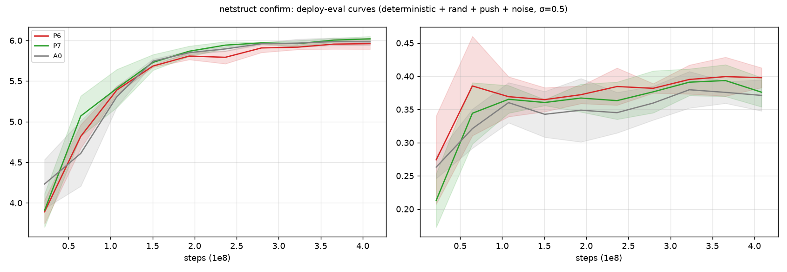

# 网络结构搜索结果

> 配套计划文档：`docs/network_structure_plan.md`。
> 评测口径（铁律）:deploy 口径 = deterministic 策略 + 域随机化 + push + 噪声 + 固定 σ=0.5;
> 排名指标 = 无权重和（Σ 8 项 attainment − action_rate)，越高越好。

## 1. Stage-1 初筛（policy 结构，1e8 × 2 seeds)

- 只改 `policy_hidden_layer_sizes`,value 固定 [512]×4，其余全部锁 baseline;σ 固定 0.5。
- 产物：`tuning/netstruct/trials/<候选>-s{0,1}/`，每 trial 末尾由 worker 做 deploy 口径加测。
- 单 trial 耗时约 13.5 min（双卡并行，共约 1.8 h)。

### 1.1 总排名（无权重和，2 seeds)

| 排名 | 候选 | 结构 | MACs | uw s0 | uw s1 | uw 均值 | ar 均值(deploy) | 平均存活步 |
| --- | --- | --- | --- | --- | --- | --- | --- | --- |
| 1 | P6 | [48,48,48] | 6240 | 5.413 | 5.417 | **5.415** | 0.393 | 563 |
| 2 | P7 | [64,32,64] | 6272 | 5.178 | 5.455 | 5.317 | 0.386 | 545 |
| 3 | A0 | [64,64]（baseline) | 6272 | 5.143 | 5.282 | 5.212 | 0.343 | 545 |
| 4 | P4 | [48,48] | 3936 | 5.392 | 4.967 | 5.179 | 0.313 | 539 |
| 5 | P5 | [56,56] | 5040 | 5.173 | 4.766 | 4.969 | 0.359 | 547 |
| 6 | P1 | [128] | 4352 | 4.692 | 4.930 | 4.811 | 0.311 | 518 |
| 7 | P2 | [160] | 5440 | 4.892 | 4.647 | 4.770 | 0.335 | 522 |
| 8 | P3 | [176] | 5984 | 4.816 | 4.687 | 4.752 | 0.299 | 486 |

### 1.2 分项 attainment(2 seeds 均值，deploy 口径固定 σ=0.5)

| 候选 | lin_vel | ang_vel | height_jnt | height_act | pitch | roll | sinyaw | wheel_sinpos |
| --- | --- | --- | --- | --- | --- | --- | --- | --- |
| P6 | 0.800 | 0.822 | 0.594 | 0.700 | 0.848 | 0.855 | 0.654 | **0.535** |
| P7 | 0.788 | 0.824 | 0.588 | 0.688 | 0.851 | 0.864 | **0.666** | 0.434 |
| A0 | 0.755 | 0.798 | 0.569 | 0.677 | 0.838 | 0.841 | 0.648 | 0.430 |
| P4 | 0.769 | **0.844** | 0.603 | 0.701 | 0.856 | 0.877 | 0.565 | 0.278 |
| P5 | 0.776 | 0.725 | 0.533 | 0.600 | 0.854 | 0.875 | 0.566 | 0.400 |
| P1 | 0.742 | 0.769 | 0.579 | 0.658 | 0.851 | 0.898 | 0.401 | 0.223 |
| P2 | 0.747 | 0.604 | 0.521 | 0.586 | 0.837 | 0.868 | 0.566 | 0.374 |
| P3 | 0.708 | 0.552 | **0.614** | **0.714** | 0.846 | **0.915** | 0.418 | 0.284 |

### 1.3 初筛结论

1. **深度 > 宽度**：前三名全部是两层以上的结构；单层加宽（P1–P3）全面垫底，
   且主要塌在 sinyaw(0.40–0.57 vs 深层 0.65）与 wheel_sinpos 两项——
   26 维观测里的弱信号（噪声化的大腿速度、历史轮指令）需要深度来提取。
2. **P6 [48,48,48] 双 seed 几乎重合**(±0.002，全组最稳）,uw 比 baseline 高 0.20;
   代价是 ar 略升（0.393 vs 0.343)。
3. **P7 [64,32,64] 瓶颈结构第二**,sinyaw 全组最高（0.666)，但 seed 间波动最大（±0.138)。
4. P4 [48,48] 与 A0 基本持平（5.179 vs 5.212)，说明宽度从 64 减到 48 代价不大，
   但加深到 3 层（P6）有正收益。
5. 注意：1e8 排名反转在 run2 有三次先例，**以上名次必须以 4e8 确认轮为准**。

## 2. Stage-2 确认（4e8 × 3 seeds)

- 初筛前 2 名 P6、P7 进入确认；baseline A0 直接复用 run1-baseline 的 4e8 × 3 seeds
  数据（`tuning/run1/trials/confirm-baseline-s{0,1,2}`，配置与 A0 完全一致；
  deploy 口径数值取自 `tuning/run2/reports/deploy_curves.s{0,1}.json` 末档 ckpt)。
- 确认轮产物：`tuning/netstruct/trials/{P6,P7}-cs{0,1,2}`,4e8、20 evals、
  deploy 口径加测，与 run1-baseline 确认轮同口径。

### 2.1 总表（4e8 末档，deploy 口径，3 seeds)

| 排名 | 候选 | 结构 | uw s0 | uw s1 | uw s2 | uw 均值 | sd | ar 均值 |
| --- | --- | --- | --- | --- | --- | --- | --- | --- |
| 1 | P7 | [64,32,64] | 6.023 | 6.052 | 5.974 | **6.017** | 0.032 | 0.376 |
| 2 | A0 | [64,64]（baseline) | 6.038 | 5.978 | 5.932 | 5.983 | 0.044 | 0.371 |
| 3 | P6 | [48,48,48] | 6.052 | 5.904 | 5.926 | 5.960 | 0.065 | 0.398 |

### 2.2 分项 attainment(3 seeds 均值，deploy 口径固定 σ=0.5)

| 候选 | lin_vel | ang_vel | height_jnt | height_act | pitch | roll | sinyaw | wheel_sinpos |
| --- | --- | --- | --- | --- | --- | --- | --- | --- |
| P7 | 0.843 | 0.877 | 0.693 | 0.825 | 0.862 | 0.874 | 0.835 | 0.583 |
| A0 | 0.854 | 0.874 | 0.679 | 0.815 | 0.861 | 0.869 | 0.832 | 0.569 |
| P6 | 0.853 | 0.870 | 0.677 | 0.806 | 0.861 | 0.872 | 0.827 | 0.594 |

### 2.3 确认结论

1. **再次排名反转（第四次先例）**:1e8 的 P6 > P7 > A0 在 4e8 变成 P7 > A0 > P6,
   初筛时 P6 的 0.20 领先优势在 4e8 完全消失。1e8 排名不可信再次应验。
2. **三组实质统计平手**：极差 0.057,≤ 1 倍 seed 标准差（0.032–0.065);
   分项 attainment 差异也全部在小数点后第二位。
3. **推荐：保持 A0 [64,64] 不变**。理由：
   - P7 仅高 0.034（在噪声内），却需要改固件前向层配置并重新验证端侧链路，
     收益/风险不划算；
   - P6 的 3 层结构在端侧多一次 kernel 调用，且 4e8 已不占优；
   - "所有候选都不显著优于 A0 → 保持现状"本身就是计划第 6 节认可的有效结论。
4. policy 结构维度到此收敛：**当前 [64,64] 在 MACs ≤ 6272 预算内已是合理选择**,
   后续提升空间在 value 网络（第 3 节）与训练超参，而非 policy 拓扑。

### 2.4 逐 ckpt 实测曲线（deploy 口径，3 seeds 均值 ± sd)

- 数据：每 2 档取 1 + 末档共 11 点逐 ckpt 实测
  (`tuning/netstruct/reports/curves.s{0,1}.json`,A0 复用 run2 已测数据）;
  工具 `tools/netstruct_curves.py`。
- 无权重和曲线：P7 从 ~0.6e8 起轻微领先并保持到末段；P6 在 1.5–2.8e8 中段
  明显掉队（与 1e8 初筛领先的假象相反）后再追回；三组阴影全程高度重叠，
  与"统计平手"的总表结论一致。
- ar 曲线：P6 早期冲高（0.38+）且全程偏上，A0 全程最低；末段三者收敛到
  0.37–0.40，差异仍在一个 sd 内。

## 3. value 网络搜索

policy 锁 [64,64](第 2 节结论),只改 `value_hidden_layer_sizes`;σ 固定 0.5,
其余全锁 baseline。V0 = [512]×4 baseline，初筛数据复用 netstruct A0-s{0,1}
（配置完全一致）。

### 3.1 Stage-1 初筛（1e8 × 2 seeds,deploy 口径无权重和）

| 排名 | 候选 | 结构 | uw s0 | uw s1 | uw 均值 | ar 均值 | 平均存活步 | 单 trial 耗时 |
| --- | --- | --- | --- | --- | --- | --- | --- | --- |
| 1 | V2 | [1024]×4 | 5.253 | 5.341 | **5.297** | 0.339 | 557 | 14.5 min |
| 2 | V0 | [512]×4（baseline) | 5.143 | 5.282 | 5.212 | 0.343 | 545 | 13.7 min |
| 3 | V3 | [512]×6 | 5.129 | 5.184 | 5.157 | 0.345 | 547 | 13.9 min |
| 4 | V1 | [1024,1024] | 4.982 | 5.329 | 5.156 | 0.313 | 554 | 13.8 min |
| 5 | V4 | [256,256] | 4.493 | 4.837 | 4.665 | 0.326 | 543 | 13.2 min |

分项 attainment(2 seeds 均值）:

| 候选 | lin_vel | ang_vel | height_jnt | height_act | pitch | roll | sinyaw | wheel_sinpos |
| --- | --- | --- | --- | --- | --- | --- | --- | --- |
| V2 | 0.781 | 0.796 | 0.578 | 0.693 | 0.837 | 0.827 | 0.645 | **0.480** |
| V0 | 0.755 | 0.798 | 0.569 | 0.677 | 0.838 | 0.841 | 0.648 | 0.430 |
| V3 | 0.754 | 0.752 | 0.585 | 0.701 | 0.829 | 0.822 | **0.660** | 0.398 |
| V1 | 0.797 | 0.829 | 0.490 | 0.544 | 0.844 | 0.832 | 0.633 | 0.500 |
| V4 | 0.730 | 0.828 | 0.446 | 0.474 | 0.838 | 0.745 | 0.597 | 0.333 |

### 3.2 初筛结论

1. **V2 [1024]×4 第一（+0.085 vs V0)**，训练吞吐代价仅 +6%(14.5 vs 13.7 min),
   主要赢在 wheel_sinpos(0.480 vs 0.430)。
2. **V4 [256,256] 明显最差（−0.55)**:value 容量不足会切实拖累策略质量，
   说明当前 [512]×4 的容量并不过剩。
3. V1/V3 与 V0 基本持平（±0.06，在 seed 波动内）。
4. 注意：1e8 排名反转已有四次先例（含本轮 policy 的 P6),**V2 的领先必须以
   4e8 确认轮为准**。

### 3.3 Stage-2 确认（4e8 × 3 seeds)

- 初筛前 2 名 V2、V3 进入确认（V1 与 V3 同分但 wheel_sinpos/结构深度均不占优，
  名额给 V3);V0 直接复用 run1-baseline 4e8 × 3 seeds 同口径数据。
- 产物：`tuning/netstruct/trials/{V2,V3}-cs{0,1,2}`。

#### 3.3.1 总表（4e8 末档，deploy 口径，3 seeds)

| 排名 | 候选 | 结构 | uw s0 | uw s1 | uw s2 | uw 均值 | sd | ar 均值 | 单 trial 耗时 |
| --- | --- | --- | --- | --- | --- | --- | --- | --- | --- |
| 1 | V3 | [512]×6 | 6.025 | 5.949 | 5.983 | **5.985** | 0.031 | 0.391 | 0.73 h |
| 2 | V0 | [512]×4（baseline) | 6.038 | 5.978 | 5.932 | 5.983 | 0.044 | 0.371 | ~0.7 h |
| 3 | V2 | [1024]×4 | 6.033 | 5.937 | 5.932 | 5.967 | 0.047 | 0.388 | 0.77 h |

#### 3.3.2 分项 attainment(3 seeds 均值，deploy 口径固定 σ=0.5)

| 候选 | lin_vel | ang_vel | height_jnt | height_act | pitch | roll | sinyaw | wheel_sinpos |
| --- | --- | --- | --- | --- | --- | --- | --- | --- |
| V3 | 0.848 | 0.871 | 0.676 | 0.811 | 0.863 | 0.871 | **0.848** | **0.588** |
| V0 | 0.854 | 0.874 | 0.679 | 0.815 | 0.861 | 0.869 | 0.832 | 0.569 |
| V2 | 0.851 | 0.861 | 0.678 | 0.816 | 0.861 | 0.872 | 0.835 | 0.581 |

#### 3.3.3 确认结论

1. **第五次 1e8→4e8 排名反转**：初筛第一 V2 在 4e8 掉到第三（5.967),
   初筛与 V0 打平的 V3 升到第一（5.985)。1e8 的 +0.085 领先再次被证伪。
2. **三组实质统计平手**：极差仅 0.018,远小于各组 seed 标准差（0.031–0.047)。
3. **推荐：保持 value [512]×4 不变**。V3/V2 的名义差异在噪声内，且 V2 还多
   10% 训练耗时；V3 的 sinyaw/wheel_sinpos 略高但 uw 不显著，不构成改默认值
   的理由。
4. value 维度唯一硬结论：容量下限存在（V4 [256,256] −0.55)，上限已过平台期
   ([512]×4 之后再加宽加深均无显著收益)。

## 4. 网络结构搜索总结论

| 网络 | 结论 | 依据 |
| --- | --- | --- |
| policy | **保持 [64,64]** | 4e8 确认：P7/P6 与 A0 统计平手（§2) |
| value | **保持 [512]×4** | 4e8 确认：V2/V3 与 V0 统计平手，V4 证容量下限（§3) |

端侧计算量零变化，固件无需任何改动。本轮搜索的净产出：在 MACs ≤ 6272
预算内穷举了 policy 拓扑、在 80k–3.2M MACs 范围内扫了 value 容量，
证明现有结构组合已处平台期；后续提升应回到训练超参与 reward 设计维度。
