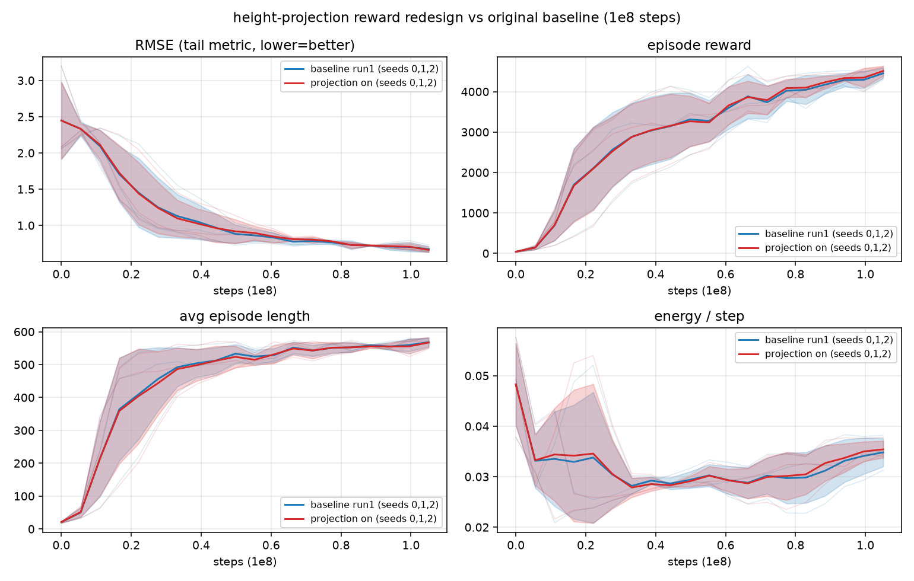
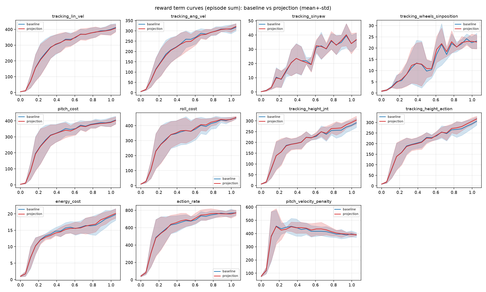

# roll-height 投影 reward 重设计：与原始 baseline 对比

2026-08-27 · 分支 `improvements/deploy-consistent` · 第二版（投影版补到 3 seeds)

## 1. 对比设置

唯一变量是 `reward_config.height_feasible_projection`（投影 reward 重设计，
见 `docs/hyperparam_tuning_plan_run2.md` 5.1)；其余 PPO 超参、网络结构、
动作映射、reward 权重完全一致。

| | 原始 baseline | 投影版 |
|---|---|---|
| 数据 | `tuning/run1/trials/baseline-s{0..4}` | `tuning/run2/trials/baseproj-s{0..2}` |
| 代码 | 旧代码（无投影） | 当前代码（`height_feasible_projection=True`，`roll_thigh_coupling=0.433`) |
| 步数 / eval | 1e8 / 20 次 | 1e8 / 20 次 |
| seeds | 5(mean±std 带） | 3(mean±std 带） |

投影语义：height 参考值按当前 roll 指令裁剪到可行域
`h_ref = clip(h_cmd, -0.5+δ, 0-δ)`，`δ = 0.433·|cmd_roll|`,
roll 占用的 thigh 差动行程不再以牺牲 height 跟踪为代价。

图表生成：`tools/compare_projection.py`，产物在 `tuning/run2/reports/`。

## 2. 总览曲线

尾部指标（最后 3 次 eval 平均）:

| 指标 | baseline run1 (n=5) | 投影版 (n=3) | 变化 |
|---|---|---|---|
| RMSE ↓ | 0.7084 ± 0.0422 | 0.6936 ± 0.0331 | -2.1% |
| episode reward ↑ | 4356.89 ± 135.13 | 4397.15 ± 129.75 | +0.9% |
| avg episode length ↑ | 557.33 ± 12.86 | 559.28 ± 13.95 | +0.4% |
| energy/step | 0.0352 ± 0.0031 | 0.0347 ± 0.0021 | -1.5% |

读法：

- **曲线图采用同 seed 配对（两侧都是 seeds 0/1/2)**：不同 seed 集合求均值
  在早期高方差阶段会产生组成性假象——跨 seed 差异在 0.11e8 处高达 5 倍
  (b0=191 vs b1=1093),baseline 多算 s3/s4 会抬高均值线，造成"投影版
  前期偏低"的错觉。配对后两侧均值带全程几乎重合。
- 同 seed 配对差值（投影 − baseline,3 对逐 eval 点，完整表见
  `tuning/run2/reports/projection_compare.md`):
  - 0.06e8:Δreward +2±3;0.11e8:+7±9 —— 前期无差异；
  - 0.17e8:Δreward −26±10、ΔRMSE +0.019±0.003 —— 唯一的轻微瞬态
    低点（约 1.5% reward，持续一个 eval 点）;
  - 0.22e8 起差值回到 ±1σ 包零，尾部（≥0.6e8）持续微正
    (+50±90 量级，σ 远大于均值）。
  - 结论：**投影不引起系统性前期变慢**;0.17e8 处的轻微下凹量级太小，
    不足为据，留 R0 继续观察。
- 尾部 RMSE -2.1%(0.6936 vs 0.7084)，两组 std 带大幅重叠——投影对
  主指标**无显著影响**（既无退化也无可宣称的提升）。
- 能耗、存活、episode reward 全部持平（±1.5% 内）。

## 3. reward 分项曲线

尾部 episode 和（最后 3 次 eval 平均）:

| 分项 | baseline mean±std | 投影版 mean±std | 变化 |
|---|---|---|---|
| tracking_lin_vel | 399.86 ± 21.72 | 397.97 ± 27.16 | -0.5% |
| tracking_ang_vel | 310.20 ± 14.38 | 313.37 ± 12.64 | +1.0% |
| tracking_sinyaw | 37.15 ± 6.76 | 36.95 ± 6.46 | -0.5% |
| tracking_wheels_sinposition | 23.79 ± 2.99 | 22.88 ± 2.59 | -3.9% |
| pitch_cost | 393.17 ± 19.39 | 392.67 ± 22.37 | -0.1% |
| roll_cost | 440.81 ± 9.41 | 444.42 ± 9.54 | +0.8% |
| tracking_height_jnt | 282.75 ± 18.72 | 292.81 ± 15.82 | +3.6% |
| tracking_height_action | 295.88 ± 18.06 | 304.90 ± 14.31 | +3.0% |
| energy_cost | 19.63 ± 1.77 | 19.43 ± 1.56 | -1.0% |
| action_rate | 760.85 ± 27.58 | 761.78 ± 35.41 | +0.1% |
| pitch_velocity_penalty | 386.24 ± 22.17 | 393.28 ± 9.54 | +1.8% |

height 分项 per-step 口径（÷episode_length，消除存活差异）:

| 分项 | baseline mean | 投影版 mean | 变化 |
|---|---|---|---|
| tracking_height_jnt/step | 0.5075 | 0.5233 | +3.1% |
| tracking_height_action/step | 0.5310 | 0.5450 | +2.6% |
| roll_cost/step | 0.7911 | 0.7948 | +0.5% |

读法：

- **height 两项 +3.0~3.6% 是投影版唯一方向一致的正向变化**(episode 和
  与 per-step 两个口径同号），量级不大但符合设计意图：roll 激活窗口
  （约 13.6% 步数）内 height 不再被不可行参考拖累。注意投影同时改变了
  height 分项的考核语义（参考值被裁剪），这部分提升里含"考核放松"成分，
  不能与物理表现提升直接划等号。
- **roll_cost 持平（+0.8%/+0.5%)**：符合设计——roll 的考核没变，
  投影没有通过牺牲 roll 来换 height。
- 第一版里 sinyaw +19.5%、sinposition +11.4% 的"亮眼变化"在 3 seeds
  下消失（-0.5% / -3.9%)，坐实了门控项 episode 和口径噪声大、
  单 seed 不可信的判断——run2 必须用激活步数达成率口径评估这两项。
- action_rate 尾部 762/episode ≈ 1.36/步，两组无差异，仍远高于 run2
  约束目标（≤0.5/步）——投影不管这个，是 R1 搜 `action_rate_scale` 的任务。

## 4. 结论

1. 投影重设计**安全**：主指标与所有关键分项均无系统性退化，学习过程
   曲线与 baseline 重合（n=3)。可作为 run2 base2 的默认 reward 语义。
2. 预期收益方向兑现但量级有限：height 分项 +3% 左右（含考核语义放松
   成分）;roll 无损失。冲突窗口内的真实物理改善幅度，待 run2 激活
   步数计数指标落地后直接在窗口内测量。
3. 本对比的两个教训都已并入 run2 计划：**单 seed 不可下任何结论**
   （学习速度、sinyaw/sinposition 都曾被单 seed 误导）;**门控项必须用
   达成率口径**(episode 和口径噪声淹没信号）。

## 5. 冲突窗口在环分析:为什么 proj 曲线没有"在 baseline 之上"

工具:`tools/compare_projection_windows.py`(策略在环,同 base-seed 指令流,
逐步记录 cmd/thigh/sinroll,全部误差离线按两个口径重算)。
对象:baseline-s0 vs baseproj-s0 的 1e8 末态 ckpt(同 seed)。

### 5.1 理论上限:矛盾在当前指令分布下量级很小

指令分布(h∈[-0.5,0]、roll∈[-0.2,0.2]、δ=0.433·|roll|)直接积分:

| 量 | 值 |
|---|---|
| 冲突步占比 | 17.3% |
| 窗内平均不可行 gap | 0.0289 rad(最大 0.087) |
| 全程平均 gap | 0.005 rad |
| height_jnt 每步 reward 天花板增益 | 0.034 raw/步 |
| ×height_scale=2.0 后占 episode 总 reward(≈7.9/步) | **0.86%** |

天花板比 seed 间噪声(±3%)低一个量级——"proj 曲线应在 baseline 之上"
的幅度预期在当前指令分布下理论上就不成立。

### 5.2 在环实测:矛盾没有约束当前策略的行为

| 冲突窗口内 | baseline | projection |
|---|---|---|
| roll 误差 abs(sinroll−cmd) | 0.0402 | 0.0404 |
| height 误差(对 h_cmd) | 0.1566 | 0.1357 |
| r_h_cmd(物理口径) | 0.457 | **0.507** |
| r_h_ref(投影口径) | 0.530 | **0.587** |
| r_roll | 0.614 | 0.609 |
| 实际 split 半幅 / 指令需要 | 0.0494 / 0.0580 | 0.0478 / 0.0580 |
| 实际 mean(thigh) | −0.1555 | −0.1789 |
| h_ref / h_cmd | −0.2571 / −0.2589 | −0.2574 / −0.2592 |

两个决定性事实:

1. **策略离 height 目标还差 ~0.1 rad,根本没顶到行程边界**
   (mean(thigh)=−0.156/−0.179 vs 目标 −0.259;全程平均跟踪误差
   0.11~0.13 rad,σ_h=0.125)。冲突模型"height 顶到可行域边缘被 roll
   挤占"的前提在当前策略水平上不成立——瓶颈是跟踪能力,不是边界。
2. **baseline 也没有牺牲 roll**:两个策略在窗内 roll 误差相同,
   且都欠 split(实际 0.048 vs 需要 0.058,差 18%)。

投影本身做对了:窗内 r_h_cmd +11%(物理口径同向改善,不是考核放松的
假象)、roll 无损、全程无副作用。它修的是"奖励记账",不是当前瓶颈。

### 5.3 对 run2 的推论

- 投影保留:语义正确、窗口内有效、无副作用,作为 base2 默认。
- run2 的杠杆在 **height/roll 的绝对跟踪能力**(权重/sigma 搜索),
  不在几何冲突。
- 待查:策略在冲突窗内系统性站得比指令高 ~0.1 rad 的偏置来源
  (delta 动作初始化?站姿平衡偏好?),R0 阶段顺手核实。

## 6. 工程备注

- 第一跑（seed 0 首次起跑）在 iteration 7 后挂起（19 分钟无 eval、
  GPU 95% 空转，ptrace 受限无法抓栈），杀掉重跑后正常完成，挂起前
  8 个迭代的数值与 run1 baseline 同期一致，判断为 XLA/CUDA 层面偶发
  问题，与 reward 改动无关。现场保留在
  `tuning/run2/trials/baseproj-s0-hung-iter7/`（本地，不入库）。
- baseline 5 seeds 尾部 RMSE:0.659 / 0.761 / 0.661 / 0.745 / 0.716,
  mean 0.7084 ± 0.042，与 run1 stage0 噪声底（σ=0.0472）一致。
- 投影版 3 seeds 尾部 RMSE:0.6762 / 0.7399 / 0.6646,
  mean 0.6936 ± 0.033。
