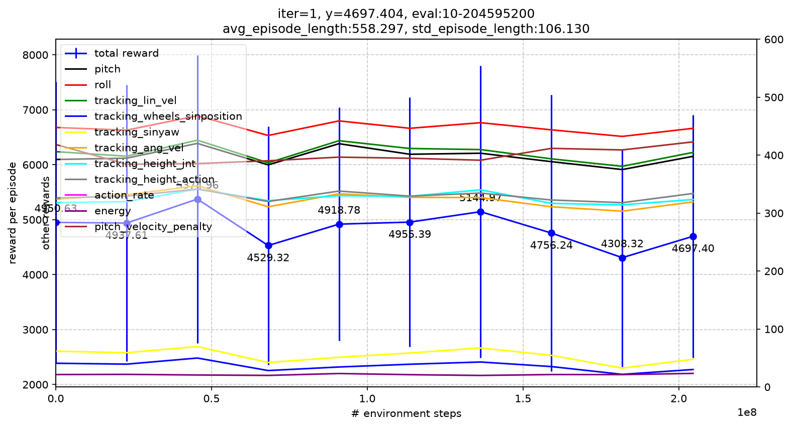
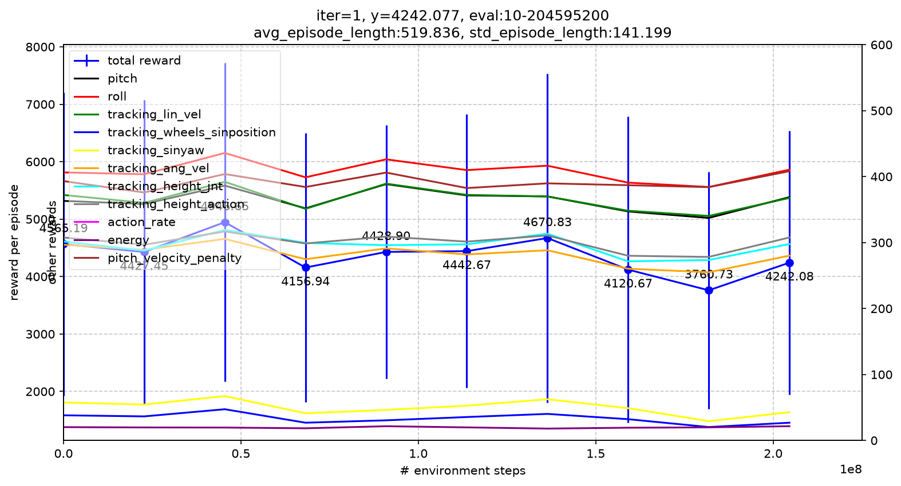
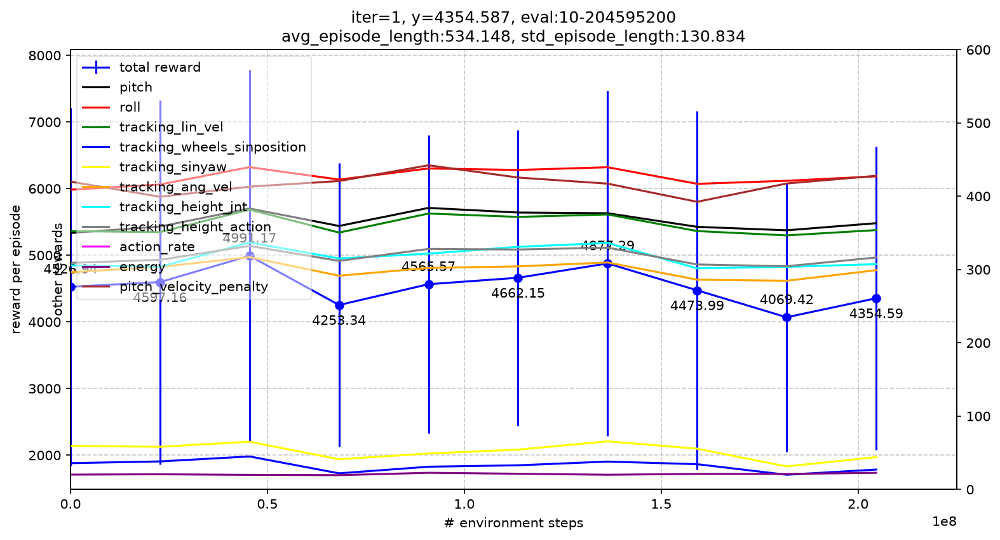
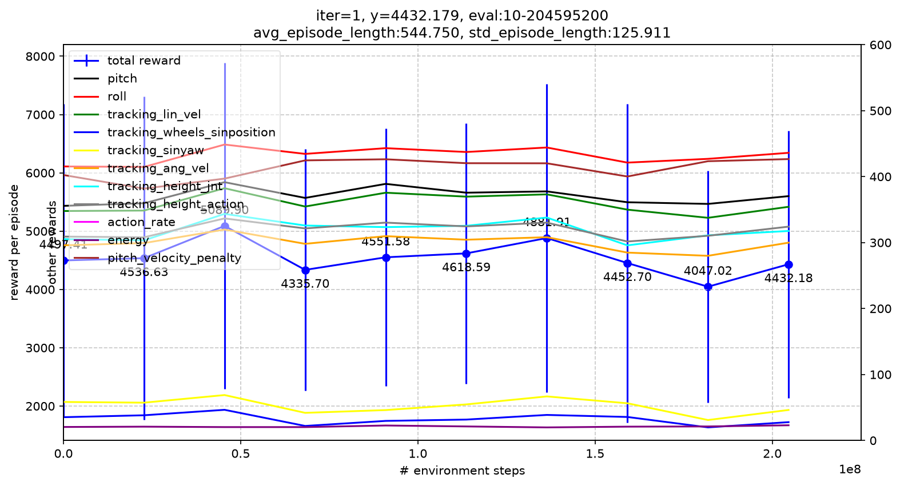
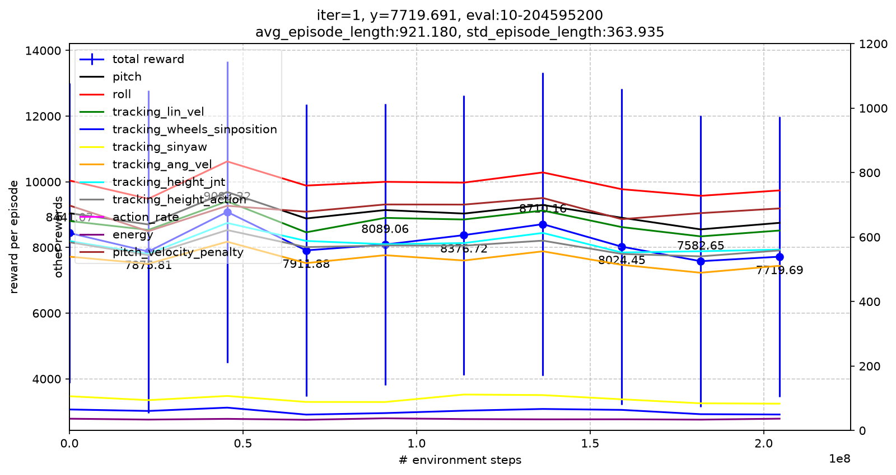

# 抗推力鲁棒性实验报告(push-robustness)

日期:2026-09-02
分支:`experiments/push-robustness`(父分支 `improvements/hold-position-heading` 不动)
方案:`docs/push_robustness_experiment_plan.md`(B1 强推过采样 + B2 burst 双推 + C 定向压力测试)
基线 ckpt:`ckpts/newobs-norecovery/000403660800`(新语义,4e8 步)

## 1. 实验设置

**env 改动**(commit `d9e17dd`,默认配置逐比特零变化):

- `push_config.magnitude_pow`:推力幅值采样 `mag = lo + (hi-lo)·u^pow`,pow<1 偏向高端;
- `push_config.burst_prob` / `burst_interval_range=[0.3,0.8]s`:每个 episode 以该概率整集改用短间隔连推。

统计验证(512 envs x 2000 步):默认 ≥0.4 m/s 占比 19.9%(均匀理论 20%);pow=0.5 时 35.3%(理论 36%);burst 间隔双峰(40/414 步)。

**评测口径**(三者互补,缺一不可——本实验最重要的方法论教训):

| 口径 | 配置 | 暴露时长 |
|---|---|---|
| 压力测试 | `batch_test --override magnitude_range=[0.4,0.5] interval_range=[1.0,2.0]`,4096 envs seed 42 | 6s/episode |
| 标准 batch_test | 默认推力分布,4096 envs seed 42 | 6s/episode |
| 120s 演示 | `record_baseline_demo --random-cmds`,seeds 1~10 与基线逐段配对 | 120s 连续 |

**训练**:均从上一棒 ckpt 续训 2e8 步(lr 1e-4,其余配置与 newobs-norecovery 一致)。

| 棒次 | ckpt | 训练推力配置 |
|---|---|---|
| step1 | `ckpts/pushrob-step1/000204595200` | magnitude_pow=0.5,burst_prob=0.15(上限仍 0.5) |
| step2 | `ckpts/pushrob-step2/000204595200` | 同上 + **magnitude_range 上限 0.5→0.6** |

## 2. 结果

### 2.1 四口径总表

| 口径 | 基线 newobs-norecovery | step1 | step2 |
|---|---|---|---|
| 压力测试存活率 | 70.24%(1219 摔) | 71.41%(1171 摔) | 72.71%(1118 摔) |
| 压力测试 return | 5190 | 5286 | 5336 |
| 标准 batch_test | 95.02% / 6263 | 95.12% / 6327 | 95.61% / 6341 |
| **120s 演示摔倒** | **8 / 393 推(2.04%)** | **6 / 397 推(1.51%)** | **12 / 379 推(3.17%)** |
| 演示机动段强推致死率 | 9.8%(8/82) | **6.7%(5/75)** | 13.9%(10/72) |

batch 两个口径的失败原因全部为 pitch;演示摔倒画像与基线一致(强推×机动叠加)。

### 2.2 读数

- **step1(B1+B2,上限不动):四个口径全面改善**。压力 +1.17pp、标准 +0.10pp、演示摔倒 8→6、强推致死率 9.8%→6.7%。幅度都不大(演示口径在噪声范围内),但方向一致、无任何口径变差;
- **step2(上限 0.6):batch 口径继续变好,部署口径显著变差**。压力/标准再升,但 120s 演示摔倒翻倍(12 vs 8),强推致死率 13.9%,且 12 次摔倒中 2 次摔前 0.6s 内无强推(基线与 step1 均为 0)——策略在持续工况下出现了基线没有的自失稳;
- **归因:退化来自上限外扩(0.5→0.6),不是 pow/burst**。step1 与 step2 唯一的配置差就是上限;batch 口径 episode 只有 6s(1~2 次推力),测不出持续工况下的行为漂移,120s 连续演示才能暴露——若只看 batch 指标会误判 step2 为"最佳",这是本实验最关键的一课;
- step2 训练 eval(4242/520)低于 step1(4697/558)是上限 0.6 变难所致,单看不说明问题,但与演示口径交叉印证了"过难分布改变了策略行为"。

### 2.3 训练曲线





两棒均稳定收敛,分项无塌缩、无"保守不动"迹象(tracking_lin_vel / ang_vel 全程贴顶)。

## 3. 结论

1. **B1 强推过采样 + B2 burst(上限不动)= 有效且安全**:四口径一致改善,无回归。**`pushrob-step1/000204595200` 取代 newobs-norecovery 成为部署候选**(标准 95.12%/6327、压力 71.41%、演示 6 摔);
2. **上限外扩(0.5→0.6)= 有害,step2 淘汰**:训练分布超出部署上限后,策略在持续工况下行为漂移(摔倒翻倍、出现无推自失稳)。推力训练上限应保持在部署预期包络内,靠 pow/burst 调密度,不靠扩量程;
3. **评测方法论**:6s episode 的 batch 指标(含压力测试)与 120s 连续部署行为可以背离——**部署候选必须过 120s 连续演示这一关**,batch 指标只做初筛;
4. **残余摔倒接近构型物理极限**:即使最好的 step1,强推致死率仍有 6.7%;轮式无侧向自由度,0.4~0.5 m/s 侧向冲量下裕度就那么多,分布侧能榨的空间已基本榨完。

## 4. 第二轮:冲击 100% 存活率(2026-09-02)

目标(方案文档 §0 第二轮):压力测试 100%(0/4096)+ 10x120s 演示 0 摔。三臂均在 step1 之上累积,推力上限 0.5 不动。

| 臂 | ckpt | 手段 | 压力存活率 | 标准 batch |
|---|---|---|---|---|
| A(step3) | `pushrob-step3/000204595200` | pow=0.4、burst=0.3 | 72.71%(+1.30pp) | 95.56% / 6278 |
| B(step4) | `pushrob-step4/000204595200` | A + termination_penalty=-100 | **73.27%**(+0.56pp) | **95.80% / 6365** |
| C(step5) | `pushrob-step5/000204595200` | B + episode 600→1200 | 73.19%(持平) | 95.53% / 6335 |

step4 演示关口(10x120s 同 seeds):9 摔 / 505 推(逐推 1.78%)、机动段强推致死率 7.4%(基线 8/393=2.04%/9.8%,step1 6/397=1.51%/6.7%)。

三臂训练曲线(step5 的 eval 量级因 episode 1200 翻倍,不与前两棒直接比):







### 4.1 失败结构分析(step4 压力测试 1095 条失败记录)

- **时间结构**:摔倒均匀散布 episode 全时段(150-600 步每百步 17~21%,前 100 步仅 2.9%)——累积暴露模型:逐推死亡率 ~7.6%,episode 内 3~5 次强推 → 存活率 ≈ 0.924^4 ≈ 73%,与实测严丝合缝;
- **命令结构**:四个维度的极端段占比 26~28% ≈ 均匀,无可剥削的特定组合;近零速时摔倒 14.3%;
- **失效模式**:pitch 双向翻倒(p10=-0.64 前扑 / p90=+0.89 后仰),roll 始终很小。

### 4.2 天花板结论:100% 在此口径下物理不可达

- 压力存活率轨迹 70.24 → 71.41 → 72.71 → 73.27 → 73.19,**三臂收益递减到零,渐近线 ~73.3%**;
- 要到 100%(0/4096)意味着逐推死亡率 <0.02%,而各臂只能把它压到 ~7%——差两个数量级以上,**不是训练量问题**;
- 物理约束:推力是基座瞬时速度跳变 0.4~0.5 m/s、每 1~2s 一次;轮力矩上限 ±0.04 N·m(XML `forcerange`,与真机固件速度环一致,**动它就破坏 deploy 一致性**);轮式无侧向自由度。在该包络内总存在不可恢复状态(侧向冲量 vs 当前机动已占用的轮差速/腿长裕度);
- 注意压力测试本身比部署严酷:部署里 ≥0.4 m/s 只占推力的 20% 且间隔 1~5s,压力测试是 100% 强推背靠背。**部署口径(step1)逐推死亡率 1.51%、强推致死率 6.7% 才是真实水位**。

### 4.3 第二轮结论与取舍

- **部署候选维持 step1 不变**:演示口径最优(逐推 1.51%/强推 6.7%),batch 口径与 step4 互有胜负但在噪声内;按"部署关口优先"的第一轮教训,不换成 step4;
- 若一定要再压数字,只剩三条路,都不在本仓库训练侧:(a) 真机确认力矩/质量有冗余 → sim 同步放大重训;(b) 固件 A 方案(命令斜坡/限幅)削减"推力×瞬态"叠加;(c) 重新定义达标口径(把压力测试幅值/密度调到部署包络上限)。

## 5. 下一步建议(按优先级)

1. **step1 部署候选确认**:3 seeds 重训确认 + 加大演示样本量(6 vs 8 在噪声内,需更多段数坐实),过关后替换部署 ckpt;
2. **A 方案(固件命令斜坡/限幅)落地**——本实验未覆盖,此前分析中 2/8 摔倒源于命令切换瞬态,是性价比最高的剩余手段,与 step1 可叠加;
3. 若还要抠鲁棒性,从**能力侧**入手(轮力矩上限/机身质量等物理参数真机若有冗余,sim 同步放大再训),不要继续拧分布;
4. 压力测试(`batch_test --override`,一条命令)与 120s 配对演示纳入后续所有部署候选的例行双检查。

## 6. 复现

```bash
# 压力测试
MUJOCO_GL=egl .venv/bin/python scripts/batch_test.py --ckpt_path <ckpt> \
  --override 'push_config.magnitude_range=[0.4,0.5]' \
  --override 'push_config.interval_range=[1.0,2.0]' --save_dir failures/stress

# step1 续训(部署候选)
./train.sh --restore <newobs-norecovery/000403660800> --save-dir <dir> --maxstep 2e8 \
  --override push_config.magnitude_pow=0.5 --override push_config.burst_prob=0.15

# 120s 配对演示(每 ckpt 一遍,seeds 1~10)
for s in 1 2 3 4 5 6 7 8 9 10; do
  .venv/bin/python tools/record_baseline_demo.py --ckpt <ckpt> \
    --out <out_dir> --tag <tag> --seed $s --duration 120 --random-cmds
done
```

数据:压力/回归日志 `logs/stress_*`、`logs/regress_*`;失败记录 `failures/stress/`、`failures/regress/`;演示 `test/{holdpos,pushrob,pushrob1}_rand_demo_120s/`(均 gitignored)。
