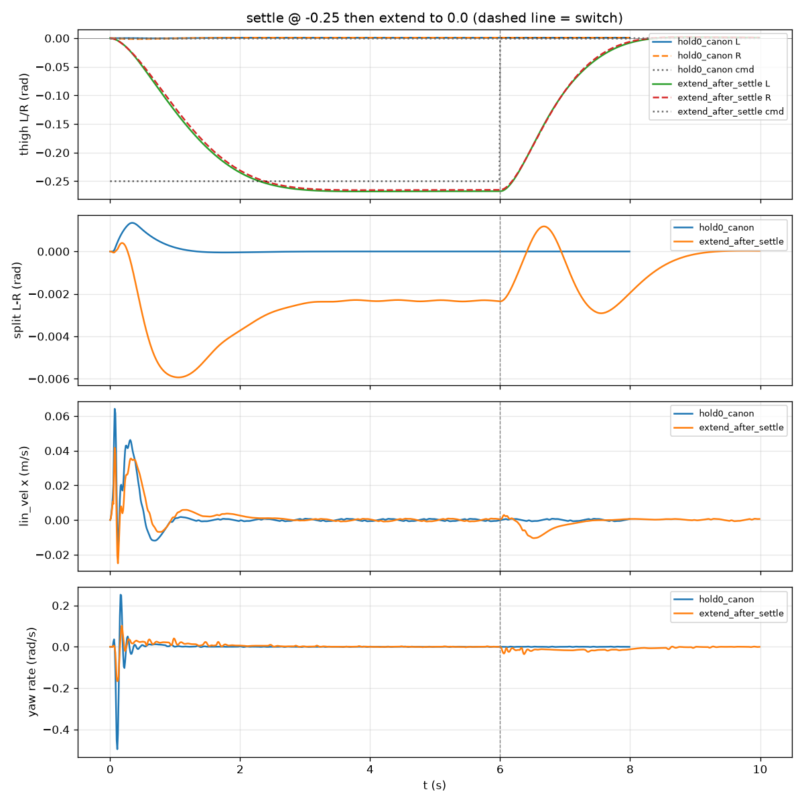
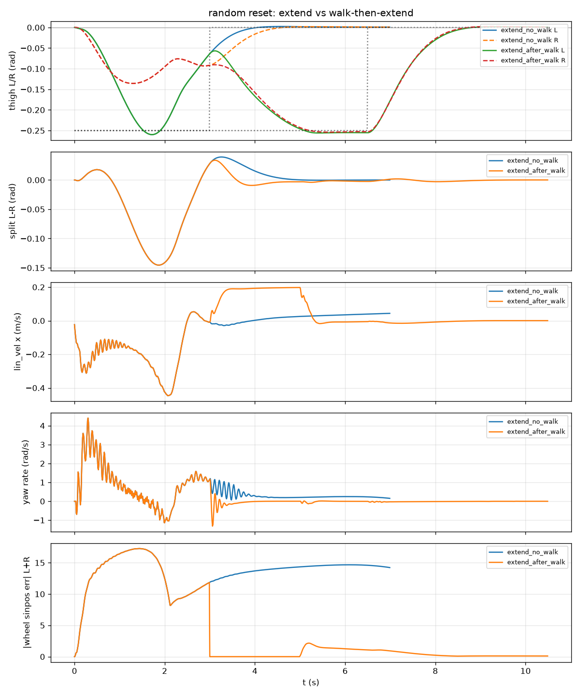

# Viewer 站稳后伸直：跑动与左右腿不等长

日期：2026-08-31
模型：`tuning/run1/trials/confirm-baseline-s0/ckpt/000408576000`（run1 baseline，4e8 确认轮 s0）
复现工具：`tools/repro_stand_tall.py`（对齐 `view.sh`：JAX=cpu、noise=0、push=0、`cmd_prob=0`、deterministic）
原始数据（gitignore）：`test/repro_stand_tall/`

## 1. 现象（交互查看器）

`bash view.sh` 随机初始姿态站稳后，把高度打到 `0.0`（腿伸直）：

- 机器人会自己跑起来（线速度、偏航都不为 0）；
- 左右大腿角度明显不一致。

同一局里先给一小段前进再停车，再伸直，上述问题消失。

## 2. 实验设置

与 `legwheel/viewer.py` 一致：`reset(rng, random=True)`、seed=`PRNGKey(0)`、每步写入 command。高度 `−0.25` 为蹲/站中位，`0.0` 为行程上止点（伸直）。命令为 `[vx, yaw, height, roll]`。

| 实验 | 序列 |
|---|---|
| A 直接伸直 | 3s `[0,0,−0.25,0]` → 4s `[0,0,0,0]` |
| B 走停再伸直 | 3s 蹲稳 → 2s `[0.2,0,−0.25,0]` → 1.5s 停车 → 4s 伸直 |
| 对照 | 同上命令，但 `reset(random=False)` 规范站姿 |

## 3. 实验 A：站稳后直接伸直

随机姿态下，**还没伸直、蹲在 −0.25 时就已经坏了**；伸直到 0 后腿被上限夹齐，但仍在转着往前蹭。

末 1s 统计（`extend_no_walk`）：

| 量 | 蹲 −0.25 | 伸直 0.0 |
|---|---|---|
| 左 / 右大腿 (rad) | −0.14 / −0.09 | +0.001 / +0.001 |
| \|L−R\| 均值（峰值） | **0.064（0.14）** | ≈ 0 |
| lin_vel x (m/s) | **−0.13（峰值 −0.45）** | **+0.039** |
| yaw rate (rad/s) | **±1 量级** | **+0.22** |
| 轮 sinpos 相对 reset 锚点 \|err\| | **~5** | **~7** |
| sinyaw 相对 reset 锚点 | −0.34 | **+1.18** |
| xy 漂移 / 1s | 0.15 m | 0.04 m |

训练默认噪声 `level=1` 的曲线与 viewer `noise=0` 几乎重合，**不是噪声开关造成的**。

规范站姿 `reset(random=False)` 做同样「蹲稳再伸直」：split≈0.002，速度≈0。问题需要 **随机初始姿态** 才触发。



## 4. 实验 B：前进一下再停下，再伸直

同一随机 reset（前 3s 与 A 逐点相同）。t=3s 起给 `vx=0.2`，约 1s 内左右腿对齐、偏航归零；停车后再伸直，两边一起走到 0，不再跑。

伸直后末 1s（`extend_after_walk` vs `extend_no_walk`）：

| 量 | A 直接伸直 | B 走停再伸直 |
|---|---|---|
| 左右腿差 | 过渡段右腿慢一拍 | ≈ 0 |
| lin_vel x | **+0.04 m/s** | **0.000** |
| yaw rate | **+0.22 rad/s** | **≈ 0** |
| 轮 sinpos \|err\| L / R | **+5.2 / −9.3** | **≈ 0.06** |
| sinyaw 锚点误差 | +1.18 | −0.009 |
| xy 漂移 / 1s | 0.040 m | 0.0005 m |

前进段末 1s：`vx≈0.196`（跟 0.2）、split≈0.005、轮 sinpos 误差 **被刷成 0**。



## 5. 与训练代码的对照

高度奖励只约束 **两腿均值**，不惩罚左右差：

```282:293:legwheel/rewards.py
    def _diff_tracking_height_jnt(...):
        diff = jp.where(
            use_both_thighs,
            jp.mean(thigh_jnt - commands),
            jp.min(thigh_jnt) - commands,
        )
```

roll 靠大腿差动（`roll_thigh_coupling=0.433`）；动作是左右独立增量（`delta_thigh_action=True`），各自 clip 到 `[-0.5, 0]`。伸直 `height=0` 是上止点，差动空间为 0。

停车时策略还要跟两个 **reset 时冻结的锚点**：轮相位 `wheels_sinposition_start`、朝向 `sinyaw_start`。观测里轮位置是相对该锚点的差：

```404:411:legwheel/env.py
        state.info["wheels_sinposition_start"] = jp.where(
            jp.logical_or(jp.abs(state.info["command"][0]) > ...,
                            jp.abs(state.info["command"][1]) > ...),
            self.get_wheels_sinposition(data), state.info["wheels_sinposition_start"])
        state.info["sinyaw_start"] = jp.where(
            jp.abs(state.info["command"][1]) > ...,
            self._getSinYaw_newest(data), state.info["sinyaw_start"])
```

`|vx|` 或 `|yaw|` 超过死区时，**轮锚点每步刷新成当前相位**；朝向锚点只在打 yaw 时刷新。训练里命令约每 3s 重采样，且 `cmd_prob=0.9` 时常出现非零 vx，锚点会被刷掉。Viewer 里若一直 `vx=yaw=0`，锚点一直停在 reset 那一帧。

## 6. 结论

1. **直接伸直**：随机站起后轮子已经转过，obs 仍相对 reset 轮相位报大误差（实验 A 达 5~9）。策略用轮扭矩去拧回去 → 差动、偏航、腿长不齐；伸直到上止点后腿被夹齐，仍剩 vx/yaw。
2. **先走再停**：前进把 `wheels_sinposition_start` 刷成当前轮相位；停下后“保持轮位”的目标已是现在的轮子，冲突消失，再伸直两边一起走。
3. 高度项只看 mean、roll 用大腿差动、上止点无差动余量，使随机姿态下的差动更容易残留；规范站姿下同样伸直几乎不复现。
