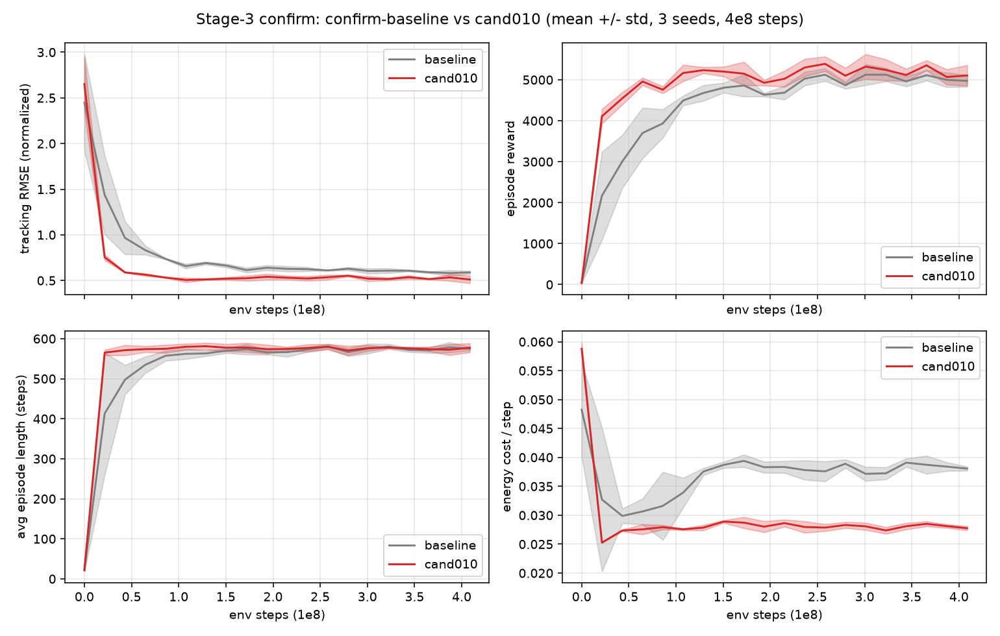
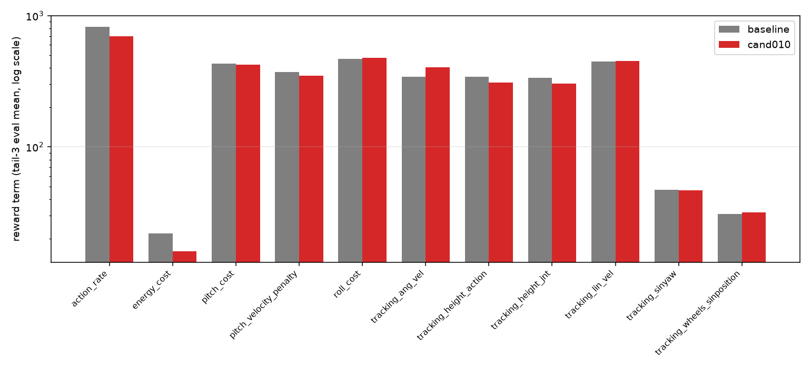
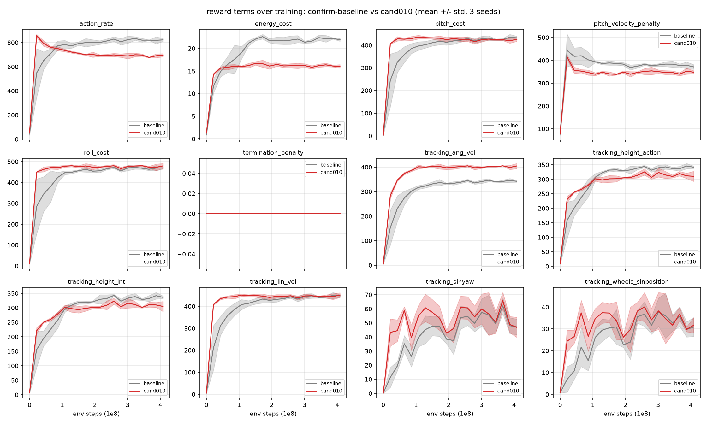

# 调参结果报告:run1(2026-08-26)

按 `docs/hyperparam_tuning_plan.md` 三阶段流水线执行(噪声底 → PB 筛选 → TPE+ASHA → 全量确认),study 目录 `tuning/run1/`(含全部 trial 痕迹、Optuna study.db、各阶段报告)。硬件:2× RTX PRO 6000(双卡并行调度)。

## 最终结论

**推荐组合 cand010(阶段二 trial search-010 的参数):全量 4e8 步 × 3 seeds 确认,归一化跟踪 RMSE 0.5201 ± 0.0288,显著优于基线 0.5866 ± 0.0131(Δ=+0.0666 > 2·σ_pool=0.0365,约 95% 置信),提升 11.3%;批量回放成功率 99.56% vs 基线 94.82%(4096 envs、带随机推力)。**

### 全量确认(阶段三,4e8 步 × 3 seeds)

| 组合 | RMSE 均值±std | 逐 seed RMSE | 存活(步) | 能耗/步 | return | 统计判定 |
|---|---|---|---|---|---|---|
| baseline(同长度新跑) | 0.5866 ± 0.0131 | 0.574 / 0.600 / 0.586 | 574.9 | 0.0384 | 5028 | 对照组 |
| **cand010** | **0.5201 ± 0.0288** | 0.489 / 0.527 / 0.545 | 574.5 | 0.0281 | 5176 | **通过**(Δ=0.067 > 0.037) |
| cand015 | 0.5411 ± 0.0117 | 0.528 / 0.544 / 0.551 | 578.0 | 0.0209 | 4688 | 通过(Δ=0.046 > 0.020) |

### 批量回放(batch_test,4096 envs,随机推力开,base_seed 42)

| 组合 | 成功率 | 失败数 | 平均失败步 | 平均 return | 失败模式 |
|---|---|---|---|---|---|
| baseline-s0 | 94.82% | 212 | 342 | 6265 | 全部 pitch |
| **cand010-s0** | **99.56%** | **18** | 275 | 5905 | 全部 pitch |

注:cand010 平均 return 略低于 baseline,主因其动作/扭矩参数更保守(action_scale.torque 更小)且 RMSE/成功率更优——return 与物理指标解耦正是计划 2.6 规则 1 的设计意图(权重未动,此处差异来自行为本身:候选更"稳而省",baseline 更"激进")。

### 参数差异(baseline vs cand010,config_resolved.json 全量 diff,由 `tools/compare_confirm.py` 生成)

| 参数 | baseline | cand010 | 变化 |
|---|---|---|---|
| `env.action_range.thigh` | [-0.5, 0] | [-0.283018, 0] | 收窄(蹲姿范围变小) |
| `env.action_scale.thigh` | 0.25 | 0.367462 | +47.0% |
| `env.action_scale.wheel` | 0.0295 | 0.0232225 | -21.3% |
| `env.vel_pid.kp` | 0.0002 | 0.000170263 | -14.9% |
| `env.vel_pid.notsmoothing` | 0.5 | 0.250821 | -49.8%(更平滑) |
| `env.vel_pid.target_scale` | 30 | 44.3696 | +47.9%(轮速残差映射更激进) |
| `env.vel_pid.torque_limit` | 0.0295 | 0.0250228 | -15.2%(更保守,部署安全方向) |
| `ppo.learning_rate` | 0.0001 | 0.000299458 | +199.5% |
| `ppo.network_factory.policy_hidden_layer_sizes` | [64, 64] | [128, 64] | 加宽 |
| `ppo.network_factory.value_hidden_layer_sizes` | [512, 512, 512, 512] | [512, 512] | 变浅(更快) |
| `ppo.num_updates_per_batch` | 4 | 8 | +100.0% |

### reward 分项对比(尾部 3 eval 均值,3 seeds 的 mean ± std)

| 分项 | baseline | cand010 | Δ 均值 |
|---|---|---|---|
| action_rate | 822.21 ± 12.54 | 695.60 ± 12.83 | -15.4%(动作更平滑) |
| energy_cost | 21.89 ± 0.31 | 16.03 ± 0.39 | -26.8%(更省能) |
| pitch_cost | 432.18 ± 7.10 | 425.57 ± 8.81 | -1.5% |
| pitch_velocity_penalty | 371.30 ± 10.06 | 348.00 ± 7.07 | -6.3% |
| roll_cost | 469.57 ± 4.70 | 479.63 ± 12.04 | +2.1% |
| termination_penalty | 0.00 ± 0.00 | 0.00 ± 0.00 |  |
| tracking_ang_vel | 342.20 ± 3.51 | 404.80 ± 10.57 | +18.3%(角速度跟踪显著更好) |
| tracking_height_action | 341.75 ± 3.84 | 310.36 ± 17.47 | -9.2% |
| tracking_height_jnt | 335.78 ± 4.48 | 304.46 ± 17.36 | -9.3% |
| tracking_lin_vel | 447.01 ± 5.59 | 450.77 ± 10.50 | +0.8% |
| tracking_sinyaw | 47.18 ± 5.50 | 46.85 ± 7.16 | -0.7% |
| tracking_wheels_sinposition | 30.86 ± 4.31 | 31.64 ± 3.54 | +2.6% |

注:height 两项略降与 `action_range.thigh` 收窄一致(蹲姿活动范围变小),换来角速度跟踪 +18.3%、能耗 -26.8%、动作平滑度 +15.4%,总体 RMSE -11.3%。

### 训练过程曲线(4e8 步,3 seeds mean ± std)

cand010 收敛明显更快(约 0.5e8 步即达 baseline 最终水平),RMSE 与能耗全程低于 baseline,存活相当。

### reward 分项柱状图(对数轴,termination_penalty 两组均为 0 已略去)

### reward 分项训练过程曲线(4e8 步,3 seeds mean ± std)

可读信息:action_rate 从训练早期 cand010 就系统性更低(平滑性来自行为而非后期收敛);
tracking_ang_vel cand010 全程领先;height 两项 baseline 在中段反超(与 thigh 动作范围
收窄一致);sinyaw/sinposition 噪声大,cand010 略占优但不确定。

复现:`cand010-s0` 的完整生效配置见 `tuning/run1/trials/cand010-s0/config_resolved.json`;checkpoint 在 `tuning/run1/trials/cand010-s{0,1,2}/ckpt/000408576000`。图表可用 `python tools/compare_confirm.py` 重新生成(片段输出在 `tuning/run1/reports/stage3_compare.md`)。

## 过程数据

### 阶段 0:噪声底(baseline ×5 seeds @1e8)

RMSE 0.659 / 0.761 / 0.661 / 0.745 / 0.716 → 均值 **0.7084**,σ_noise = **0.0472**;能耗预算 0.0423(基线 ×1.2)。详见 `tuning/run1/reports/stage0_noise.md`。

### 阶段 1:PB 筛选(29 因子 × 32 runs @1e8,单 seed)

主效应(|E|,RMSE 方向:负=高水平更好)前排:

| 因子 | E_i | 含义 |
|---|---|---|
| vel_pid.target_scale | +1.56 | 低水平(15)好→但阶段二连续搜索发现 44 更优(非单调/交互) |
| learning_rate | −1.53 | 高 lr(3e-4)显著更好 |
| action_scale.wheel | +1.36 | 低水平好 |
| policy_net | +1.36 | PB 两水平下 64x64 好;阶段二在 128x64 找到更优点 |
| vel_pid.notsmoothing | −1.36 | 高平滑(0.75)好 |
| vel_pid.torque_limit | +1.19 | 低水平好 |
| action_range_thigh_lo | −1.16 | 收窄好 |
| num_updates_per_batch | +1.06 | PB 两水平下 2 好;阶段二连续值 8 更优(交互) |
| action_scale.thigh | +1.05 | — |
| value_net | −1.00 | 512×4 好(阶段二:512×2 更好) |
| vel_pid.kp | −0.99 | 中低值好 |

所有 reward_config 权重因子排名 13 名开外;仅 reward_scaling 与 roll_scale 低于噪声底。gate-1 人工核准:top-10 + vel_pid.kp 共 11 因子进阶段二,其余 18 个冻结。详见 `reports/stage1_screening.md`。

### 阶段 2:TPE + ASHA(40 trials @1e8,num_evals 48)

7 个跑完全程、33 个被剪枝(rungs: eval 4/12/36)。Top-5 RMSE:0.516 / 0.554 / 0.559 / 0.570 / 0.650(第 5 名存活 416<550 违反硬约束,按 WORST 处理不进确认)。Top-4 全部无异常标记,S(θ) 与 RMSE 排名一致。可视化:`reports/stage2_parallel_coordinate.png`、`stage2_intermediate_values.png`。

一致规律:policy `128x64`、value `512x512`、lr 偏高端(1.2e-4~3e-4)、kp 偏低(1e-4~1.7e-4)。

## 工程改造留痕(本分支新增)

- `scripts/train.py`:`--override/--ppo-override/--seed`;`scripts/batch_test.py`:`--override`(按 trial 训练配置评估)
- `legwheel/training/ppo.py`:`compute_discounting` 纯函数、`ppo_overrides/env_cfg/seed/progress_fn/randomization_fn` 可选注入(默认行为零变化)
- `legwheel/rewards.py`+`env.py`:`track/err2_lin_vel|ang_vel` 归一化误差平方直出(数值口径经单步手算验收)
- `legwheel/randomization.py`:参数化(C 层消融用,默认不变)
- `legwheel/tuning/` + `scripts/tune.py`:调参流水线(baseline/screen/search/confirm,双卡 flock 调度,子进程隔离,SQLite 断点续搜)
- `legwheel/evaluation/runner.py`:修复 brax 0.14.2 下 `load_policy` 的 config 反序列化 bug(回退到 extract.load + 手动重建,含观测归一化)——**此 bug 影响所有 brax 0.14.2 checkpoint 的 batch_test,与调参无关**
- `train.sh`:反向 flock 检查 + `logs/train.pid`
- `tools/compare_confirm.py`:阶段三 baseline vs 候选对比图表生成(参数全量 diff 表、reward 分项表、训练曲线/分项柱状图)

## 后续(gate-3 之前)

- cand010 的 `action_range.thigh` 收窄到 [-0.283, 0]:蹲得更浅,部署前确认实机需要的最低姿高度仍覆盖(若需要更深蹲姿,该因子应锁回 -0.5 重调)。
- `vel_pid.torque_limit` 0.0250 < 电机额定为保守方向,安全;`target_scale` 44.4 改变了轮速残差映射范围,固件侧无需改动(仅训练侧动作语义)。
- 部署前按 `docs/deploy_firmware_comparison.md` 处理待对齐项,并用 visualize.py 做指令跟踪复核。
