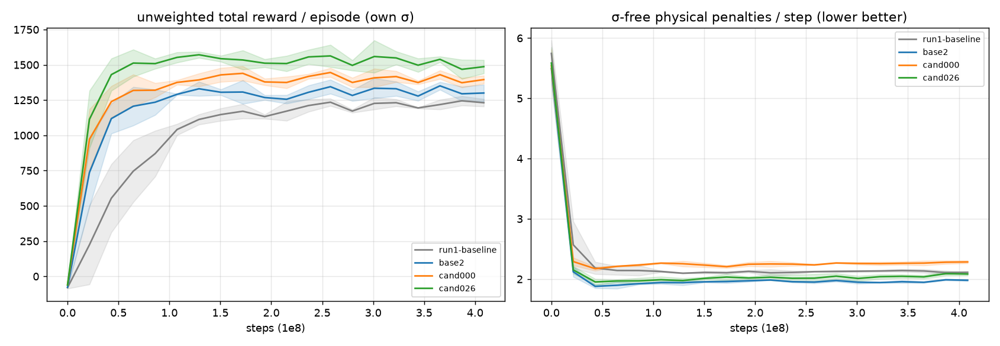
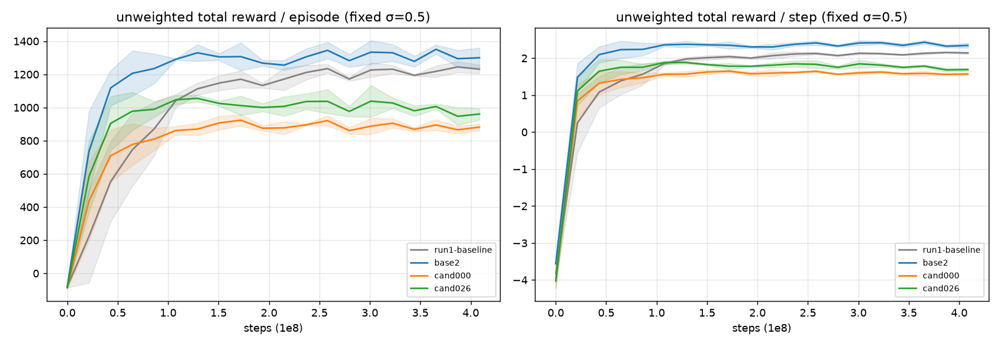
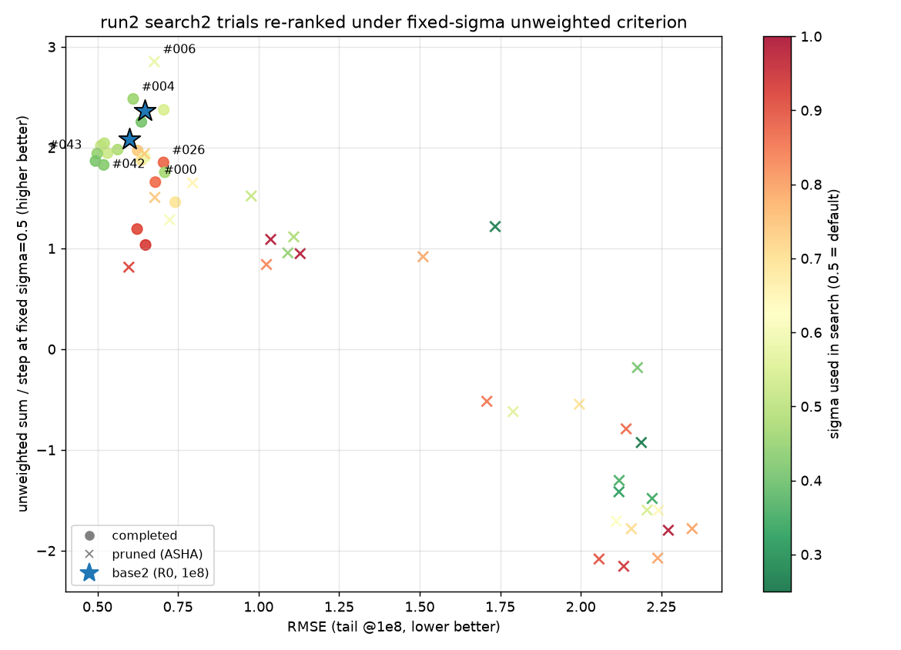
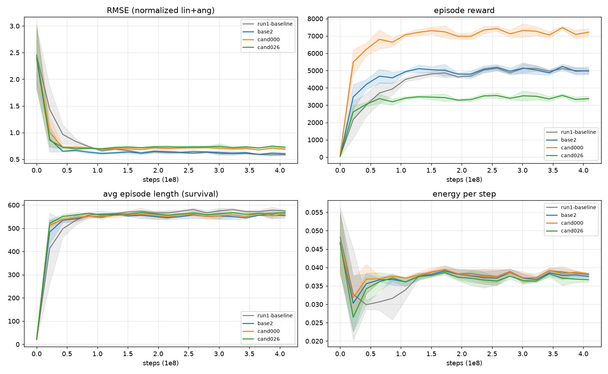
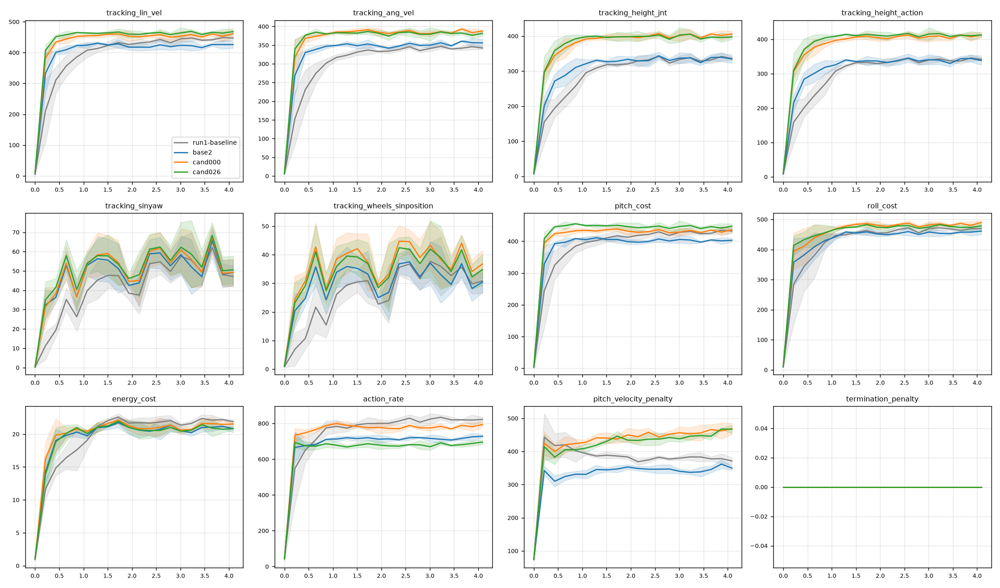

# 调参 run2 结果报告:reward shaping 搜索(冻结网络结构)

日期:2026-08-28。前置:`docs/hyperparam_tuning_plan_run2.md`(计划)、
`docs/tuning_run1_results.md`(run1 结果)。
工程产物:`tuning/run2/`(base2.json、study2.db、trials/、reports/)。

## 0. 一句话结论

**run2 没有找到全面优于 base2 的 reward 权重组合**(R2 帕累托判定无人通过),
但搜索澄清了可行前沿:action_rate 部署口径可以压到 **0.25/步**(比 base2 低 45%、
比 run1 baseline 低 31%),代价是 RMSE 劣化 ~0.12——平滑与跟踪精度在本权重
空间内是硬 trade-off,不存在兼得点。cand010 增益移植(base2)在 1e8 短训显著
优于 baseline,但 4e8 长训后 RMSE 优势被追平(0.603 vs 0.587,差异 ~1σ),
且部署口径 action_rate 反而更差(0.464 vs 0.371)。

## 1. 流程与口径修正记录

| 阶段 | 内容 | 结果 |
|---|---|---|
| R0 | base2 = cand010 四增益(lr 3e-4、updates 8、kp 1.7e-4、notsmoothing 0.25)移植回 baseline 网络,2 seeds @1e8 | RMSE 0.6238 vs baseline 0.7084±0.0472,成立 |
| R1 第一轮 | 硬约束记 WORST | 0/7 全过;TPE 目标全为 10.0 失明 |
| gate-R1 决议① | ar 门槛 0.15→0.30,改软约束(罚函数) | 见计划文档决议记录 |
| R1 第二轮 | 软约束,TPE 有梯度 | ar 前沿 ≈0.34(存活健康前提) |
| gate-R1 决议② | ar 门槛 0.35/0.40(逐 seed),续搜 25 trials,ASHA min_resource 4→6 | 同上 |
| R1 第三轮 | 续搜至 51 trials | search2-026 首个"全过"——但发现口径漏洞 |
| **口径修正** | 达成率原用 trial 自己的 σ 计算,σ 是搜索因子 → 球门移动;改为**固定 σ=0.5 + deterministic** 在环实测(`deploy_evaluate`),19 个完成 trial + base2 + run1 baseline 全部重测 | 026 的"全过"不成立(修后 lin/ang 微退化) |
| R2 | cand026、cand000、base2 × 3 seeds @4e8 | 无候选通过帕累托判定 |

## 2. R2 全量确认结果(4e8 × 3 seeds)

主指标与部署口径(数值为 3 seeds 均值 ± std;达成率为固定 σ=0.5、
deterministic 策略、域随机化+push+噪声在环实测):

| 组 | RMSE ↓ | episode reward | 存活(步) | ar 部署/步 ↓ | sinyaw 达成率 |
|---|---|---|---|---|---|
| run1 baseline | **0.5866±0.0107** | 5028 | 574 | 0.371 | 82.9% |
| base2 | 0.6028±0.0152 | 5066 | 556 | 0.464 | **87.2%** |
| cand000 | 0.6923±0.0043 | 7262 * | 560 | 0.380 | 84.7% |
| cand026 | 0.7280±0.0043 | 3423 * | 565 | **0.255** | 86.3% |

\* episode reward 各组权重不同,不可跨组比较(列在这里仅为完整性;
无权重口径复核见第 5 节)。

帕累托判定(计划 6.R2,条件 5 batch_test 因 1-4 未过未执行):

| 候选 | 条件1 RMSE 显著优 | 条件2 ar ≤0.35/0.40 | 条件3 sinyaw +2pp | 条件4 分项不退化 | 总判 |
|---|---|---|---|---|---|
| cand026 | ✗(0.728 vs 0.603) | **✓(0.255)** | ✗(86.3% vs 需 ≥89.2%) | ✗(lin/ang/roll 逐 seed 有退化) | 未通过 |
| cand000 | ✗(0.692) | ✗(0.380,逐 seed 0.374~0.385 过 0.40 但均值超 0.35) | ✗(84.7%) | ✗ | 未通过 |

注意条件 3 的参照在 4e8 上移动了:base2 的 sinyaw 从 1e8 的 80.0% 涨到
87.2%,候选在 1e8 建立的优势(+4.7pp)在长训下被 base2 自己追平。

## 3. 参数对照表

| 参数 | run1 baseline | base2 | cand000 | cand026 |
|---|---|---|---|---|
| learning_rate | 1e-4 | 3e-4 | 3e-4 | 3e-4 |
| num_updates_per_batch | 4 | 8 | 8 | 8 |
| vel_pid.kp (×1e-4) | 2.0 | 1.70 | 1.51 | 1.76 |
| vel_pid.notsmoothing | 0.5 | 0.251 | 0.287 | 0.310 |
| vel_scale | 2.0 | 2.0 | 2.12 | 1.19 |
| height_scale | 2.0 | 2.0 | 3.11 | 1.77 |
| roll_scale | 4.0 | 4.0 | 4.81 | 1.75 |
| zero_keep_scale | 10.0 | 10.0 | 10.52 | 7.57 |
| action_rate_scale | -0.5 | -0.5 | -0.32 | **-0.55** |
| energy_scale | -1.0 | -1.0 | -1.08 | **-2.52** |
| pitch_velocity_penalty_scale | -0.5 | -0.5 | -0.25 | -0.24 |
| sigma | 0.5 | 0.5 | 0.86 | 0.87 |
| sigma_wheel | 0.5 | 0.5 | 0.95 | 0.63 |
| 网络/动作映射/扭矩限幅 | 全部相同(冻结,部署口径零变化) | | | |

## 4. 分项达成率对照(固定 σ 部署口径,4e8 末态,3 seeds 均值)

| 分项 | run1 baseline | base2 | cand000 | cand026 |
|---|---|---|---|---|
| tracking_lin_vel | **85.3%** | 84.5% | 81.7% | 81.9% |
| tracking_ang_vel | **87.4%** | 84.4% | 83.5% | 82.8% |
| tracking_height_jnt | 68.0% * | 67.6% | 68.0% | 61.9% |
| tracking_height_action | **81.5% *** | 80.3% | 80.8% | 75.1% |
| pitch_cost | **86.1%** | 85.1% | 84.6% | 85.1% |
| roll_cost | 86.9% | **89.3%** | 86.8% | 82.0% |
| tracking_sinyaw | 82.9% | **87.2%** | 84.7% | 86.3% |
| tracking_wheels_sinposition | 56.7% | **56.8%** | 53.5% | **56.8%** |

\* run1 baseline 的 rollout 在当前(投影后)reward 代码下重测,其训练时
height 语义为投影前口径,达成率仅供参考;其余分项语义未变,可比。

## 5. 无权重口径复核(为什么不看 episode reward)

权重只影响训练时的重要性分配,跨组比较应看不带权重的分项统计和
(跟踪/姿势类取正,惩罚类取负)。按此口径计算(尾部 3 eval 均值):

| 组 | 正项和 | 负项和 | 无权重总 reward |
|---|---|---|---|
| run1 baseline | 2449.3 | -1218.0 | 1231.3 |
| base2 | 2411.2 | -1096.1 | 1315.1 |
| cand000 | 2674.3 | -1274.9 | 1399.4 |
| cand026 | 2666.9 | -1169.0 | 1497.9 |

表面上 cand026 > cand000 > base2 > baseline,**但这个比较不成立**:σ 本身
是搜索因子(见 3 节参数表),跟踪 6 项均为 `exp(-err²/σ)` 型,cand000/026 的
σ≈0.86~0.87 对比 base2/baseline 的 0.5,尺子被搜松了。定量:由 baseline
lin 项反推物理 err²≈0.126,同一误差在 cand000 的 σ=0.86 下每步得 0.863
而非 0.777,每集白涨约 50 分/项;cand000 的 lin+ang 仅比 baseline 高 57 分
(846 vs 789),光 σ 膨胀就能解释约 100 分——其"正项优势"是尺子变松的幻觉,
实际 RMSE 反而更差(0.692 vs 0.587)。

剔除 σ 影响后,真正可跨组比较的原始物理项(每步,报表口径):

| 组 | energy ↓ | action_rate ↓ | pitch 角速度惩罚 ↓ |
|---|---|---|---|
| run1 baseline | 0.0385 | 1.429 | **0.655** |
| base2 | 0.0378 | 1.300 | **0.634** |
| cand000 | 0.0385 | 1.407 | 0.831 |
| cand026 | **0.0369** | **1.218** | 0.814 |

cand026 仅在平滑/能耗上占优,pitch 角速度惩罚(机身晃动)明显更差;
cand000 全面无优势。**统一尺子下的无权重比较就是 2/4 节的固定 σ=0.5 实测
达成率与 RMSE(纯物理、与 σ 无关)**,结论一致:跟踪 baseline/base2 赢,
平滑 cand026 赢,没有兼得者。

按"σ 固定为代码默认值 0.5"重做无权重比较:deploy_evaluate 的达成率即
固定 σ=0.5、deterministic 下各分项每步得分(0~1),作为无权重正项,
action_rate 部署口径作为负项直接减入(权重只取正负号),每步无权重总和
(3 seeds 均值;energy 与 pitch 角速度惩罚未在 deploy 口径测量,不含):

| 组 | lin_vel | ang_vel | height_jnt | height_act | pitch | roll | sinyaw | sinpos | ar ↓ | **无权重和/步** |
|---|---|---|---|---|---|---|---|---|---|---|
| run1 baseline | **0.853** | **0.874** | 0.680 | **0.815** | **0.861** | 0.869 | 0.829 | 0.567 | 0.371 | **5.98±0.06** |
| base2 | 0.845 | 0.844 | 0.676 | 0.803 | 0.851 | **0.893** | **0.872** | **0.568** | 0.464 | 5.89±0.09 |
| cand000 | 0.817 | 0.835 | 0.680 | 0.808 | 0.846 | 0.868 | 0.847 | 0.535 | 0.380 | 5.86±0.07 |
| cand026 | 0.819 | 0.828 | 0.619 | 0.751 | 0.851 | 0.820 | 0.863 | **0.568** | **0.255** | 5.86±0.06 |

统一 σ 后排名翻转:run1 baseline 第一,两个 cand 垫底——之前"无权重
总和 cand 领先"完全是大 σ 灌水。cand026 的 ar 优势(0.255)只能把它
拉到与 cand000 并列,height 两项和 roll 亏得太多。

无权重口径的训练过程曲线:

读图要点:

- **左图**(分项原始值带符号求和,各组自身 σ):cand026 > cand000 > base2
  > baseline 的"领先"全程存在——这正是尺子被搜松后的账面假象;
- **右图**(σ 无关的纯物理惩罚项和/步,越低越好):cand000 全程最差,
  cand026 与 base2 最优,baseline 居中——物理口径下 cand 没有任何
  账面外的隐藏优势。

固定 σ=0.5 的无权重总 reward 全过程曲线(从训练日志数学重打分):

重打分原理:所有跟踪/姿势项均为 `exp(-err / (σ·cmd_scale))`,故
`s_fixed = s_own^(σ_own/0.5)`,cmd_scale 在指数比中约去;各组 σ 从
trials 的 overrides.json 读取(baseline/base2=0.5,cand000≈0.86,
cand026≈0.87,sinpos 用各自 sigma_wheel);σ 无关惩罚项原样保留。
对每集均值做变换属 Jensen 近似,但各组同公式处理,相互比较公平。

读图要点:

- 统一 σ 后**全程**排名:base2 ≥ baseline > cand026 > cand000,两个 cand
  从 1e8 之后就被压在下方,差距稳态不收敛——cand 的"账面领先"在任意
  训练阶段都不存在,不是终态巧合;
- 此图为训练报表口径(stochastic,含探索噪声),与上表 deploy 口径
  (deterministic)在 base2/baseline 的先后上互换,但二者差 ~1σ,且
  两种口径一致:cand 垫底,baseline/base2 争冠。

### 5.1 免费复核:新准则下重排名全部 51 个 search2 trial

疑问:σ 参与搜索 + 旧目标(RMSE + ar 罚)是否埋掉了好 trial?不需要重搜
即可回答——用固定 σ=0.5 无权重和对全部 trial 的尾部 3 eval 重打分
(同一 Jensen 近似),与 RMSE 联合散点:

| trial | 固定σ无权重和/步 | RMSE(1e8) | ar 部署 | σ | 旧命运 |
|---|---|---|---|---|---|
| search2-006 | **2.854** | 0.677 | 未测 | 0.578 | **被 ASHA 剪枝**(0.86e8) |
| search2-004 | 2.483 | 0.611 | 0.524 | 0.459 | 完成,被 ar 罚埋掉 |
| search2-043 | 2.044 | **0.521** | 0.519 | 0.507 | 完成,被 ar 罚埋掉 |
| search2-042 | 2.019 | **0.511** | 0.524 | 0.520 | 完成,被 ar 罚埋掉 |
| search2-026(=cand026) | 1.853 | 0.705 | 0.255 | 0.868 | 中选 |
| search2-000(=cand000) | 1.658 | 0.680 | 0.380 | 0.861 | 中选 |
| base2(R0 参照,2 seeds) | 2.08 / 2.37 | 0.600 / 0.648 | 0.37~0.38 | 0.5 | 中选 |

复核结论:

1. **σ 污染的是搜索过程,不是最终判定**:口径修复后全部完成 trial 经固定
   σ 重测、R2 用纯物理指标,旧准则下"无人打赢 baseline/base2"仍成立;
2. **旧目标确实埋掉了两类 trial**:006 无权重和全场最高(σ≈0.58 非灌水)
   却因 RMSE 一般被 ASHA 剪掉;042/043 RMSE 全场最优(优于 base2 同期)
   却因 ar≈0.52 触罚线被埋;
3. **补救不需要重搜**:数据都在,缺的是决赛圈——按新准则选 top(006、
   004、042/043)补一轮 4e8×3 seeds + deploy_evaluate 确认即可;仅当确认
   全军覆没且认为 51 样本覆盖太稀,才值得续搜(σ 冻结 + 目标换无权重和,
   `study2.db` 可续);
4. **注意准则分歧**:006 无权重和第一但 RMSE 0.677 偏差——它是平滑/姿势
   项堆出的高分;042/043 相反(跟踪最好、抖动大)。选谁进确认轮取决于
   部署侧认"无权重和"还是"跟踪优先";
5. **1e8 排名在 4e8 可能反转**(base2 RMSE 优势、cand026 sinyaw 优势均有
   先例),补确认前以上排名不算数。

(数据:`run2_rerank_unweighted.json`;工具 `tools/rerank_run2_unweighted.py`)

## 6. 训练过程曲线(4 组 mean±std,3 seeds)

读图要点:

- **RMSE**:base2 全程最低,cand000/026 全程被压在上方,差距随训练拉长
  不收敛——候选的 RMSE 劣势是稳态的,不是"还没训够";
- **action_rate(报表口径)**:base2 反常地最低(≈680),cand000/026 更高
  (≈800/760)——但部署口径恰好相反(0.464 vs 0.380/0.255)。报表口径含
  探索 σ 噪声,候选策略熵更高;再次证明 action_rate 只能看部署口径;
- **tracking_sinyaw**:cand026 全程上沿,base2 后程追平;
- **height 两项**:候选(process 口径含投影)持续高于 base2/run1。

## 7. 结论与后续建议

1. **部署候选仍是 base2(或直接回退 run1 baseline)**:run2 的两个候选在
   主指标上显著更差,不可部署。base2 vs run1 baseline 在 4e8 上 RMSE 打平
   (0.603 vs 0.587,~1σ),base2 胜在 sinyaw(+4.3pp),败在 ar 部署口径
   (0.464 vs 0.371)——若部署侧对抖动敏感,run1 baseline 反而更稳。
2. **action_rate 的物理地板**:reward 权重路线(含 8 倍惩罚)只能到 ~0.25,
   且那时 RMSE 已崩。再往下必须动映射/固件(target_scale、action_scale、
   观测噪声源头),这是部署变更决策,超出训练侧调参范围。
   **【事后修正】** 此结论已被 cand006 推翻:search2-006 配置(ar 惩罚
   ×7.2)4e8 确认 ar 部署口径 **0.178** 且 RMSE 0.603 未崩,详见
   `docs/tuning_run2_unweighted_review.md` 4.2 节。
3. **方法论教训**(已固化到管线):① 约束判定用的指标必须与被搜参数解耦
   (σ 口径漏洞);② 硬约束记 WORST 会让 TPE 失明,软罚 + 尾部硬判定是
   正确结构;③ 1e8 短训的结论在 4e8 可能反转(base2 的 RMSE 优势、
   候选的 sinyaw 优势都被长训抹平),确认轮长度不能省。
4. run1 cand010 的网络加宽部分仍不可部署;其增益部分(base2)长训后
   无 RMSE 收益。run1/run2 两轮下来,**默认配置(baseline)在 4e8 主指标上
   仍未被击败**。

## 8. 产物索引

- 审查报告:`tuning/run2/reports/run2_base2.md`(R0)、`run2_search.md`(R1)、
  `run2_confirm.md`(R2 帕累托判定)
- 图:`run2_final_curves.png`、`run2_final_reward_term_curves.png`、
  `run2_final_unweighted_sum.png`、`run2_final_fixedsigma_unweighted.png`、
  `run2_rerank_unweighted.png`(工具 `tools/rerank_run2_unweighted.py`)
  (生成工具 `tools/compare_run2_final.py`)
- 数据:`tuning/run2/base2.json`、`study2.db`、`reports/run2_final_tail_terms.json`、
  `reports/run1_baseline_deploy_eval.json`
- 离线重估工具:`tools/reval_fixed_sigma.py`;部署口径实测:
  `legwheel/evaluation/action_rate.py::deploy_evaluate`
- 第一轮(硬约束失明)数据归档:`tuning/run2/archive_r1a/`
