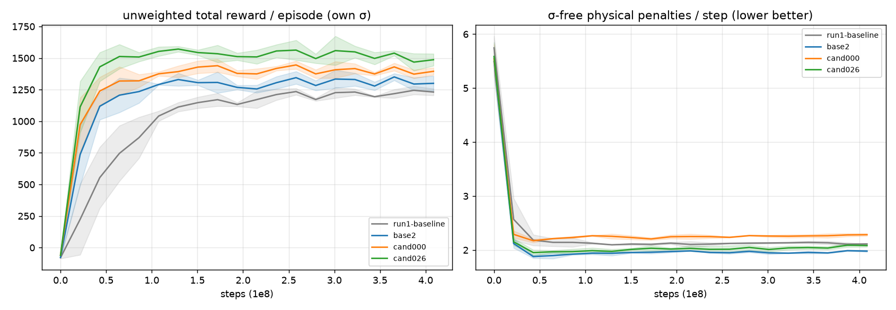
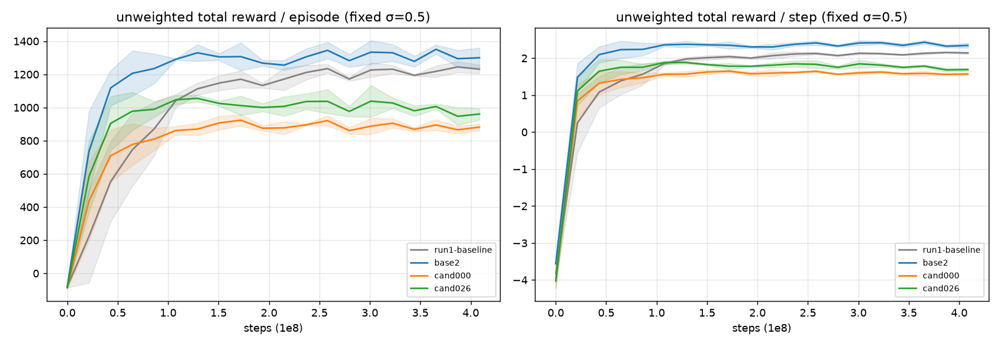
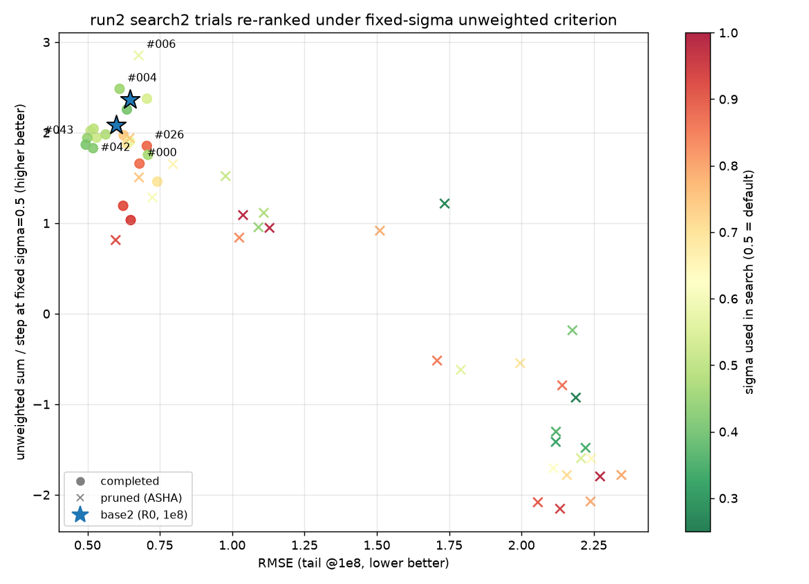
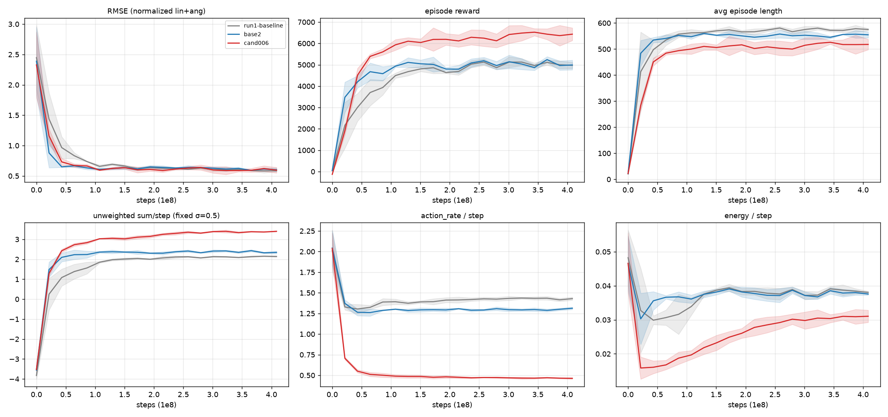
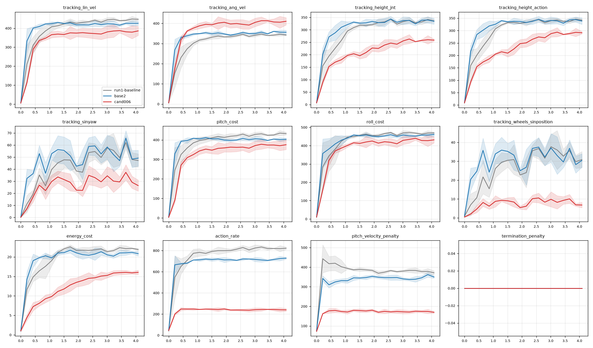

# run2 无权重口径复核报告:σ 固定后的 reward 总和对决

日期:2026-08-28。前置:`docs/tuning_run2_results.md`(run2 终版报告)、
`docs/hyperparam_tuning_plan_run2.md`(计划,σ 冻结决议已记入因子表)。

本报告汇总"无权重总 reward"口径下的全部复核工作:为什么 episode reward
不可比、σ 灌水的定量拆解、固定 σ=0.5 后的重新对决、以及用新准则对全部
51 个 search2 trial 的免费重排名。

## 0. 一句话结论

**σ 统一固定为代码默认值 0.5 后,无权重总 reward 排名全程为
base2 ≥ run1 baseline > cand026 > cand000**——cand 此前的"领先"是大 σ
灌水造成的账面假象。进一步用 deploy 口径(扰动在环 + deterministic)
重排名全部 trial:**当初选 000/026 没有选错**(1e8 前二);曾被报表口径
误判为"被埋榜首"的 search2-006 在 deploy 口径 0.86e8 仅 5.235,但其
4e8 确认揭示了真正价值:ar 0.178 的平滑极限点(RMSE 0.603 不崩),
推翻"ar 物理地板 ~0.25"的旧结论。筛选与判定一律用 deploy 口径。

## 1. 背景:为什么不能直接比 reward 总和

权重只影响训练时的重要性分配,跨组比较应看不带权重的分项统计和
(跟踪/姿势类取正,惩罚类取负)。但 run2 把 σ 也放进了搜索空间
(计划文档因子表,范围 0.25~1.0),而所有跟踪/姿势项均为
`exp(-err / (σ·cmd_scale))` 型——**σ 兼为评分标准本身**,搜它等于让
各组自选裁判松紧。cand000/026 搜出 σ≈0.86~0.87(vs 默认 0.5),
账面分被灌水。

定量:由 baseline lin 项反推物理 err²≈0.126,同一误差在 cand000 的
σ=0.86 下每步得 0.863 而非 0.777,每集白涨约 50 分/项;cand000 的
lin+ang 仅比 baseline 高 57 分(846 vs 789),光 σ 膨胀即可解释约 100 分。
铁证:cand000 无权重总和(各组自身 σ)比 baseline 高 13%,但物理跟踪
误差 RMSE 反而差 18%(0.692 vs 0.587)。

**事后决议(已记入计划文档):σ / σ_wheel 一律冻结为代码默认值 0.5,
永不参与搜参。**

## 2. 固定 σ=0.5 无权重对照表(deploy 口径)

deploy_evaluate 的达成率即固定 σ=0.5、deterministic、域随机化+push+噪声
在环实测的各分项每步得分(0~1),作为无权重正项;action_rate 部署口径
作为负项直接减入(权重只取正负号)。每步无权重总和(3 seeds 均值;
energy 与 pitch 角速度惩罚未在 deploy 口径测量,不含):

| 组 | lin_vel | ang_vel | height_jnt | height_act | pitch | roll | sinyaw | sinpos | ar ↓ | **无权重和/步** |
|---|---|---|---|---|---|---|---|---|---|---|
| run1 baseline | **0.853** | **0.874** | 0.680 | **0.815** | **0.861** | 0.869 | 0.829 | 0.567 | 0.371 | **5.98±0.06** |
| base2 | 0.845 | 0.844 | 0.676 | 0.803 | 0.851 | **0.893** | **0.872** | **0.568** | 0.464 | 5.89±0.09 |
| cand000 | 0.817 | 0.835 | 0.680 | 0.808 | 0.846 | 0.868 | 0.847 | 0.535 | 0.380 | 5.86±0.07 |
| cand026 | 0.819 | 0.828 | 0.619 | 0.751 | 0.851 | 0.820 | 0.863 | **0.568** | **0.255** | 5.86±0.06 |

统一 σ 后排名翻转:run1 baseline 第一,两个 cand 垫底。cand026 的 ar
优势(0.255)只能把它拉到与 cand000 并列,height 两项和 roll 亏得太多。

## 3. 无权重口径训练过程曲线(4e8 × 3 seeds,mean±std)

各组自身 σ 下的原始求和(左=账面假象;右=σ 无关纯物理惩罚项,越低越好):

固定 σ=0.5 数学重打分后的无权重总 reward 全过程曲线:

重打分原理:`exp(-err/(σ·cmd_scale))` ⇒ `s_fixed = s_own^(σ_own/0.5)`,
cmd_scale 在指数比中约去;各组 σ 从 trials 的 overrides.json 读取
(baseline/base2=0.5,cand000≈0.86/σ_w≈0.95,cand026≈0.87/σ_w≈0.63);
σ 无关惩罚项(energy/action_rate/pitch_velocity)原样保留。对每集均值做
变换属 Jensen 近似,但各组同公式处理,相互比较公平。

读图要点:

- 统一 σ 后**全程**排名 base2 ≥ baseline > cand026 > cand000,两个 cand
  从 1e8 之后被压在下方,差距稳态不收敛——"账面领先"在任何训练阶段
  都不存在;
- 固定 σ 图为训练报表口径(stochastic,含探索噪声),与第 2 节 deploy
  口径(deterministic)在 base2/baseline 先后上互换,但二者差 ~1σ;
  **两种口径一致:cand 垫底,baseline/base2 争冠**;
- 自身 σ 原始求和图(上)左图中 cand026 > cand000 > base2 > baseline
  的"领先"全程存在——尺子被搜松后的假象;右图 σ 无关纯物理惩罚项
  cand000 全程最差,cand026 与 base2 最优。

## 4. 免费复核:新准则重排名全部 51 个 search2 trial

疑问:σ 参与搜索 + 旧目标(RMSE + ar 罚)是否埋掉了好 trial?不用重搜:
对全部 trial 重打分即可。但**口径必须是 deploy 口径**(deterministic +
域随机化 + push + 噪声)——报表口径(干净环境 + stochastic)的 ar 项含
探索噪声,量级虚高,会系统性偏向"平滑倾斜"的 trial,不能用于筛选。

### 4.0 deploy 口径重排名(正确口径)

19 个完成 trial 均有 deploy 实测(达成率 + ar),直接算无权重和
(Σ8 项达成率 − ar_deploy);被剪枝的 006 补测其存档 ckpt:

| trial | deploy 无权重和/步 | RMSE | ar 部署 | 旧命运 |
|---|---|---|---|---|
| search2-000 | **5.905** | 0.680 | 0.339 | 中选 ✓ |
| search2-026 | 5.859 | 0.705 | 0.260 | 中选 ✓ |
| search2-007 | 5.858 | 0.706 | 0.364 | 完成 |
| search2-036 | 5.706 | 0.709 | 0.362 | 完成 |
| search2-024 | 5.676 | 0.637 | 0.382 | 完成 |
| search2-004 | 5.608 | 0.611 | 0.524 | 完成 |
| search2-006(@0.86e8 补测) | 5.235 | — | 0.174 | **被 ASHA 剪枝** |
| search2-021(@0.86e8 补测) | 5.025 | — | 0.392 | 被 ASHA 剪枝 |
| search2-025(@0.86e8 补测) | 5.022 | — | 0.423 | 被 ASHA 剪枝 |
| search2-042 | 5.048 | **0.511** | 0.524 | 完成 |
| search2-043 | 5.128 | 0.521 | 0.519 | 完成 |
| base2(R0 参照) | ~5.63(2 seeds) | 0.60~0.65 | 0.37~0.38 | 中选 |

**deploy 口径下当初选 000/026 就是对的**——它们是 1e8 的前两名;
006 在 0.86e8 仅 5.235(高度/姿态一推就垮),042/043 被 ar≈0.52 拖在
底部,均非"被埋的天才"。4e8 后:baseline 5.98 > base2 5.89 >
000 5.86 > 026 5.86 > 006 5.77。

**覆盖完整性**:全部 19 个完成 trial + 3 个 0.86e8 深剪枝 trial
(006/021/025)均已有 deploy 实测,无一翻案;更浅剪枝(≤0.42e8,29 个)
训练深度不同、分数不可比,且其报表 RMSE 在同深度已明显落后(多数 >1.0),
任何口径都翻不了案,无需补测。deploy 口径评测至此覆盖所有"有资格
被讨论"的 trial。

### 4.0b 报表口径重排名(错误示范,仅留档)

若误用报表口径(固定 σ 但含探索噪声、无扰动)重排名,006 会以 2.854/步
"高居第一"——这是探索噪声把别家 ar 灌到 1.3~1.4 而 006 仅 0.47 的假象
(部署时无探索噪声,此优势蒸发 80%)。教训:**筛选与判定一律用 deploy
口径;报表口径只能看训练趋势**。

(上图为报表口径散点,仅用于说明口径误用的后果,不作筛选依据。)

复核结论:

1. **σ 污染的是搜索过程,不是最终判定**:口径修复后全部完成 trial 经
   固定 σ 重测、R2 用纯物理指标,旧准则下"无人打赢 baseline/base2"
   仍成立;
2. **"埋掉好 trial"的担心不成立**:deploy 口径重排名显示旧候选选择
   (000/026)正确;006 与 042/043 在正确口径下本就不在前列;
3. **006 的价值是 4e8 确认后才发现的新边界**(ar 0.178 平滑极限,
   见 4.2),不是排名意义上的冠军;若部署需要极低抖动,它才有意义;
4. **方法论教训**:任何跨组筛选/排序必须用 deploy 口径(扰动在环 +
   deterministic + 固定 σ);报表口径的 reward 类指标含探索噪声,
   只配做训练过程仪表板;
5. **1e8 排名在 4e8 可能反转**(base2 RMSE 优势、cand026 sinyaw 优势
   均有先例),任何确认轮长度不能省。

### 4.1 search2-006 参数与 reward 全对照(报表口径榜首,留档)

> 注意:此节为**报表口径**(干净环境 + stochastic)下的事迹,006 的
> "榜首"身份在 deploy 口径下不成立(见 4.0);参数与分项数据仍有效。

参数对照(vs run1 baseline 默认值):

| 参数 | run1 baseline | search2-006 | 变化方向与含义 |
|---|---|---|---|
| learning_rate | 1e-4 | 3e-4 | 继承 base2 锚定,学更快 |
| num_updates_per_batch | 4 | 8 | 继承 base2 锚定,每批多更新 |
| vel_pid.kp (×1e-4) | 2.0 | 1.22 | 轮速环增益降 39%,动作更柔 |
| vel_pid.notsmoothing | 0.5 | 0.209 | 平滑比例大降,滤波更重 |
| vel_scale | 2.0 | 3.97 | 速度跟踪权重 ×2 |
| height_scale | 2.0 | **0.75** | 高度权重 ÷2.7,基本放弃高度优先 |
| roll_scale | 4.0 | 8.26 | 横滚姿势权重 ×2 |
| zero_keep_scale | 10.0 | 3.74 | 零保持(sinyaw/sinpos)权重 ÷2.7 |
| action_rate_scale | -0.5 | **-3.61** | 动作变化率惩罚 ×7.2,猛压抖动 |
| energy_scale | -1.0 | -0.56 | 能耗惩罚减半 |
| pitch_velocity_penalty_scale | -0.5 | -1.84 | 俯仰角速度惩罚 ×3.7,压机身晃动 |
| sigma | 0.5 | 0.578 | 接近默认(非灌水) |
| sigma_wheel | 0.5 | 0.697 | 略放宽 |
| 网络/动作映射/扭矩限幅 | — | 全部相同(冻结) | 部署口径零变化 |

reward 明细对照(相同训练量 0.86e8,训练报表口径 stochastic,
固定 σ=0.5 重打分,每步;baseline 为 3 seeds 均值):

| 分项 | run1 baseline | search2-006 | 解读 |
|---|---|---|---|
| tracking_lin_vel | 0.653 | **0.705** | 006 线速度跟踪更好 |
| tracking_ang_vel | 0.492 | **0.766** | 006 角速度跟踪大幅领先 |
| tracking_height_jnt | **0.410** | 0.362 | 006 高度略差(权重 ÷2.7 的代价) |
| tracking_height_action | **0.433** | 0.367 | 同上 |
| tracking_sinyaw | 0.030 | 0.045 | 早期均低(零指令窗口占比小) |
| pitch_cost | 0.651 | **0.674** | 006 俯仰姿势更好 |
| roll_cost | 0.730 | **0.783** | 006 横滚姿势更好(权重 ×2) |
| tracking_wheels_sinposition | 0.007 | 0.014 | 早期均低 |
| energy_cost ↓ | 0.032 | **0.016** | 006 能耗减半 |
| action_rate ↓ | 1.388 | **0.486** | 006 动作平滑度约为 baseline 的 1/3 |
| pitch_velocity_penalty ↓ | 0.722 | **0.360** | 006 机身晃动减半 |
| **RMSE ↓** | 0.737 | **0.677** | 006 同训练量下 RMSE 也更好 |
| **无权重和/步 ↑** | 1.263 | **2.854** | 006 全面领先 |

解读:006 的配方=**猛压平滑项(action_rate ×7、pitch 角速度 ×3.7)+
加强 roll/速度跟踪 + 牺牲高度/零保持**。同训练量下它不仅无权重和第一,
RMSE 也更好,高度两项是唯一明显代价。但注意:①这是 1e8 短训且 006
被中途剪枝,4e8 反转有两次先例;②006 是 TPE 选出的 51 个 trial 之一,
存在多重比较偏差。**必须补 4e8×3 seeds + deploy_evaluate 确认后才能
下结论。**

### 4.2 cand006(006 配置)4e8 × 3 seeds 全量确认结果

已按 confirm2 同口径补跑(`tools/confirm006_full.py`,4e8、20 evals、
尾部 deploy_evaluate,3 seeds,双卡约 1.6h)。

主指标(3 seeds 均值 ± std;达成率/ar 为固定 σ=0.5、deterministic、
域随机化+push+噪声部署口径):

| 指标 | run1 baseline | base2 | **cand006** |
|---|---|---|---|
| RMSE ↓ | **0.587±0.011** | 0.603±0.015 | 0.603±0.038 |
| ar 部署/步 ↓ | 0.371 | 0.464 | **0.178±0.001** |
| 存活(步) | **574** | 556 | 518 |
| energy/步 ↓ | 0.0385 | 0.0378 | **0.031** |
| tracking_lin_vel | **0.853** | 0.845 | 0.842 |
| tracking_ang_vel | 0.874 | 0.844 | **0.941** |
| tracking_height_jnt | **0.680** | 0.676 | 0.579 |
| tracking_height_action | **0.815** | 0.803 | 0.655 |
| pitch_cost | **0.861** | 0.851 | 0.778 |
| roll_cost | 0.869 | 0.893 | **0.917** |
| tracking_sinyaw | 0.829 | **0.872** | 0.788 |
| tracking_wheels_sinposition | **0.567** | **0.568** | 0.450 |
| **deploy 无权重和/步 ↑** | **5.98±0.06** | 5.89±0.09 | 5.77±0.06 |
| 报表固定σ无权重和/步 ↑ | 2.14 | 2.36 | **3.38** |

训练过程曲线(cand006 vs base2 vs run1 baseline,3 seeds mean±std):

reward 分项过程曲线(4e8,**固定 σ=0.5 重打分**,3 seeds mean±std;
exp 型分项按 `s^(σ_own/0.5)` 换算,σ 无关惩罚项原样):

读图要点:

- **action_rate / energy / pitch_velocity_penalty**:006 全程大幅低于
  另两组(ar ≈230 vs 700/860,约 1/3),且 0.3e8 后就进入稳态——
  平滑优势不是末期才出现;
- **tracking_ang_vel**:006 全程明显上沿(vel_scale×2 真实生效);
  **tracking_lin_vel** 后程与 baseline 持平;
- **roll_cost**:统一 σ 后 006 仅持平(略低)——自身 σ 下的"上沿"
  部分是尺子略宽(σ=0.578)的账面虚高;
- **height 两项 / sinyaw / pitch / sinpos**:006 全程在下沿,sinpos
  差距被固定 σ 进一步拉开(σ_wheel=0.697 的灌水被挤掉)——代价项
  全程存在,不是"还没训够";
- termination_penalty 全程为 0(无早夭),存活差距来自 time limit 前
  的平均步数。

结论:

1. **"ar 物理地板 ~0.25"的旧结论被推翻**:权重路线可以到 **0.18**,
   且 RMSE 不崩(0.603,与 base2 持平、比 cand026 的 0.728 好 0.125)。
   cand026 不再是平滑方向的最优点,006 全面替代它(ar 再低 30%);
2. **但按 deploy 口径固定σ无权重和(铁律),baseline 仍是第一**
   (5.98 > base2 5.89 > 006 5.77):006 的 ar 优势(+0.19)抵不过
   height/pitch/sinyaw/sinpos 四项的达成率损失(合计约 -0.5);
3. **两种口径排序不同**:训练报表口径(stochastic)006 无权重和 3.38
   大幅领先,deploy 口径(deterministic+随机化+push+噪声)006 垫底。
   验收以 deploy 口径为准,报表口径仅作训练过程参考;
4. **006 的定位**:目前最好的"平滑优先"候选——若部署侧对抖动/能耗
   敏感(电机温升、齿轮寿命),它是 ar 0.18 档位的唯一选择;若跟踪与
   姿势保持优先,baseline 仍是铁律下的冠军;
5. 006 的 ang_vel(0.941)与 roll(0.917)达成率为全场最高,说明其
   配方里 vel_scale ×2 与 roll_scale ×2 是真实生效的;
6. 多重比较提醒:006 是 51 个 trial 里的极值,3 seeds 下 ar 极稳
   (±0.001)、RMSE 波动略大(±0.038,s1 偏差 0.647);结论 1-4 不依赖
   单 seed。

## 5. 产物索引

- 图:`tuning/run2/reports/run2_final_unweighted_sum.png`、
  `run2_final_fixedsigma_unweighted.png`(工具
  `tools/compare_run2_final.py`)、`run2_rerank_unweighted.png`
  (工具 `tools/rerank_run2_unweighted.py`)、`confirm006_curves.png`、
  `confirm006_term_curves.png`(工具 `tools/compare_confirm006.py`)
- 数据:`tuning/run2/reports/run2_rerank_unweighted.json`、
  `run2_final_tail_terms.json`、`run1_baseline_deploy_eval.json`、
  `confirm006_tail.json`、`search2_006_deploy_eval.json`、`search2_deep_pruned_deploy_eval.json`
  (深剪枝 006/021/025 存档 ckpt 补测);
  cand006 确认训练:
  `tuning/run2/trials/cand006-s{0,1,2}/`(启动器 `tools/confirm006_full.py`)
- 部署口径实测:`legwheel/evaluation/action_rate.py::deploy_evaluate`
