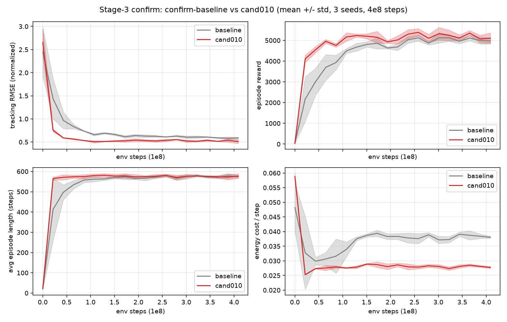
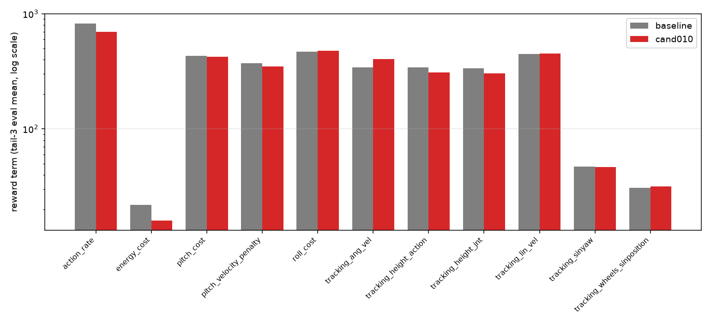
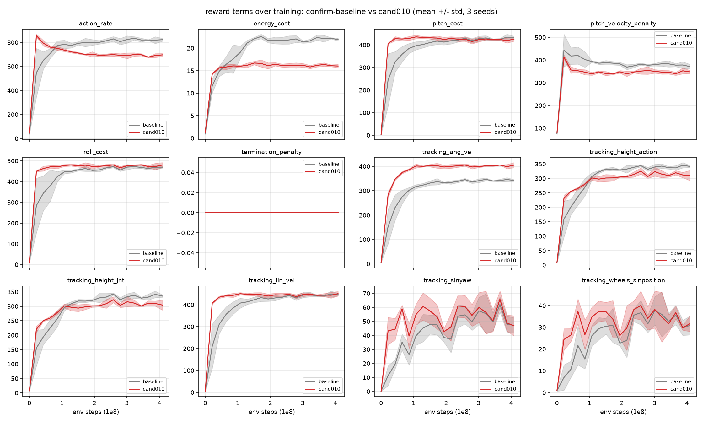

### 参数差异(baseline vs cand010,config_resolved.json 全量 diff)

| 参数 | baseline | cand010 | 变化 |
|---|---|---|---|
| `env.action_range.thigh` | [-0.5, 0] | [-0.283018, 0] |  |
| `env.action_scale.thigh` | 0.25 | 0.367462 | +47.0% |
| `env.action_scale.wheel` | 0.0295 | 0.0232225 | -21.3% |
| `env.vel_pid.kp` | 0.0002 | 0.000170263 | -14.9% |
| `env.vel_pid.notsmoothing` | 0.5 | 0.250821 | -49.8% |
| `env.vel_pid.target_scale` | 30 | 44.3696 | +47.9% |
| `env.vel_pid.torque_limit` | 0.0295 | 0.0250228 | -15.2% |
| `ppo.learning_rate` | 0.0001 | 0.000299458 | +199.5% |
| `ppo.network_factory.policy_hidden_layer_sizes` | [64, 64] | [128, 64] |  |
| `ppo.network_factory.value_hidden_layer_sizes` | [512, 512, 512, 512] | [512, 512] |  |
| `ppo.num_updates_per_batch` | 4 | 8 | +100.0% |

### reward 分项对比(尾部 3 eval 均值,3 seeds 的 mean ± std)

| 分项 | baseline | cand010 | Δ 均值 |
|---|---|---|---|
| action_rate | 822.21 ± 12.54 | 695.60 ± 12.83 | -15.4% |
| energy_cost | 21.89 ± 0.31 | 16.03 ± 0.39 | -26.8% |
| pitch_cost | 432.18 ± 7.10 | 425.57 ± 8.81 | -1.5% |
| pitch_velocity_penalty | 371.30 ± 10.06 | 348.00 ± 7.07 | -6.3% |
| roll_cost | 469.57 ± 4.70 | 479.63 ± 12.04 | +2.1% |
| termination_penalty | 0.00 ± 0.00 | 0.00 ± 0.00 |  |
| tracking_ang_vel | 342.20 ± 3.51 | 404.80 ± 10.57 | +18.3% |
| tracking_height_action | 341.75 ± 3.84 | 310.36 ± 17.47 | -9.2% |
| tracking_height_jnt | 335.78 ± 4.48 | 304.46 ± 17.36 | -9.3% |
| tracking_lin_vel | 447.01 ± 5.59 | 450.77 ± 10.50 | +0.8% |
| tracking_sinyaw | 47.18 ± 5.50 | 46.85 ± 7.16 | -0.7% |
| tracking_wheels_sinposition | 30.86 ± 4.31 | 31.64 ± 3.54 | +2.6% |

