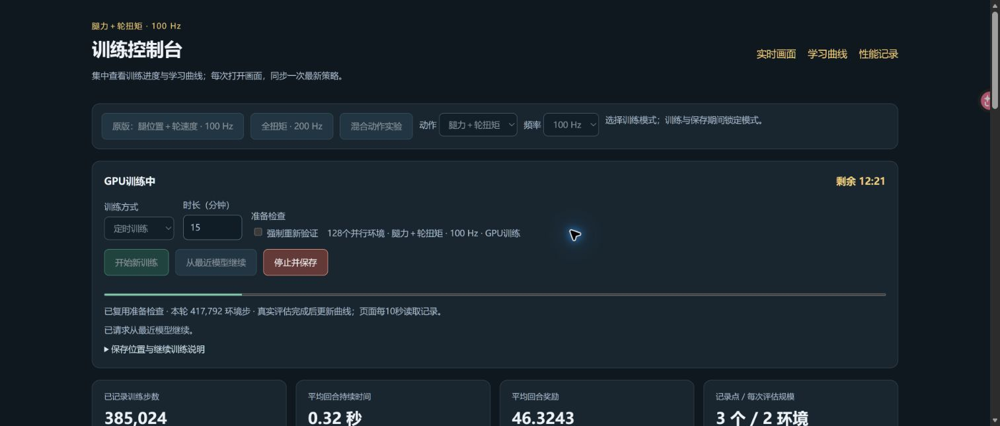
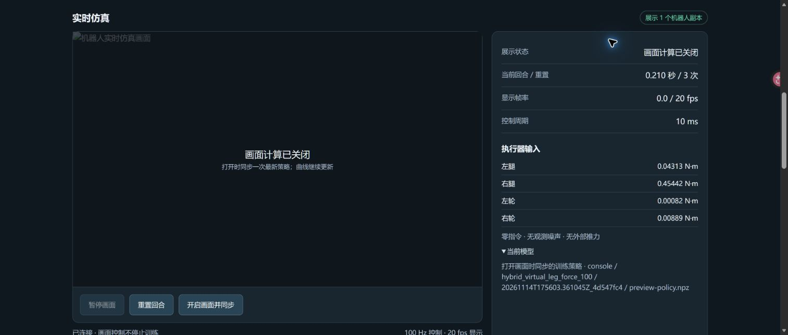
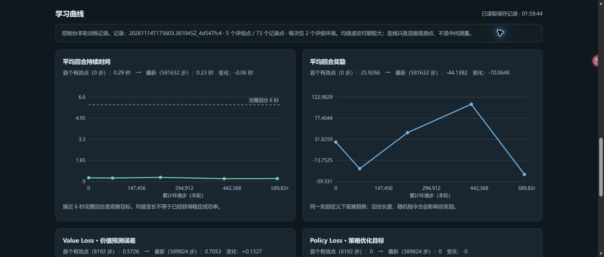

# 训练控制台 UI/UX 优化与功能待办

日期：2026-11-15。状态：保留最初审查及F-01～08的历史依据；下文的UI方案、验证待办和“已有基础”均是当时观察，不代表当前页面或并行后端状态。

当前设计与本轮总结见 [DESIGN.md](../experiments/torque200/ui-prototype/DESIGN.md)，合并后的真实能力核对/补齐清单见 [BACKEND-TODO.md](../experiments/torque200/ui-prototype/BACKEND-TODO.md)。早期“持续显示独立模拟标识”等要求已被后续用户决定替代；正常界面用正式产品文案，隔离事实留在开发文档。

独立稿与使用说明见 [ui-prototype/README.md](../experiments/torque200/ui-prototype/README.md)，模拟与视觉验证见 [design-qa.md](../experiments/torque200/ui-prototype/design-qa.md)。以下 F-01～08 的真实能力继续保留为待办。

## 目标与边界

让用户在同一个训练工作区里回答四个问题：当前在做什么、使用哪个模型、训练是否改善、下一步可以做什么。

- 新功能可以超出现有接口；以下功能项全部作为待办，不代表已经实现。
- 后续 UI 先在独立预览环境使用模拟数据测试，通过前不接入现有训练后端或生产环境。
- 保持训练、学习曲线、仿真共用同一工作区和视觉规范。
- 保留“打开画面时同步一次策略，观看期间固定版本”的行为，并明确策略来源与步数。
- 本轮只观察已有页面、核对源码并记录方案，没有操作训练、模式或画面控制。

## 本轮证据

审查时页面为“腿力＋轮扭矩 · 100 Hz”，GPU 正在训练，画面计算关闭。三张截图按浏览顺序采集，期间训练数值继续更新，因此不能把跨截图的数值直接当作同步对比。

1. **训练首屏**：训练状态、倒计时和“停止并保存”容易找到；配置和禁用按钮占用较大空间。本轮环境步与已记录指标的步数同时出现，缺少直接的时效说明。

   

2. **实时仿真区域**：关闭提示清楚，但大块空画面、破损图片图标和未标注采样时间的旧遥测同时出现。策略路径较长，来源、同步步数和时间没有集中在同一位置。

   

3. **学习曲线区域**：已经说明评估规模、噪声和 6 秒参考目标；横轴末尾长刻度被裁切。回合时长数据贴近底部，难以观察小幅变化，长数字摘要也增加阅读成本。

   

原始观察记录见 [capture-notes.md](uiux-audit-2026-11-15/capture-notes.md)。这些截图只覆盖运行中且画面关闭的桌面状态；准备、停止保存、故障、手机、键盘和屏幕阅读器体验尚未实测。

## 建议的信息架构

首屏优先呈现“本轮身份 + 当前阶段 + 可用操作 + 最新评估”，配置编辑按使用阶段展开，仿真在关闭时收起为紧凑状态条。历史性能记录与底层路径进入诊断详情。

| 区域 | 主要内容 | 交互方向 |
| --- | --- | --- |
| 持续可见的任务栏 | 运行名称、当前模式与频率、阶段、计时、连接状态 | 运行中保留停止入口；保存中显示真实阶段，直到校验成功才显示已保存 |
| 本轮概览 | 当前训练步数、最近评估步数与时间、回合时长、奖励 | 区分正在计算的进度与最近一次实际评估，显示数据延迟 |
| 配置摘要 | 动作、频率、训练方式、模型来源 | 空闲时编辑；训练中以清晰的只读摘要呈现，减少禁用表单堆叠 |
| 效果区域 | 回合时长与奖励优先，Loss 和诊断按需展开 | 精确查看记录点，保留原始数据与样本范围 |
| 仿真区域 | 策略来源、步数、同步时间、画面与遥测 | 关闭时收起；展开后集中显示同一个策略版本的信息 |
| 运行与模型 | 历史记录、模型选择、比较、评估报告 | 与训练工作区共用导航、组件和配色，保持当前运行上下文 |

窄屏按“任务状态与操作 → 关键指标 → 效果曲线 → 仿真 → 详情”排序；底部操作区须避开内容和软键盘。具体排版在独立稿中验证后确定。

视觉方案按用户最新要求采用 minimalism 与克制的黑白灰，独立稿使用本地 token；个人设计系统和生产页面不随之修改。选中模式、训练阶段和故障须有文字、线型或层级标识。数据区采用易读的数值排版，减少重复长路径、长数字和说明文字；保留按需展开的准确解释。

## 界面修正待办

- [ ] **UI-01 / P0：明确仿真数据是否有效。** 关闭时隐藏无来源图像或显示正常空状态；遥测显示“上次采样”与时间，缺少时间时明确“非实时”，不可显示为实时测量。画面关闭、暂停、同步中、同步失败分别呈现不同状态。
- [ ] **UI-02 / P0：明确运行与指标的身份。** 将当前训练步数、最近评估步数、数据更新时间分别标注；顶栏直接显示当前动作和频率，训练锁定时保持可读。
- [ ] **UI-03 / P0：修复曲线读数。** 长刻度不越界；摘要采用便于比较的有效位数，原值可查看；Loss、奖励和时长保留独立单位及轴范围，缺失数据不填成零。
- [ ] **UI-04 / P1：调整主次与密度。** 训练中压缩配置、突出状态与停止操作；准备阶段显示“取消准备”，正式训练阶段显示“停止并保存”；画面关闭时释放空间给效果指标和曲线。
- [ ] **UI-05 / P1：统一反馈。** 错误靠近相关操作，说明当前数据/模型是否仍有效及可做的恢复动作；停用按钮说明原因；保存完成、画面暂停和训练停止使用明确且不同的文案。
- [ ] **UI-06 / P1：完善可访问性与窄屏。** 验证焦点顺序、键盘操作、状态播报、200% 缩放和手机操作区；图表提供等价读数入口，状态同时用文字表达。

## 新功能待办

优先级：P0 解决过程与结果的可信度，P1 帮助判断实验效果，P2 降低重复操作成本。涉及新增接口的名称与字段在实施时设计，当前不受现有接口限制。

### F-01 / P0：逐阶段准备面板与事件记录

- [ ] 展示预检、新训练验证、热启动验证各阶段的等待、复用、运行、通过、失败或取消状态，以及来源、耗时与失效原因。
- [ ] 将准备、编译、训练、停止请求、保存、导出、校验组织成可回看的事件时间线。
- [ ] 阶段成功后立即显示可复用凭据；取消或后续失败时保留已成功阶段，不把整套流程重置成未完成。

**已有基础：** `hybrid/readiness.py` 已按阶段发布与复用凭据；`managed_training.py` 传递当前阶段与部分准备状态，页面目前主要显示单条消息。

**需要补充：** 面向页面的完整阶段清单、阶段结果、失效原因及事件历史；通用生命周期与混合动作准备阶段要区分。

**验收：** 独立预览覆盖全部复用、部分复用、第二阶段失败、第三阶段取消、恢复后只补缺失阶段等场景。准备时间与训练时间分开；编译等未知时长阶段不虚构完成百分比或倒计时。

### F-02 / P0：模型选择与来源关系

- [ ] 新训练与继续训练共享一个清晰的模型来源选择区，可选择兼容的已验证模型，展示模式、频率、步数、保存时间和来源运行。
- [ ] 将本轮训练、最近已验证模型、正在观看的策略快照分别标识，展示续训的父模型关系。
- [ ] 观看时持续显示该策略的固定版本、同步时间和步数；明确继续训练会重建优化器。

**已有基础：** 控制器能列出已验证运行、选择最近模型和按需发布预览快照；网页只提供“从最近模型继续”。

**需要补充：** 运行/模型查询、指定兼容模型的续训请求、可追溯的来源信息和不兼容原因。兼容条件需要绑定实际动作、频率、观测、模型与训练定义。

**验收：** 同时放入作者策略、旧保存模型、运行中快照和不兼容模型时，用户能明确识别当前来源；不兼容项说明原因；选择只改变配置草稿，开始动作才创建任务。观看期间模型版本保持固定。

### F-03 / P0：数据时效与断线恢复提示

- [ ] 显示服务连接状态、最后一次成功读取时间、训练进度更新时间和最近评估时间。
- [ ] 区分页面连接断开、暂时没有新评估、训练进程异常及模型保存失败。
- [ ] 恢复连接后重新核对当前运行与阶段，保留尚未提交的配置草稿，并清楚呈现已有数据是否过期。

**已有基础：** 后端管理训练进程与运行身份，页面已经轮询和重试。

**需要补充：** 数据时间戳/序列与细分错误信息；不能仅用网页读取时间表示评估数据的新鲜度。

**验收：** 模拟断线、响应延迟、重复响应和恢复连接；旧数据有标识、无法重复创建任务、页面不能据连接失败宣称训练已停止。轮询不抢焦点，重要阶段变化可被辅助技术感知。

### F-04 / P1：运行历史与实验对比

- [ ] 按模式/频率查找运行，支持自定义名称、备注和标签，展示来源模型、预算、状态与已验证产物。
- [ ] 选择两个或多个可比较运行，按环境步或实际训练时间查看曲线及配置差异。
- [ ] 标注动作定义、奖励定义、评估工况、随机种子和样本规模差异；历史缺失字段显示未记录。

**已有基础：** 运行目录、请求与验证报告已经保存；控制器有已验证运行列表。

**需要补充：** 查询/筛选接口、实验元数据、多个运行的数据读取、配置差异与兼容性说明。

**验收：** 能找到指定历史模型及其父运行；不同实验数据不拼接；比较模式不切换或停止当前训练。奖励定义不同的运行不生成无条件的优劣排名。

### F-05 / P1：独立评估方案与结果报告

- [ ] 为指定模型选择有明确工况、种子、回合数和计算预算的独立评估方案。
- [ ] 报告回合长度分布、跌倒/成功比例，以及方案定义的姿态或速度误差；展示样本数、阈值、失败条件与评估版本。
- [ ] 区分保存/导出数值校验通过与策略达到行为目标，可在同一评估方案下比较多个模型。

**已有基础：** 当前曲线含小样本平均回合时长和奖励，保存结果包含数值校验；这些不等于稳定平衡验收。

**需要补充：** 可控评估任务、版本化评估方案、逐回合结果与报告读取。行为阈值和工况需在对应评估方案中定义。

**验收：** 只浏览报告不启动训练或评估；执行评估必须由明确操作触发并显示预算。相同方案下复现实验，缺失或中断样本清楚标记，不把尚未完成的结果显示为通过。

### F-06 / P1：曲线交互、原始数据与导出

- [ ] 支持键盘和触摸查看具体记录点，显示步数、时间、原值及样本规模。
- [ ] 为回合时长提供“完整目标尺度 / 局部变化”切换，局部视图显著标注轴范围，保留目标距离信息。
- [ ] 提供评估记录表和数据导出；可选平滑时保留原始点及算法/窗口说明。

**已有基础：** `/learning-data` 提供记录点，页面已生成带点的曲线和简单悬浮读数。

**需要补充：** 交互图表、等价表格和导出格式；若需要真实评估时间等新字段，还需扩展记录格式。

**验收：** 稀疏点、缺失 Loss、负奖励、长刻度和大量点均可阅读；切轴不改变数据或制造改善结论；表格与导出原值一致，键盘可到达并读取数据点。

### F-07 / P2：实验配置预设与单变量差异

- [ ] 保存有版本的配置预设，快速复用动作、频率、时长、模型来源与后续可开放参数。
- [ ] 开始前展示与基线/上次运行的实际差异，帮助只改变一个因素；高级参数按需展开。
- [ ] 明确预算中准备、训练、保存各部分的计时范围，保留不确定性。

**已有基础：** 模式、频率和训练时长可选；部分训练参数仍固定。

**需要补充：** 配置 schema、参数校验、预设持久化与后端对新增参数的支持。

**验收：** 预设切换只编辑草稿，不自动切换后端模式或启动训练；提交时显示实际生效配置。不支持的旧预设给出具体原因，不能静默忽略字段。

### F-08 / P2：训练资源与吞吐概览

- [ ] 在诊断区显示有时间戳的训练吞吐、GPU/显存和展示开关状态，帮助判断等待来自计算、评估或保存。
- [ ] 标明统计窗口、采样时效和缺失数据；区分训练吞吐与行为效果。

**已有基础：** 页面包含历史显示开关性能记录，不等同当前运行的资源遥测。

**需要补充：** 轻量只读采样、当前运行关联与可观测开销；已有历史结果保留其原始测试条件。

**验收：** 资源读取失败不影响训练操作；不因打开诊断区启动性能对照或额外训练；独立测试确认采样开销可接受，所有模拟值均标为演示数据。

## 独立 UI 验证待办

- [ ] 独立目录建立预览；默认只使用本地模拟状态和记录点，页面持续显示“独立预览 · 演示数据”。
- [ ] 预览不配置真实服务地址、不导入训练启动器、不转发真实控制请求；核对网络请求，证明没有向现有训练服务发送控制操作。
- [ ] 场景覆盖：无模型、可续训、准备全部/部分复用、准备失败/取消、编译、定时/不限时训练、请求停止、保存/导出/校验、完成、异常中断、保存失败、断线与重连。
- [ ] 仿真单独覆盖关闭、同步中、取消同步、同步失败、暂停、运行与回合结束；验证这些状态不会改变训练状态。
- [ ] 图表覆盖无记录、等待评估、稀疏点、缺失值、负值、长刻度；模型与曲线来源不一致时明确标注。
- [ ] 桌面至少检查 1440×900 和 1280×720；窄屏检查 390×844，并验证 200% 缩放、键盘顺序、焦点与状态播报。
- [ ] 检查主操作触控面积和间距；本项目建议主要触控操作达到 44×44 CSS 像素。该值作为设计目标，不宣称现有页面已违反标准。
- [ ] 独立 UI 验收通过后，再单独记录真实接口集成范围与验收条件；集成完成前不宣称新增功能可用于真实训练。

可访问性依据：普通文字对比度目标至少 4.5:1；重要状态变化须以可编程识别的状态信息表达；主要触控操作采用更大的设计目标。详见 [W3C 对比度说明](https://www.w3.org/WAI/WCAG22/Understanding/contrast-minimum.html)、[状态消息说明](https://www.w3.org/WAI/WCAG22/Understanding/status-messages.html)和[目标尺寸说明](https://www.w3.org/WAI/WCAG22/Understanding/target-size-minimum.html)。本轮未测量实际对比度，也未进行完整无障碍验收。

## 推荐实施顺序

1. 以 UI-01～03 与 F-01～03 为第一批设计范围，先解决状态、数据时效和模型来源。
2. 独立稿验证首屏、图表、仿真和全生命周期状态；真实后端能力继续保持待办。
3. 再按 F-04～06 补齐历史对比和效果判断，最后考虑 F-07～08 的效率能力。

## 本轮 review

- 已检查三张当前页面截图并核对页面、训练管理、阶段准备与状态接口的源码。
- 逐阶段缓存、进程管理、按需策略快照等已有能力不列为从零新建；待办聚焦其页面表达、信息补全与新增交互。
- 所有界面和功能项仍未勾选；本轮没有修改业务代码、创建 UI 预览、启动训练或评估，也没有接入生产环境。
- 后续移动端、键盘、屏幕阅读器、完整状态流和真实接口集成均需分别验证。
